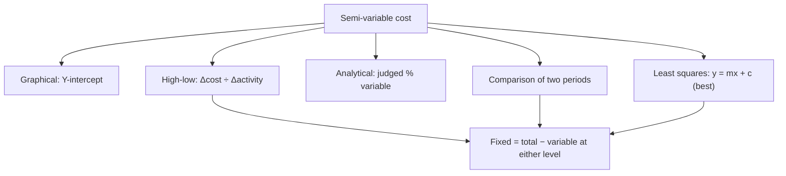

# OV-3: Cost Behaviour and Segregating Semi-Variable Costs

Covers: fixed, variable and semi-variable costs, and the five ICAI methods for splitting a semi-variable cost (graphical, high-low, analytical, comparison by period or level of activity, least squares), each with the ICAI illustration. **(ICAI SM ch. 1, para 13.3)** The split is used again in flexible budgets (CC-8) and marginal costing (CC-5).

## Where this fits in the exam

A quick numerical MCQ (find fixed cost from two levels) or a 4-mark working inside a flexible budget or CVP question.

## Three behaviours

- **Fixed cost:** incurred for a period; within output limits, unaffected by activity (rent, factory insurance). Flat line on a graph.
- **Variable cost:** varies with activity (direct material, direct labour). Line from the origin.
- **Semi-variable cost:** part fixed, part variable (telephone, gas, electricity). Line starting above the origin.

## Method 1: Graphical

Plot total cost (Y) against output (X) for many observations; draw a line of best fit by judgement; where it cuts the Y-axis is the fixed cost; variable cost at any output = total cost − fixed cost.

## Method 2: High-low (ICAI Illustration 1)

Variable rate = (cost at highest − cost at lowest) ÷ (activity at highest − activity at lowest). ICAI's illustration measures activity by **sales value**.

| | Sales value (₹) | Total cost (₹) |
|---|---|---|
| Highest volume | 1,40,000 | 72,000 |
| Lowest volume | 80,000 | 60,000 |
| Difference | 60,000 | 12,000 |

1. Variable cost = 12,000 ÷ 60,000 = 1/5 = **20% of sales value**.
2. At the highest level: variable = 20% × 1,40,000 = 28,000; fixed = 72,000 − 28,000 = **₹44,000**.
3. Check at the lowest level: 60,000 − 20% × 80,000 = 60,000 − 16,000 = ₹44,000 ✓.

## Method 3: Analytical (ICAI Illustration 2)

An experienced cost accountant judges the degree of variability of each expense. Semi-variable expenses ₹3,000, variability 70%.

1. Variable = 70% × 3,000 = ₹2,100; fixed = ₹900.
2. Next month production rises 50%: variable = 2,100 × 1.5 = ₹3,150; total = 900 + 3,150 = **₹4,050**.

Easy to apply, but the degree of variability is hard to estimate.

## Method 4: Comparison by period or level of activity

Variable rate = change in expense ÷ change in output.

| | Units | Expense (₹) |
|---|---|---|
| January | 100 | 260 |
| February | 140 | 300 |
| Difference | 40 | 40 |

Variable = 40 ÷ 40 = ₹1 per unit. January: variable 100, fixed 260 − 100 = **₹160**. February: variable 140, fixed still ₹160.

## Method 5: Least squares (ICAI Illustration 3)

ICAI calls it the **best** method: a statistical line of best fit, y = mx + c, where m = variable cost per unit, c = total fixed cost, y = total cost, x = output. ICAI's illustration solves two levels as simultaneous equations:

| Capacity | 60% | 80% |
|---|---|---|
| Labour hours (x) | 150 | 200 |
| Maintenance (y) | ₹1,200 | ₹1,275 |

1. 1,200 = 150m + c; 1,275 = 200m + c.
2. Subtract: 75 = 50m, so m = **₹1.50 per labour hour**.
3. c = 1,200 − 150 × 1.50 = 1,200 − 225 = **₹975**.

With many observations, the full least-squares normal equations are Σy = nc + mΣx and Σxy = cΣx + mΣx².

## Traps

- Dividing by the wrong difference. Always cost difference ÷ activity difference.
- Forgetting to check the fixed cost at the second level. It must come out the same.
- Letting fixed cost change when output rises (Illustration 2: fixed stays ₹900).

## What to remember

- High-low (Ill. 1): 20% of sales; fixed ₹44,000.
- Analytical (Ill. 2): fixed ₹900; after a 50% rise, total ₹4,050.
- Comparison: ₹1 per unit; fixed ₹160.
- Least squares (Ill. 3): ₹1.50 per hour; fixed ₹975. ICAI calls least squares the best method.

## Concept map

## Flashcards
Q: High-low formula for the variable rate?
A: (Cost at highest − cost at lowest) ÷ (activity at highest − activity at lowest).

Q: ICAI Ill. 1: sales ₹1,40,000 / ₹80,000, cost ₹72,000 / ₹60,000. Variable rate and fixed cost?
A: 20% of sales; fixed ₹44,000.

Q: Which segregation method does ICAI call the best?
A: The least squares method.

Q: In y = mx + c, what are m and c?
A: m = variable cost per unit; c = total fixed cost.

Q: ICAI Ill. 3: 150 hours ₹1,200, 200 hours ₹1,275. m and c?
A: m = ₹1.50 per hour; c = ₹975.

Q: Semi-variable ₹3,000 at 70% variability; output rises 50%. New total?
A: ₹900 fixed + ₹3,150 variable = ₹4,050.

Q: Weakness of the analytical method?
A: The degree of variability is a judgement and hard to estimate accurately.

## Sources
- ICAI Intermediate Paper 4 Study Material, July 2026 edition, Chapter 1, para 13.3, Illustrations 1-3: https://resource.cdn.icai.org/93304bos-aps5870-ch1.pdf
- Previous: [[CA Inter CMA Unit 1 - OV-2 Cost Concepts Elements and Classification]] · Next: [[CA Inter CMA Unit 1 - OV-4 Methods and Techniques of Costing and Digital Costing]]
- [[CA Inter CMA Unit 1 - Overview MOC (Node Map)]]
