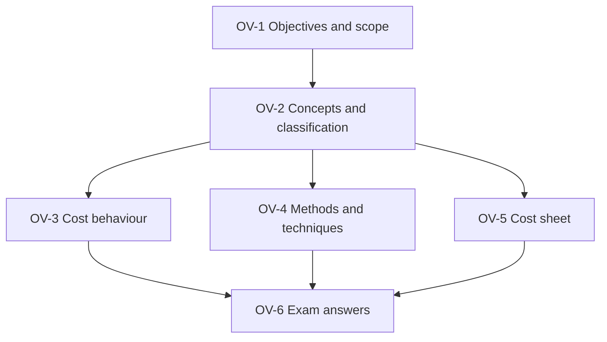

# CA Inter CMA Unit 1: Overview of Cost and Management Accounting, node map

ICAI section I, weight **10-15%** of Paper 4 (section-wise weightage, issued 26 October 2023). Paper pattern: 3 hours, 100 marks; Part I 30 marks of MCQs (2 marks each, no negative marking), Part II 70 marks descriptive (Question 1 compulsory, then any 4 of the other 5). Every worked example is an ICAI illustration or ICAI practical problem.

## Nodes

| Node | Topic | Deps | Minutes | Exam focus |
|---|---|---|---|---|
| OV-1 | Objectives, Scope and Related Disciplines | none | 35 | yes |
| OV-2 | Cost Concepts, Elements and Classification | OV-1 | 35 | yes |
| OV-3 | Cost Behaviour and Segregating Semi-Variable Costs | OV-2 | 35 | yes |
| OV-4 | Methods and Techniques of Costing, Digital Costing | OV-2 | 30 | yes |
| OV-5 | Cost Sheet for Manufacturing and Service | OV-2 | 50 | yes |
| OV-6 | Unit 1 Exam Answers | OV-1 to OV-5 | 40 | yes |

Total reading time: about 225 minutes.

## Dependency graph

## Headline facts

- Cost control is preventive and ends at the target; cost reduction is corrective and never ends.
- Semi-variable split (ICAI Ill. 1): variable 20% of sales, fixed ₹44,000. Least squares (Ill. 3): ₹1.50 per hour, fixed ₹975.
- Cost sheet: prime cost → factory cost (WIP) → cost of production → cost of goods sold (finished goods) → cost of sales. Interest shown separately in cost of sales; GST with ITC excluded.

## Links
- [[CA Inter CMA MOC]]
