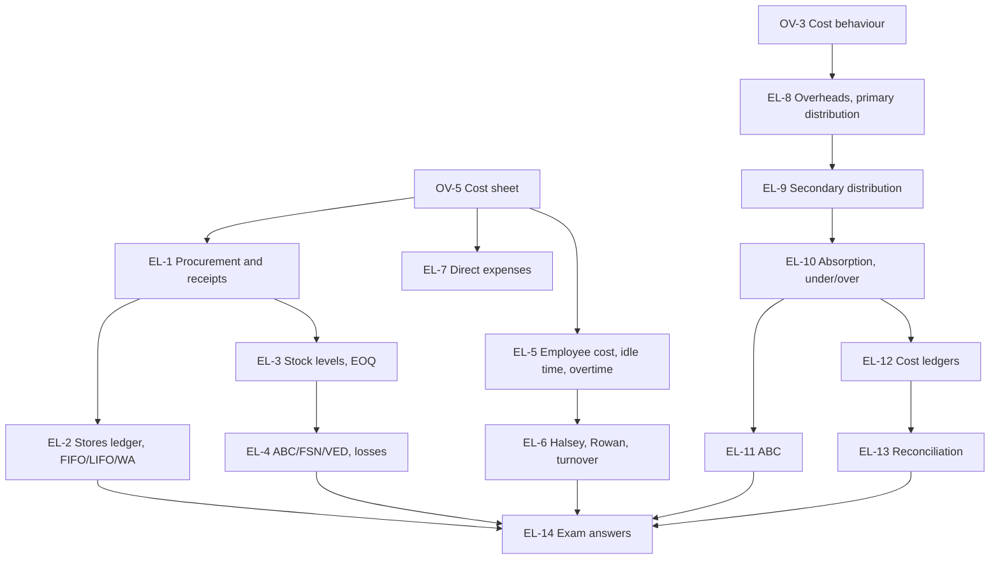

# CA Inter CMA Unit 2: Ascertainment of Cost and Cost Accounting System, node map

ICAI section II, weight **35-40%** of Paper 4, the heaviest unit. Paper pattern: 3 hours, 100 marks; Part I 30 marks of MCQs, Part II 70 marks descriptive. Every worked example is an ICAI illustration, recomputed.

## Nodes

| Node | Topic | Deps | Minutes | Exam focus |
|---|---|---|---|---|
| EL-1 | Material Procurement and Receipts | OV-5 | 40 | yes |
| EL-2 | Stores Records and Pricing of Issues | EL-1 | 50 | yes |
| EL-3 | Stock Levels and EOQ | EL-1 | 50 | yes |
| EL-4 | Inventory Control Techniques and Material Losses | EL-3 | 45 | yes |
| EL-5 | Employee Cost, Payroll, Idle Time and Overtime | OV-5 | 50 | yes |
| EL-6 | Incentive Schemes, Efficiency and Employee Turnover | EL-5 | 50 | yes |
| EL-7 | Direct Expenses | OV-5 | 20 | yes |
| EL-8 | Overheads: Classification and Primary Distribution | OV-3 | 40 | yes |
| EL-9 | Secondary Distribution of Service Department Costs | EL-8 | 50 | yes |
| EL-10 | Absorption Rates, Under or Over Absorption | EL-9 | 60 | yes |
| EL-11 | Activity Based Costing | EL-10 | 45 | yes |
| EL-12 | Integrated and Non-Integrated Accounting Systems | EL-10 | 45 | yes |
| EL-13 | Reconciling Cost and Financial Profit | EL-12 | 45 | yes |
| EL-14 | Unit 2 Exam Answers | EL-1 to EL-13 | 45 | yes |

Total reading time: about 635 minutes.

## Dependency graph

## Headline numbers (ICAI illustrations)

- Material rate after shortage: A ₹12.04, B ₹15.43 per kg. FIFO vs LIFO issues ₹7,800 vs ₹8,300.
- EOQ 2,500 kg (4 orders); ROL 300, max 450, min 150, danger 60; safety stock 20 units at ₹2,140.
- Halsey ₹420 vs Rowan ₹450; equal at 50% time saved. Profit foregone from turnover ₹5,57,930.
- Machine hour rate ₹382.86; supplementary rate ₹5 per unit; reconciliation ₹3,00,000 cost vs ₹1,10,000 financial.

## Links
- [[CA Inter CMA MOC]]
