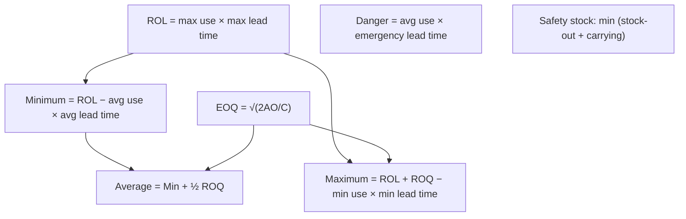

# EL-3: Stock Levels and EOQ

Covers: inventory control by quantitative levels (re-order level, re-order quantity and EOQ, minimum, maximum, average, danger level, buffer stock), the stock control chart, EOQ assumptions, total inventory cost, and the stock-out vs carrying cost trade-off for safety stock, with ICAI Illustrations 3-7. **(ICAI SM ch. 2, para 6.1-6.2)** Background: [[SFM Unit 3 - WC-5 Inventory EOQ and Stock Levels]] covers EOQ in the working-capital setting.

## Where this fits in the exam

The most numerical topic in materials. Expect an MCQ case set (EOQ, number of orders, ROL, maximum level) or a 5-mark descriptive part. Learn the formulas cold; ICAI also likes quantity-discount and price-change EOQ comparisons.

## The levels (ICAI formulas)

| Level | Answers | Formula |
|---|---|---|
| **Re-order level (ROL)** | When to order | Maximum consumption × maximum re-order period. Alternative: minimum level + (average consumption × average re-order period) |
| **Re-order quantity / EOQ** | How much | √(2AO ÷ C) |
| **Minimum level** | At least how much | ROL − (average consumption × average re-order period) |
| **Maximum level** | Up to how much | ROL + ROQ − (minimum consumption × minimum re-order period) |
| **Average level** | Normally held | Minimum level + ½ ROQ, or (maximum + minimum) ÷ 2 |
| **Danger level** | Emergency issues only | Average consumption (sometimes minimum) × lead time for emergency purchase |
| **Buffer stock** | Sudden demand | Contingency quantity |

Re-order period = **lead time**. Stock control chart: stock rises with each receipt (possibly to the maximum), falls with use; at ROL an order is placed; the fresh supply normally arrives as stock reaches the minimum level.

## EOQ

EOQ = the order size at which **ordering cost + carrying cost is minimum**.

- A = annual requirement; O = cost per order (quotations, purchase orders, procurement staff, transport, inspection); C = carrying cost per unit per year (interest on funds, storage, insurance, obsolescence).
- At EOQ, total ordering cost = total carrying cost.
- **Assumptions:** O and C known and fixed; usage known; unit price constant (no quantity discount); **lead time zero** (immediate receipt).

## ICAI Illustration 3

A = 10,000 kg; O = ₹50; price ₹2; storage 8% of average inventory, so C = 8% × 2 = ₹0.16.

EOQ = √(2 × 10,000 × 50 ÷ 0.16) = √62,50,000 = **2,500 kg**. Orders a year = 10,000 ÷ 2,500 = **4**.

## ICAI Illustration 4: EOQ and total cost, then a price change

A = 5,000 units; price ₹20; O = ₹16; carrying = storage 2% + interest 12% + obsolescence 6% = 20%, so C = ₹4.

| | At ₹20 | At ₹12.80 |
|---|---|---|
| C (20% of price) | ₹4.00 | ₹2.56 |
| EOQ = √(2 × 5,000 × 16 ÷ C) | **200** | **250** |
| Purchase cost (5,000 × price) | 1,00,000 | 64,000 |
| Ordering cost | 25 orders × 16 = 400 | 20 × 16 = 320 |
| Carrying cost (EOQ ÷ 2 × C) | 100 × 4 = 400 | 125 × 2.56 = 320 |
| **Total cost** | **1,00,800** | **64,640** |

Ordering cost equals carrying cost at EOQ in both cases, which is a useful check.

## ICAI Illustration 5: levels for two components

Normal usage 50 per week, maximum 75, minimum 25 (both). ROQ: A 300, B 500. Re-order period: A 4-6 weeks, B 2-4 weeks.

| | A | B |
|---|---|---|
| ROL = 75 × max period | 75 × 6 = **450** | 75 × 4 = **300** |
| Minimum = ROL − 50 × average period | 450 − 250 = **200** | 300 − 150 = **150** |
| Maximum = ROL + ROQ − 25 × min period | 750 − 100 = **650** | 800 − 50 = **750** |
| Average = (min + max) ÷ 2 | **425** | **450** |

## ICAI Illustration 6: levels with EOQ and danger level

O = ₹20; A = 5,000; C = ₹5; lead time average 10 days, maximum 15, minimum 5, emergency 4; consumption average 15 per day, maximum 20.

1. EOQ = √(2 × 5,000 × 20 ÷ 5) = **200 units**.
2. Minimum consumption: average = (min + max) ÷ 2, so 15 = (x + 20) ÷ 2, x = **10 per day**.
3. ROL = 20 × 15 = **300**.
4. Maximum = 300 + 200 − (10 × 5) = **450**.
5. Minimum = 300 − (15 × 10) = **150**.
6. Danger = 15 × 4 = **60**.

**Trick:** when minimum consumption is not given, back it out from average = (minimum + maximum) ÷ 2.

## Safety stock: stock-out vs carrying cost (ICAI Illustration 7)

Stock-out costs money and goodwill; carrying safety stock costs carrying cost. Choose the level with the lowest total.

M/s Tyrotubes: stock-out ₹150 per unit, carrying ₹50 per unit. Stock-outs in the year: 100 units (2 times), 80 (5), 50 (10), 20 (20), 10 (30), 0 (33); total 100, so probabilities 0.02, 0.05, 0.10, 0.20, 0.30, 0.33.

| Safety stock | Expected stock-out cost (₹) | Carrying cost (₹) | Total (₹) |
|---|---|---|---|
| 100 | 0 | 5,000 | 5,000 |
| 80 | 20 × 150 × 0.02 = 60 | 4,000 | 4,060 |
| 50 | (50 × 0.02 + 30 × 0.05) × 150 = 375 | 2,500 | 2,875 |
| **20** | (80 × 0.02 + 60 × 0.05 + 30 × 0.10) × 150 = 1,140 | 1,000 | **2,140** |
| 10 | (90 × 0.02 + 70 × 0.05 + 40 × 0.10 + 10 × 0.20) × 150 = 1,695 | 500 | 2,195 |
| 0 | (100 × 0.02 + 80 × 0.05 + 50 × 0.10 + 20 × 0.20 + 10 × 0.30) × 150 = 2,700 | 0 | 2,700 |

Optimum safety stock = **20 units** (total ₹2,140). At each level, the shortfall = demand above the safety stock, weighted by its probability.

## Traps

- Using average consumption in ROL. ROL uses **maximum consumption × maximum period**.
- Using minimum values in the minimum-level formula. Minimum level uses **average × average**.
- Taking C as a percentage. Convert it to rupees per unit (percentage × unit price).
- Forgetting the purchase cost when comparing a price change or discount offer.

## What to remember

- ROL = max × max; Min = ROL − avg × avg; Max = ROL + ROQ − min × min; Danger = avg × emergency lead time.
- EOQ = √(2AO ÷ C); at EOQ ordering cost = carrying cost.
- Ill. 3: 2,500 kg, 4 orders. Ill. 4: 200 units, ₹1,00,800; at ₹12.80, 250 units, ₹64,640.
- Ill. 6: ROL 300, max 450, min 150, danger 60. Ill. 7: safety stock 20 units, ₹2,140.

## Concept map

## Flashcards
Q: Formula for re-order level?
A: Maximum consumption × maximum re-order period.

Q: Formula for maximum stock level?
A: ROL + ROQ − (minimum consumption × minimum re-order period).

Q: Formula for minimum stock level?
A: ROL − (average consumption × average re-order period).

Q: Formula for danger level?
A: Average consumption × lead time for emergency purchases.

Q: Four assumptions of EOQ?
A: Ordering and carrying costs known and fixed; usage known; unit price constant; lead time zero.

Q: ICAI Ill. 3: A 10,000 kg, O ₹50, price ₹2, carrying 8%. EOQ and number of orders?
A: 2,500 kg; 4 orders.

Q: At EOQ, how do ordering cost and carrying cost compare?
A: They are equal.

Q: ICAI Ill. 6: average use 15/day, maximum 20/day. Minimum use?
A: 10 per day, from average = (min + max) ÷ 2.

Q: ICAI Ill. 7: optimum safety stock and its total cost?
A: 20 units; ₹2,140.

## Sources
- ICAI Intermediate Paper 4 Study Material, July 2026 edition, Chapter 2, para 6, Illustrations 3-7: https://resource.cdn.icai.org/93305bos-aps5870-ch2.pdf
- Previous: [[CA Inter CMA Unit 2 - EL-2 Stores Records and Pricing of Issues]] · Next: [[CA Inter CMA Unit 2 - EL-4 Inventory Control Techniques and Material Losses]]
- [[CA Inter CMA Unit 2 - Ascertainment of Cost MOC (Node Map)]]
