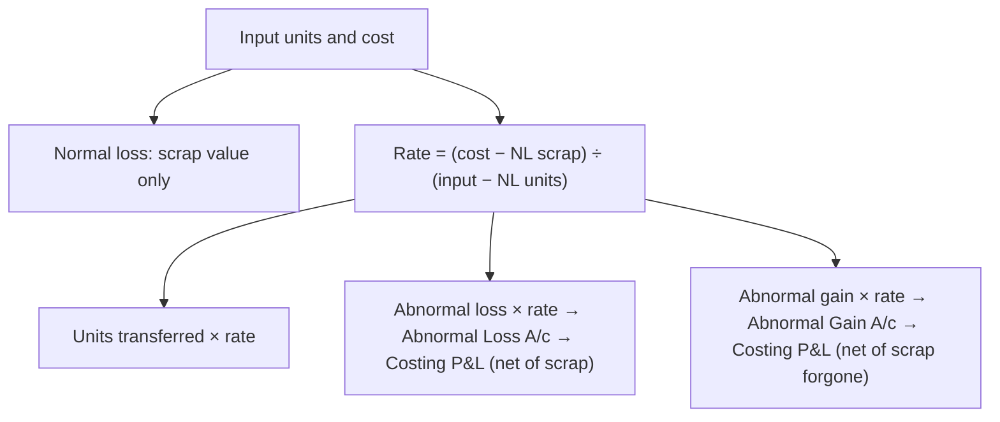

# MC-3: Process Costing, Normal Loss, Abnormal Loss and Abnormal Gain

Covers: meaning and features of process costing; the cost of each process; process accounts; normal loss (with and without scrap value), abnormal loss and abnormal gain, their valuation and the abnormal gain account; with ICAI Examples 1-4 and Illustrations 1-3. **(ICAI SM ch. 10, paras 1-3)**

## Where this fits in the exam

Process accounts with losses and gains are among the most frequent 10-14 mark CMA questions. One formula does most of the work: the **cost per good unit expected**. Equivalent units (WIP) are in MC-4.

## Meaning and features

"A method of cost accounting whereby costs are charged to processes or operations and **averaged over units produced**." A separate account per process; the output of one process is the input of the next. Used in steel, paper, medicines, soaps, chemicals, rubber, vegetable oil, paints.

**Features:** the plant is divided into processes (cost centres); production is continuous; output of one process feeds the next; end products are alike; lots cannot be traced to inputs (sugar bags to sugarcane); joint and by-products may arise.

**Cost of each process:** materials (from requisitions; plus the cost transferred from the previous process); labour (apportioned if shared); direct expenses (depreciation, repairs, insurance of that process); production overheads (rent, power, lighting) apportioned, usually at pre-determined rates.

### ICAI Illustration 1: three processes, no losses

240 units. Indirect expenses ₹85,000 apportioned by wages (80,000 : 2,00,000 : 60,000) = ₹20,000 / ₹50,000 / ₹15,000.

| | Process I | Process II | Process III |
|---|---|---|---|
| From previous process | | 2,76,000 | 6,48,000 |
| Materials | 1,50,000 | 50,000 | 20,000 |
| Labour | 80,000 | 2,00,000 | 60,000 |
| Other expenses | 26,000 | 72,000 | 25,000 |
| Indirect | 20,000 | 50,000 | 15,000 |
| **Transferred** | **2,76,000 (₹1,150/unit)** | **6,48,000 (₹2,700)** | **7,68,000 (₹3,200)** |

## The key formula

**Cost per unit = (total cost − scrap value of normal loss) ÷ (input units − normal loss units)**

Use this one rate to value **units transferred, abnormal loss and abnormal gain**. Normal loss is valued only at its scrap value.

## Normal loss

Loss inherent in the work (evaporation, moisture change, test samples): anticipated and unavoidable. **Treatment:** its cost is absorbed by good units; its scrap sale value is credited to the process account.

## Abnormal loss

Loss beyond the normal (carelessness, bad plant design, sabotage): not anticipated, but controllable. **Treatment:** valued at the cost of a good unit, credited to the process account, and debited to an **Abnormal Loss Account**, which receives its scrap value and passes the net loss to **Costing P&L**. Not part of product cost.

## Abnormal gain

Actual loss is less than normal (over-estimated loss, better efficiency or technology). **Treatment:** the process account is **debited** with abnormal gain units at the good-unit rate; Abnormal Gain Account credited. Because those units would otherwise have been normal loss sold as scrap, the Abnormal Gain Account is debited with the **scrap value forgone** (normal loss account), and only the **net** gain goes to Costing P&L. Normal loss is still valued on the **estimated** figure.

## ICAI Examples 1-4: one process, four outcomes

Input 5,000 units; material ₹40,000 + wages ₹30,000 + overhead ₹27,000 = ₹97,000; normal loss 5% = 250 units.

| | Ex 1 (no scrap value; output 4,750) | Ex 2 (scrap ₹2; output 4,750) | Ex 3 (scrap ₹2; output 4,550) | Ex 4 (scrap ₹2; output 4,850) |
|---|---|---|---|---|
| Normal loss value | 0 | 500 | 500 | 500 |
| Rate (97,000 − scrap) ÷ 4,750 | 20.42 | 20.32 | 20.32 | 20.32 |
| Abnormal loss / (gain) units | 0 | 0 | 200 loss | 100 gain |
| Abnormal value | | | 4,063 Cr | 2,032 Dr |
| **Transferred** | **97,000** | **96,500** | **92,437** | **98,532** |

**Abnormal gain account (Ex 4):** Dr normal loss account 200 (100 units × ₹2 scrap forgone), Dr Costing P&L **1,832**; Cr Process I 2,032.

## ICAI Illustration 2: three processes with loss and gain

10,000 units into Process I. Costs (material, labour, OH): I 40,000 / 6,000 / 10,000; II 20,000 / 4,000 / 10,000; III 10,000 / 1,000 / 15,000. Outputs and normal loss: I 9,750 (2%); II 9,400 (5%); III 8,000 (10%). No scrap value.

| | Process I | Process II | Process III |
|---|---|---|---|
| Input | 10,000 | 9,750 | 9,400 |
| Normal loss | 200 | 488 | 940 |
| Expected output | 9,800 | 9,262 | 8,460 |
| Actual output | 9,750 | 9,400 | 8,000 |
| Abnormal | 50 loss | 138 gain | 460 loss |
| Total cost | 56,000 | 89,714 | 1,17,051 |
| Rate | 5.7142 | 9.6862 | 13.8358 |
| Abnormal value | 286 | 1,337 | 6,364 |
| **Transferred** | **55,714** | **91,051** | **1,10,687** |

Process II's total cost (₹89,714) = transfer-in 55,714 + 34,000; with the gain debited, transfers out are ₹91,051. **Cost of finished articles = ₹1,10,687.**

## ICAI Illustration 3: scrap values, finished stock and income statement

RST Ltd. Process I: 7,500 units at ₹60; wages 1,35,750; direct expenses 60% and overheads 20% of wages; normal loss 5%, scrap ₹12.50; transferred 7,050. Process II: wages 1,29,250; expenses 65%, overheads 15%; normal loss 10%, scrap ₹37.50; transferred 6,525.

**Process I:** total ₹6,94,350; normal loss 375 × 12.50 = ₹4,688; rate = 6,89,662 ÷ 7,125 = **₹96.7947**; abnormal loss 75 units = ₹7,259; to Process II **₹6,82,403**.

**Process II:** costs 6,82,403 + 1,29,250 + 84,013 + 19,387 = ₹9,15,053; normal loss 705 × 37.50 = ₹26,438; rate = 8,88,615 ÷ 6,345 = **₹140.0496**; expected 6,345, actual 6,525 → **abnormal gain 180 units** = ₹25,209; to finished stock **₹9,13,824**.

**Finished stock:** 6,000 units sold at cost ₹8,40,298; closing 525 units ₹73,526.

| Income statement | ₹ |
|---|---|
| Sales (8,40,298 × 115%) | 9,66,343 |
| Abnormal gain net of scrap forgone: 180 × (140.0496 − 37.50) | 18,459 |
| Less cost of sales | (8,40,298) |
| Less abnormal loss net of scrap: 75 × (96.7947 − 12.50) | (6,322) |
| **Net profit** | **1,38,182** |

## Traps

- Valuing normal loss at the good-unit rate. Normal loss is valued **only at scrap value**.
- Forgetting to deduct scrap value of normal loss before dividing.
- Valuing normal loss on actual loss when there is a gain. Normal loss stays at the **estimated** figure; the gain account absorbs the scrap forgone.
- Process II's input is the **transferred units of Process I**; its normal loss is a % of that.

## What to remember

- Rate = (total cost − normal loss scrap) ÷ (input − normal loss units); value transfers, abnormal loss and gain at this rate.
- Abnormal loss → Costing P&L net of scrap; abnormal gain → Costing P&L net of scrap forgone.
- Ex 3: abnormal loss ₹4,063, transfer ₹92,437. Ex 4: gain ₹2,032 (net ₹1,832 to Costing P&L), transfer ₹98,532.
- Ill. 2: finished articles ₹1,10,687. Ill. 3: net profit ₹1,38,182.

## Concept map

## Flashcards
Q: Formula for cost per unit in a process with normal loss?
A: (Total cost − scrap value of normal loss) ÷ (input units − normal loss units).

Q: How is normal loss valued in the process account?
A: At its scrap (realisable) value only.

Q: How is abnormal loss valued?
A: At the cost of a good unit (the same rate as units transferred).

Q: Where does the net abnormal loss go?
A: Costing P&L Account, after crediting its scrap value.

Q: Why is the abnormal gain account debited with scrap value?
A: Those units would otherwise have been normal loss sold as scrap; the scrap value forgone reduces the gain.

Q: ICAI Ex 3: input 5,000, cost ₹97,000, normal loss 5% (scrap ₹2), output 4,550. Value of abnormal loss?
A: ₹4,063 (200 units × ₹20.32).

Q: ICAI Ill. 2: Process II expected output 9,262, actual 9,400. Abnormal loss or gain?
A: Abnormal gain of 138 units.

Q: ICAI Ill. 3: rate per unit in Process I?
A: ₹96.7947.

## Sources
- ICAI Intermediate Paper 4 Study Material, July 2026 edition, Chapter 10, paras 1-3, Examples 1-4, Illustrations 1-3: https://resource.cdn.icai.org/93313bos-aps5870-ch10.pdf
- Previous: [[CA Inter CMA Unit 3 - MC-2 Job Costing]] · Next: [[CA Inter CMA Unit 3 - MC-4 Equivalent Units Inter-Process Profit and Operation Costing]]
- [[CA Inter CMA Unit 3 - Methods of Costing MOC (Node Map)]]
