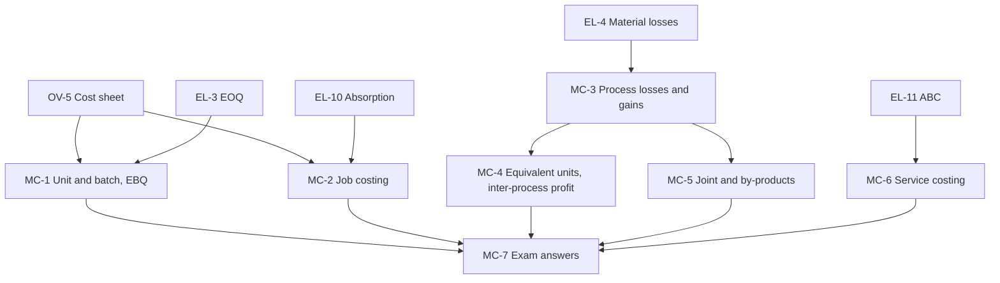

# CA Inter CMA Unit 3: Methods of Costing, node map

ICAI section III, weight **20-25%** of Paper 4. Every worked example is an ICAI illustration or example, recomputed.

## Nodes

| Node | Topic | Deps | Minutes | Exam focus |
|---|---|---|---|---|
| MC-1 | Unit Costing and Batch Costing (EBQ) | OV-5, EL-3 | 45 | yes |
| MC-2 | Job Costing | OV-5, EL-10 | 35 | yes |
| MC-3 | Process Costing, Normal and Abnormal Loss, Abnormal Gain | OV-5, EL-4 | 55 | yes |
| MC-4 | Equivalent Units, Inter-Process Profit, Operation Costing | MC-3 | 55 | yes |
| MC-5 | Joint Products and By-Products | MC-3 | 45 | yes |
| MC-6 | Service Costing | OV-5, EL-11 | 55 | yes |
| MC-7 | Unit 3 Exam Answers | MC-1 to MC-6 | 40 | yes |

Total reading time: about 330 minutes.

## Dependency graph

## Headline numbers (ICAI)

- EBQ 600 units (Ill. 5); 5,060 every 36.5 days (Ill. 6). Muffins ₹20.83 each.
- Process rate = (cost − normal loss scrap) ÷ (input − normal loss units); Ex 3 abnormal loss ₹4,063.
- FIFO ₹210.88 vs average ₹209.18 per equivalent unit.
- Joint cost by NRV 38,700 / 25,800; PVC processing adds ₹20,000.
- Bus ₹0.40 per passenger-km; hotel single room ₹33.73; toll ₹24.35 per vehicle.

## Links
- [[CA Inter CMA MOC]]
