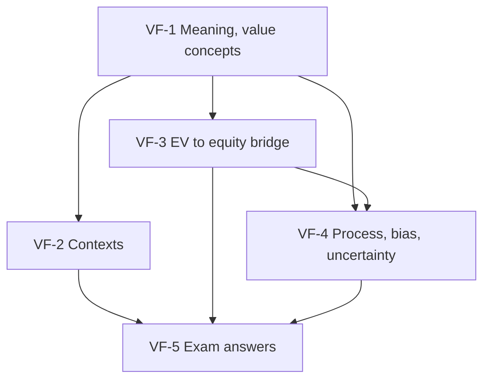

# Corporate Valuation Unit 1: Overview and Framework, node map

ESE: 50 marks; Section A 3 × 5, Section B 2 × 10 (assumed, the syllabus text is inconsistent), Section C one 15-mark case. Unit 1 is CO1 (concepts and purposes) and feeds the bridge used in every case. All examples are **hypothetical numbers**; no faculty slides exist yet, so content is labelled (syllabus) or (textbook).

## Nodes

| Node | Topic | Deps | Minutes | Exam focus |
|---|---|---|---|---|
| VF-1 | Meaning, Scope and Value Concepts | none | 25 | yes |
| VF-2 | Contexts of Valuation | VF-1 | 30 | yes |
| VF-3 | EV to Equity Bridge | VF-1 | 45 | yes |
| VF-4 | Valuation Process, Bias and Uncertainty | VF-1, VF-3 | 30 | yes |
| VF-5 | Unit 1 Exam Answers | VF-1 to VF-4 | 35 | yes |

Total reading time: about 165 minutes.

## Dependency graph

## Headline numbers to know

- ₹6 growing 5%: value ₹100.00, ₹85.71, ₹75.00 at Ke 11%, 12%, 13%.
- VC method: ₹300 crore exit, 40% IRR: post-money ₹55.78 crore, stake 17.93%. IPO: 4 × 21.25 = ₹85.
- Bridge: 5,000 − 1,250 + 400 = ₹4,150 crore, ₹41.50 per share. Lease retailer: 2,600 under both treatments.
- Peer EV/EBITDA 4,700 ÷ 500 = 9.4x; wrong EBITDA gives 3,308.8 instead of 3,760.
- Sensitivity: FCFF 100 gives ₹1,250 to ₹2,500 crore; centre ₹1,667 crore.
- Malabar case: 3,055 crore, ₹76.38 vs ₹68, upside 12.3%.

## Links
- [[Corporate Valuation MOC]]
