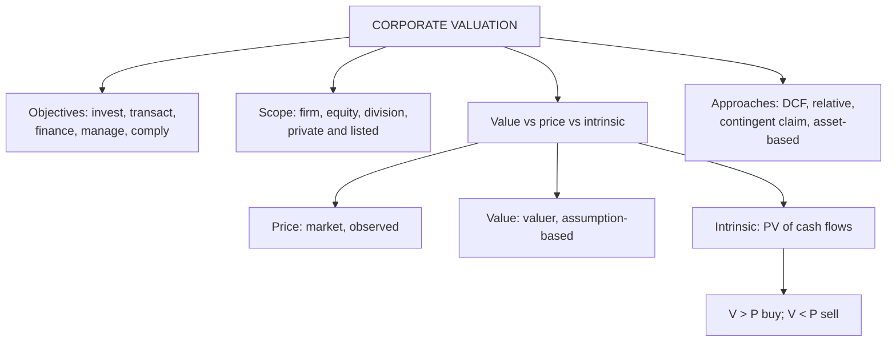

# VF-1: Meaning, Scope and Value Concepts

Covers: what corporate valuation is, its scope and objectives, and the difference between value, price and intrinsic value. **(syllabus)**

## Where this fits in the ESE

Definition-style 5-mark questions ("distinguish value, price and intrinsic value", "scope and objectives of valuation") come almost always from Unit 1. They are the easiest marks in the paper, so write them as a short table plus one example. No faculty slides are available yet, so everything here is **(textbook)**; swap in the faculty's definitions when the slides arrive and write those in the exam.

## Meaning, scope and objectives

**Corporate valuation** is the process of estimating the worth of a business, a part of it, or a claim on it (equity, debt, preference shares), using the cash flows it can generate, the risk of those cash flows, or the assets it owns. **(textbook)**

**Scope: what can be valued**
- The whole firm (enterprise value) or only the equity.
- A division, a project, a brand, a patent.
- Listed and unlisted (private) firms.
- Claims: ordinary shares, preference shares, convertible debt, ESOPs.

**Objectives: why we value**
1. **Investment decisions:** buy, hold or sell a share.
2. **Transactions:** price for a merger, acquisition, IPO or stake sale.
3. **Corporate finance:** capital raising, buy-backs, restructuring.
4. **Value-based management:** find which strategies and business units create value.
5. **Compliance and disputes:** fair value for tax, accounting, court or regulator.

## Value, price and intrinsic value

| Term | Meaning | Who sets it | Changes when |
|---|---|---|---|
| **Price** | What a buyer actually pays at a point in time | Market demand and supply | Sentiment, liquidity, news |
| **Value** | Worth of an asset to a particular valuer under stated assumptions | The valuer | Assumptions change |
| **Intrinsic value** | Present value of the expected cash flows at a risk-adjusted rate, from fundamentals alone | Analysis of fundamentals | Cash flow or risk estimates change |
| **Book value** | Net assets as per the balance sheet (historical cost) | Accounting rules | Accounting entries |
| **Liquidation value** | Net proceeds if assets are sold off (see AV-4) | Asset buyers | Urgency of sale |

Two further terms appear in the literature. **Fair value** is an exit price between willing market participants (Ind AS 113 uses this idea **[VERIFY]** exact wording). **Investment value** is the value to one specific buyer, including that buyer's synergies, so it can exceed fair market value.

**Decision rule.** Compare intrinsic value (V) with price (P):
- V > P: undervalued, buy.
- V < P: overvalued, sell or avoid.
- V ≈ P: fairly priced.
**Margin of safety = (V − P) ÷ V.** A margin protects against estimation error.

## The three valuation approaches

**(textbook, Damodaran's grouping)**
1. **Intrinsic (DCF):** value = PV of expected cash flows. Units 2 to 4.
2. **Relative:** value from what similar assets sell for, using multiples (P/E, EV/EBITDA).
3. **Contingent claim (option pricing):** for assets with option-like features. Mention only.

The syllabus adds **asset-based** approaches (book, liquidation, replacement) in Unit 4.

## Worked example: value is an estimate, not a fact

*Hypothetical.* A share has expected cash flow to equity of ₹6 per share next year, growing 5% for ever. Price in the market is ₹90.

**Step 1.** Value = FCFE₁ ÷ (Ke − g).
**Step 2.** Run three cost-of-equity assumptions.

| Ke | Ke − g | Value | Versus ₹90 |
|---|---|---|---|
| 13% | 8% | 6 ÷ 0.08 = ₹75.00 | Overvalued by ₹15 |
| 12% | 7% | 6 ÷ 0.07 = ₹85.71 | Overvalued by ₹4.29 |
| 11% | 6% | 6 ÷ 0.06 = ₹100.00 | Undervalued, margin of safety 10% |

**Decision line:** at ₹90 the call flips on a 1-point change in Ke. Intrinsic value is a range of ₹75 to ₹100 here, so recommend buying only when the price sits well below the low end of a defensible range. That is the interpretation the rubric pays for: price is a fact, value is an opinion with a range.

## Traps

- **Treating DCF output as "the" value.** It is conditional on inputs; always show a range.
- **Calling a low price "undervalued"** without comparing it with a value estimate.
- **Mixing book value with intrinsic value.** Book value is history; intrinsic value is the future.
- **Forgetting that a buyer's value can exceed market value** because of synergies (AD-3).

## What to remember

- Valuation estimates worth from cash flows, risk or assets; objectives are investing, transactions, finance, value management and compliance.
- Price is observed, value is estimated, intrinsic value rests on fundamentals only.
- V > P buy, V < P sell; margin of safety = (V − P) ÷ V.
- One point on Ke moved the example from ₹75 to ₹100: always give a range.
- Three approaches: intrinsic DCF, relative, contingent claim; the syllabus adds asset-based.

## Concept map

## Flashcards
Q: Define corporate valuation.
A: Estimating the worth of a business, part of it, or a claim on it, from its cash flows, risk or assets.

Q: Give three objectives of valuation.
A: Investment decisions, transaction pricing (M&A, IPO), and value-based management; also compliance and dispute resolution.

Q: Difference between price and intrinsic value?
A: Price is what the market pays now; intrinsic value is the PV of expected cash flows at a risk-adjusted rate, from fundamentals.

Q: What is the decision rule comparing intrinsic value V and price P?
A: V > P buy (undervalued); V < P sell or avoid (overvalued); V close to P fairly priced.

Q: Formula for margin of safety?
A: (V − P) ÷ V.

Q: FCFE₁ ₹6, g 5%, Ke 11%, 12%, 13%. Values?
A: ₹100.00, ₹85.71 and ₹75.00. Value is a range, not a point.

Q: What is investment value?
A: Value to a specific buyer including that buyer's synergies; it can exceed fair market value.

Q: Name the three valuation approaches in Damodaran's grouping.
A: Intrinsic (DCF), relative (multiples) and contingent claim (option pricing).

## Sources
- BBA304F-6 syllabus, Unit 1 (meaning, scope, objectives; value vs price vs intrinsic value)
- Damodaran, *Investment Valuation* (4th ed., essential reading), introductory chapters
- Next: [[Corporate Valuation Unit 1 - VF-2 Contexts of Valuation]]
- [[Corporate Valuation Unit 1 - Framework MOC (Node Map)]]
