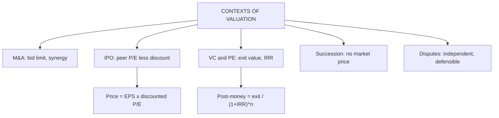

# VF-2: Contexts of Valuation

Covers: why valuation is needed in mergers and acquisitions, IPOs, venture capital and private equity, succession planning and disputes, with the need and importance of valuation. **(syllabus)**

## Where this fits in the ESE

"Explain the contexts in which valuation is required" is a likely 5-mark question, and the VC and IPO arithmetic below is short enough to ask as a numerical. Use the table for the theory and one worked line for marks.

## The five contexts

| Context | Who values and why | What is special | Typical method |
|---|---|---|---|
| **Mergers and acquisitions** | Acquirer sets a maximum bid; target judges the offer | Synergy, control premium, winner's curse (AD-3) | DCF plus synergy, comparables |
| **IPO** | Merchant bankers and the issuer set the price band | Peer multiples with an issue discount, information gap with new investors | Relative (P/E, EV/EBITDA), DCF as check |
| **Venture capital and private equity** | Investor sets stake for money invested | No earnings, high risk, exit-driven returns | VC method, DCF with scenarios |
| **Succession planning** | Family firm values shares for transfer, buy-out or gift | No market price, key-person risk, emotional bias | Adjusted net assets, DCF, capitalised earnings |
| **Dispute resolution** | Courts or tribunals in shareholder disputes, dissent, tax, matrimonial or oppression cases | Valuer must be independent and defensible; "fair value" is contested | Method set by law or court, often more than one |

Regulatory detail (SEBI ICDR pricing disclosures, registered valuers under the Companies Act 2013, RBI/FEMA valuation norms for foreign investment) changes often. **[VERIFY]** current rules before quoting section numbers in an answer.

## Need and importance of valuation

1. **Fair pricing:** avoids overpaying or selling too cheap.
2. **Capital allocation:** shows which projects and units earn more than their cost of capital.
3. **Negotiation anchor:** a defensible number to bargain from.
4. **Stakeholder trust:** minority shareholders, lenders and regulators rely on it.
5. **Strategy:** valuation links decisions to value creation (CO4, value-based management).

## Worked example 1: venture capital method

*Hypothetical start-up.* A fund invests ₹10 crore. It expects an exit value of ₹300 crore in 5 years and needs a 40% IRR.

**Step 1.** Pre- and post-money if it takes 20%: post-money = 10 ÷ 0.20 = ₹50 crore; pre-money = 50 − 10 = ₹40 crore.
**Step 2.** Required multiple = 1.40⁵ = 5.378.
**Step 3.** Post-money the fund can accept = 300 ÷ 5.378 = **₹55.78 crore**.
**Step 4.** Stake needed = 10 ÷ 55.78 = **17.93%**. (Check: 17.93% of 300 = ₹53.8 crore = 10 × 5.378.)

| Item | ₹ crore |
|---|---|
| Exit value, year 5 | 300.00 |
| Discount factor at 40% (÷ 5.378) | 55.78 post-money today |
| Investment | 10.00 |
| Stake required | 17.93% |

**Decision line:** a 20% stake asked for would be more than the fund needs. The founder can negotiate down to about 18%, if the ₹300 crore exit is believed. Interpretation: VC returns depend on the exit assumption, so test it with a downside case. A failure rate across the portfolio is why VCs demand 40% rather than the 15% cost of capital of a listed firm.

## Worked example 2: IPO pricing with peer P/E

*Hypothetical.* Issuer PAT ₹120 crore, post-issue shares 30 crore, so EPS = ₹4.00. Listed peers trade at P/E 25. Bankers apply a 15% discount for new-issue risk.

**Step 1.** Issue P/E = 25 × (1 − 0.15) = 21.25.
**Step 2.** Price = 4.00 × 21.25 = **₹85**.
**Decision line:** the price band should be set around ₹85 with the range justified by the DCF value; the issue discount leaves room for the post-listing gain that investors expect.

## Traps

- **One method for every context.** Succession and disputes lean on asset and earnings methods; M&A needs synergy.
- **Ignoring who the valuer works for.** The bias pressure differs by context (VF-4).
- **Treating pre-money and post-money as the same.** Post-money = pre-money + new cash.

## What to remember

- Five contexts: M&A, IPO, VC and PE, succession, disputes. Each has its own bias and method.
- Need: fair price, capital allocation, negotiation, trust, strategy.
- VC method: post-money = exit value ÷ (1 + IRR)ⁿ; stake = investment ÷ post-money (₹55.78 crore, 17.93%).
- IPO: peer P/E less an issue discount times EPS (₹85).
- Regulatory specifics carry a [VERIFY] tag; do not quote section numbers from memory.

## Concept map

## Flashcards
Q: Name the five valuation contexts in the syllabus.
A: Mergers and acquisitions, IPOs, venture capital and private equity, succession planning, and dispute resolution.

Q: Pre-money versus post-money valuation?
A: Post-money = pre-money + new investment. ₹10 crore for 20% gives post-money ₹50 crore and pre-money ₹40 crore.

Q: VC method formula?
A: Post-money today = expected exit value ÷ (1 + target IRR)ⁿ; stake = investment ÷ post-money.

Q: Exit ₹300 crore in 5 years, IRR 40%, investment ₹10 crore. Stake?
A: 1.4⁵ = 5.378; post-money 55.78; stake 17.93%.

Q: Why do IPO prices carry a discount to peer P/E?
A: Compensation for new-issue risk and the information gap with new investors; it leaves room for a listing gain.

Q: EPS ₹4, peer P/E 25, 15% discount. Issue price?
A: P/E 21.25 times EPS 4 = ₹85.

Q: Why is succession valuation difficult?
A: No market price, key-person dependence and family bias; adjusted net assets and DCF are used together.

Q: Name two reasons valuation matters for stakeholders.
A: Fair pricing in transactions and capital allocation to value-creating projects; also negotiation anchor and trust.

## Sources
- BBA304F-6 syllabus, Unit 1 (contexts of valuation; need and importance)
- Damodaran, *Investment Valuation*, relevant chapters; Koller et al., *Valuation*, part 1
- Previous: [[Corporate Valuation Unit 1 - VF-1 Meaning Scope and Value Concepts]] · Next: [[Corporate Valuation Unit 1 - VF-3 EV to Equity Bridge]]
- [[Corporate Valuation Unit 1 - Framework MOC (Node Map)]]
