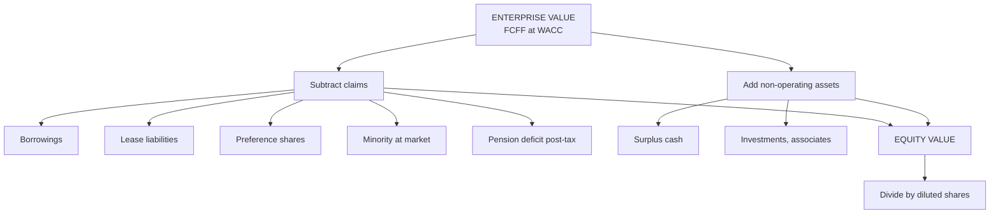

# VF-3: Enterprise Value to Equity Value Bridge

Covers: the difference between enterprise value and equity value, every item in the bridge (net debt, preference shares, minorities, investments, leases under Ind AS 116, other debt-like items), and the per-share step. This is one of the hardest and most examined steps in the paper. **(syllabus + textbook)**

## Where this fits in the ESE

Every DCF answer ends with this bridge, and a case study can lose 3 to 4 marks by getting it wrong. The question "is the claim you subtract matched to the cash flow you discounted?" is the examiner's favourite check.

## Enterprise value versus equity value

- **Enterprise value (EV):** value of the operating business, belonging to **all** capital providers: equity holders, lenders, preference holders and minority shareholders in subsidiaries. FCFF discounted at WACC gives this.
- **Equity value:** what is left for the ordinary shareholders of the parent. FCFE or dividends discounted at Ke give this directly.

**Core bridge**

**Equity value (ordinary shares) = EV − net debt − lease liabilities − preference shares − minority interest (NCI) − other debt-like items + non-operating investments and associates**

where **net debt = borrowings − cash and cash equivalents**.

**Value per share = Equity value ÷ diluted shares outstanding.**

## Item by item: what to do and why

| Item | Treatment | Reason |
|---|---|---|
| Borrowings (short and long term) | Subtract **at market value** if known, else book | Lenders have a claim on EV |
| Cash and liquid investments | **Add** (surplus cash only) | FCFF excludes interest on cash, so cash is valued separately |
| Operating cash needed for the business | **Do not add** | It is part of working capital already inside FCFF |
| Preference shares | Subtract at market or redemption value | Claim ranks before ordinary equity |
| Minority interest (NCI) | Subtract at **market value**, not book | FCFF consolidates 100% of the subsidiary, but 20% of it is not yours |
| Associates and joint ventures (equity method) | **Add** at market or fair value | Their profit is not in consolidated EBIT or FCFF |
| Non-operating investments (listed shares, mutual funds, idle land) | **Add** at market value | Income from them is excluded from FCFF |
| Lease liabilities (Ind AS 116) | **Subtract**, if FCFF is before lease payments (see below) | Leases are debt-like financing |
| Unfunded pension or gratuity deficit | Subtract **after tax** | Debt-like obligation |
| Contingent liabilities, deferred consideration | Subtract at probability-weighted value | Real claims on value |
| ESOPs and convertibles | Add to the **share count** (diluted) or reduce equity value by option value | Existing holders are diluted |

## Worked example: full bridge

*Hypothetical.* Aarav Packaging Ltd (fictional). DCF enterprise value ₹5,000 crore. Data in ₹ crore:

- Borrowings 900; lease liabilities (Ind AS 116) 150; preference shares 50.
- Subsidiary: net profit 40, minority holds 25%, similar listed firms trade at P/E 12.
- Unfunded gratuity deficit 40, tax rate 25%.
- Cash and equivalents 220. Listed investments at market value 80. Associate stake at fair value 100.
- Shares: 100 crore.

**Step 1.** Market value of minority = 40 × 0.25 × 12 = **120**.
**Step 2.** Gratuity deficit after tax = 40 × (1 − 0.25) = **30**.
**Step 3.** Claims to deduct = 900 + 150 + 50 + 120 + 30 = **1,250**.
**Step 4.** Assets to add = 220 + 80 + 100 = **400**.
**Step 5.** Equity value = 5,000 − 1,250 + 400 = **₹4,150 crore**.
**Step 6.** Per share = 4,150 ÷ 100 = **₹41.50**.

| Line | ₹ crore |
|---|---|
| Enterprise value | 5,000 |
| Less borrowings | (900) |
| Less lease liabilities | (150) |
| Less preference shares | (50) |
| Less minority interest at market | (120) |
| Less gratuity deficit, post-tax | (30) |
| Add cash | 220 |
| Add listed investments | 80 |
| Add associate | 100 |
| **Equity value** | **4,150** |

**Decision line:** if the market price is ₹36, the share trades 13.3% below ₹41.50: undervalued, margin of safety (41.50 − 36) ÷ 41.50 = 13.3%. If the price is ₹45, the share trades 8.4% above ₹41.50, so it is overvalued. Say that the answer depends on EV assumptions and show the bridge items, because the rubric gives a mark for each correct item.

*Note: ₹36 and ₹45 are illustrative prices to show the decision rule.*

## Leases under Ind AS 116 **[VERIFY]**

Under Ind AS 116 the lessee records a right-of-use asset and a lease liability. The rent expense disappears from operating cost and is replaced by **depreciation** (inside EBITDA's D&A) and **interest** (financing). Consequences:

- **EBITDA rises** (it is now before lease cost). EBIT rises slightly.
- If FCFF is built **before** lease payments, EV includes the lease claim, so you must **subtract the lease liability** in the bridge.
- WACC should then include leases in the debt weight.

**The consistency rule: pick one treatment and keep it throughout.**

| Treatment | FCFF | Discount rate | Bridge |
|---|---|---|---|
| **A. Leases as debt (post-Ind AS 116)** | Before lease payments | WACC with leases in debt | Subtract lease liability |
| **B. Leases as operating cost (pre-116 style)** | After rent | WACC without leases | Do **not** subtract lease liability |

*Hypothetical consistency check.* A retailer's operating cash flow before rent is ₹300 crore a year for ever. Annual rent is ₹40 crore. Discount rate 10% in both treatments (same lease rate, so lease liability = 40 ÷ 0.10 = ₹400 crore).

- **A:** EV = 300 ÷ 0.10 = 3,000; less lease liability 400 = **2,600**.
- **B:** EV = (300 − 40) ÷ 0.10 = 2,600; no lease deduction = **2,600**.

Same answer. The error is to mix them: discounting FCFF before rent (3,000) and not subtracting the lease overstates equity by ₹400 crore; deducting rent **and** the liability double counts.

**Multiples need the same match.** A peer has market cap 4,000, debt 800, lease liability 200, cash 300, so EV including leases = 4,000 + 800 + 200 − 300 = 4,700. EBITDA after Ind AS 116 is 500, so EV/EBITDA = 4,700 ÷ 500 = **9.4x**. Target EBITDA after Ind AS 116 is 400 and its lease liability is 300, with annual lease payments of 48.

- Correct: 9.4 × 400 = 3,760 (EV including leases); then subtract the 300 lease liability in the bridge.
- Wrong: using pre-Ind AS 116 EBITDA of 352 (400 − 48) with the same multiple gives 9.4 × 352 = 3,308.8, an understatement of 451.2.

## Reverse bridge (for relative valuation)

**EV = market capitalisation + debt + leases + preference + NCI − cash − non-operating investments.**
*Example:* market cap 2,000; debt 700; leases 90; cash 150; investments 60: EV = 2,000 + 700 + 90 − 150 − 60 = **₹2,580 crore**.

## Traps

1. **Using book value of minority interest.** Use market value (market P/E on the subsidiary's profit).
2. **Adding all cash.** Add surplus cash only; operating cash is inside working capital.
3. **Double counting cash:** adding cash while FCFF also contains interest income.
4. **Leases mixed.** Discounting pre-rent FCFF and ignoring the liability, or subtracting both.
5. **Forgetting associates:** consolidated FCFF excludes equity-accounted income.
6. **Net debt on book, equity on market** in the WACC weights. Use market values.
7. **Basic instead of diluted shares.** Include ESOPs and in-the-money convertibles.

## What to remember

- EV belongs to all providers of capital; equity value is EV minus all claims senior to ordinary shares, plus non-operating assets.
- Bridge: EV − debt − leases − preference − NCI (market) − other debt-like items + cash + investments + associates.
- Full example: 5,000 − 1,250 + 400 = ₹4,150 crore, ₹41.50 per share on 100 crore shares.
- Leases: pick treatment A (subtract liability) or B (do not), never both or neither. Retailer example gives 2,600 either way.
- Subtract NCI at market value, pension deficits after tax, and use diluted shares.

## Concept map

## Flashcards
Q: Write the EV to equity bridge.
A: Equity value = EV − debt − leases − preference − minority interest (market) − other debt-like items + cash + non-operating investments and associates.

Q: Why subtract minority interest at market value, not book?
A: FCFF consolidates 100% of the subsidiary; the minority's claim is its share of the subsidiary's market value.

Q: Subsidiary profit ₹40 crore, minority 25%, P/E 12. Minority value?
A: 40 × 0.25 × 12 = ₹120 crore.

Q: EV 5,000; claims 1,250; additions 400; shares 100 crore. Value per share?
A: Equity 4,150, so ₹41.50.

Q: Under Ind AS 116, when do you subtract the lease liability?
A: When FCFF is before lease payments (leases treated as debt). If FCFF is after rent, do not subtract.

Q: FCFF before rent 300, rent 40, discount 10%, lease liability 400. Equity under both treatments?
A: Treatment A: 3,000 − 400 = 2,600. Treatment B: 260 ÷ 0.10 = 2,600. Same.

Q: Which cash is added in the bridge?
A: Surplus cash and liquid investments only; operating cash stays in working capital.

Q: How is an unfunded pension deficit treated?
A: Subtract it after tax as a debt-like claim: 40 × (1 − 0.25) = 30.

Q: Reverse bridge from market cap to EV?
A: EV = market cap + debt + leases + preference + NCI − cash − non-operating investments.

## Sources
- BBA304F-6 syllabus, Unit 1 (equity value vs enterprise value), Unit 3 (equity valuation vs firm valuation)
- Damodaran, *Investment Valuation*, chapters on cash, cross-holdings, minority interests; Koller et al., *Valuation*, chapter on reorganising financial statements
- Ind AS 116 Leases, for the lessee model **[VERIFY]**
- Previous: [[Corporate Valuation Unit 1 - VF-2 Contexts of Valuation]] · Next: [[Corporate Valuation Unit 1 - VF-4 Valuation Process Bias and Uncertainty]]
- [[Corporate Valuation Unit 1 - Framework MOC (Node Map)]]
