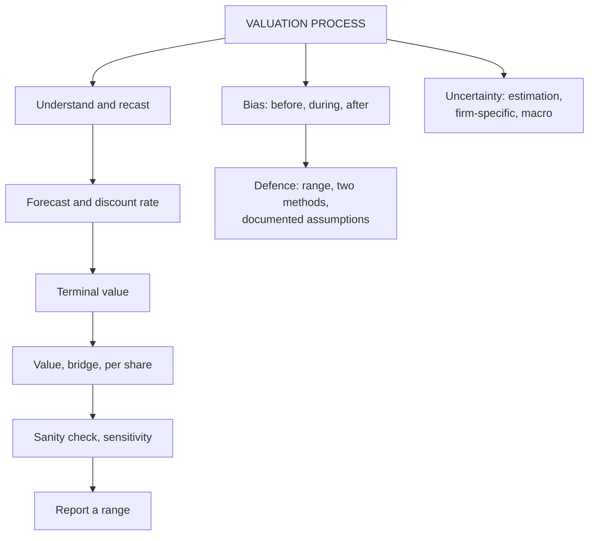

# VF-4: Valuation Process, Bias, Subjectivity and Uncertainty

Covers: the steps of a valuation, how to choose a model for a firm, where bias and subjectivity enter, and the three kinds of uncertainty. **(syllabus)**

## Where this fits in the ESE

A 5-mark "explain the valuation process" or "bias and uncertainty in valuation" is likely. It also supplies the layout for the 15-mark case in VF-5.

## The valuation process (eight steps)

**(textbook)**
1. **Understand the business:** industry, strategy, competitive advantage, stage of life cycle.
2. **Recast the financials:** separate operating from non-operating items; treat leases and R&D consistently.
3. **Forecast** revenue growth, margins, tax and reinvestment (FF-2).
4. **Estimate the discount rate:** WACC for FCFF, cost of equity for FCFE and dividends.
5. **Estimate terminal value** consistent with growth and ROIC (FF-3, FF-4).
6. **Compute** value and convert EV to equity per share (VF-3).
7. **Sanity-check:** compare with multiples, implied growth and market price; run sensitivity.
8. **Conclude and report** a range, the key assumptions and the recommendation.

## Choosing the model

| Firm situation | Suitable model | Why |
|---|---|---|
| Stable, positive FCFF, capital structure stable | FCFF at WACC | Standard DCF (Unit 2) |
| Bank, NBFC, insurer | Dividend or FCFE at Ke | Debt is raw material; FCFF is meaningless |
| Capital structure changing sharply | APV (Unit 4) | Tax shield changes with debt |
| Pays out close to its FCFE | DDM (Unit 3) | Dividends are a good cash flow proxy |
| Pays out far less than FCFE | FCFE | Dividends understate cash available |
| Loss-making or start-up | DCF with margin path, survival adjustment (AD-2) | Current earnings are not the base |
| Asset-heavy holding company, firm in distress | Asset-based (AV-4) | Assets, not income, support value |
| Private firm | DCF with adjusted beta or multiples with discounts (AD-1) | No market price or beta |

**Rule: the cash flow, the discount rate and the claim being valued must match.** FCFF goes with WACC and gives EV; FCFE and dividends go with Ke and give equity value.

## Bias, subjectivity and uncertainty

**Bias: where it enters**
- **Before:** the valuer knows what the client wants (a high value for a sale, a low one for a buy-out or tax).
- **During:** choosing optimistic growth, a low discount rate, generous comparables, or an extended forecast period.
- **After:** anchoring on the first number, selective use of the sensitivity range, confirmation bias.

**Subjectivity: the inputs that are judgement**
- Terminal growth and fade period.
- Beta, equity risk premium, size or illiquidity adjustments.
- Normalised margins; which peers are comparable.

**Uncertainty (Damodaran's three sources)**
1. **Estimation uncertainty:** the inputs are noisy even if the model is right.
2. **Firm-specific uncertainty:** the business itself may succeed or fail.
3. **Macroeconomic uncertainty:** interest rates, exchange rates, GDP growth.

**Defences:** state assumptions, show a range, run scenario and sensitivity analysis, use two methods, document sources, separate the valuer from the deal incentive (see AD-4 for ethics).

## Worked example: sensitivity of one business

*Hypothetical.* FCFF next year is ₹100 crore, growing for ever at g. Value = 100 ÷ (WACC − g).

| WACC \ g | 4% | 5% | 6% |
|---|---|---|---|
| 10% | 1,667 | 2,000 | 2,500 |
| 11% | 1,429 | 1,667 | 2,000 |
| 12% | 1,250 | 1,429 | 1,667 |

(₹ crore, rounded.) Central case WACC 11%, g 5% gives **₹1,667 crore**.

**Decision line:** the same business is worth ₹1,250 crore to ₹2,500 crore on 1-point changes in two inputs; the top is twice the bottom. An honest report gives a range (say ₹1,430 to ₹2,000 crore, the inner ring) and states that the point estimate carries the valuer's judgement. The spread is the quantified form of "subjectivity".

## Traps

- **Reporting a single number** without a range.
- **Choosing the model to match the desired answer.** Model follows firm type, not the client.
- **Mixing cash flow and discount rate** (FCFF at Ke, FCFE at WACC), see EQ-4.
- **Treating sensitivity as uncertainty analysis.** Sensitivity moves one input at a time; scenarios move linked inputs together.

## What to remember

- Eight steps: understand, recast, forecast, discount rate, terminal value, compute and bridge, sanity-check, report.
- Match the model to the firm: FCFF for stable non-financials, FCFE or DDM for financials, APV when leverage changes, asset-based for holding or distressed firms.
- Bias enters before, during and after the valuation; subjectivity sits mainly in growth, discount rate and comparables.
- Three uncertainty sources: estimation, firm-specific, macro.
- 3 × 3 sensitivity example: ₹1,250 to ₹2,500 crore around ₹1,667 crore.

## Concept map

## Flashcards
Q: List the steps of the valuation process.
A: Understand the business, recast financials, forecast, estimate the discount rate, estimate terminal value, compute and bridge to equity, sanity-check, report a range.

Q: Which model suits a bank, and why?
A: Dividend or FCFE at Ke, because debt is raw material for a bank and FCFF is not meaningful.

Q: Which model when capital structure is changing sharply?
A: APV, because the tax shield from debt changes year by year.

Q: What rule links cash flow, discount rate and claim?
A: FCFF with WACC gives enterprise value; FCFE or dividends with Ke give equity value. Never mix.

Q: Name the three sources of uncertainty in valuation.
A: Estimation, firm-specific, and macroeconomic uncertainty.

Q: Where can bias enter a valuation?
A: Before (client's desired answer), during (optimistic inputs) and after (anchoring, selective reporting).

Q: FCFF₁ 100, WACC 11%, g 5%. Value? And at WACC 10%, g 6%?
A: 100 ÷ 0.06 = 1,667; 100 ÷ 0.04 = 2,500.

Q: How do you defend a valuation against subjectivity?
A: State assumptions, report a range with sensitivity and scenarios, cross-check with a second method, document sources.

## Sources
- BBA304F-6 syllabus, Unit 1 (valuation process and steps; bias, subjectivity and uncertainty)
- Damodaran, *Investment Valuation*, chapters on the three sources of uncertainty; Koller et al., *Valuation*, framework chapters
- Previous: [[Corporate Valuation Unit 1 - VF-3 EV to Equity Bridge]] · Next: [[Corporate Valuation Unit 1 - VF-5 Unit 1 Exam Answers]]
- [[Corporate Valuation Unit 1 - Framework MOC (Node Map)]]
