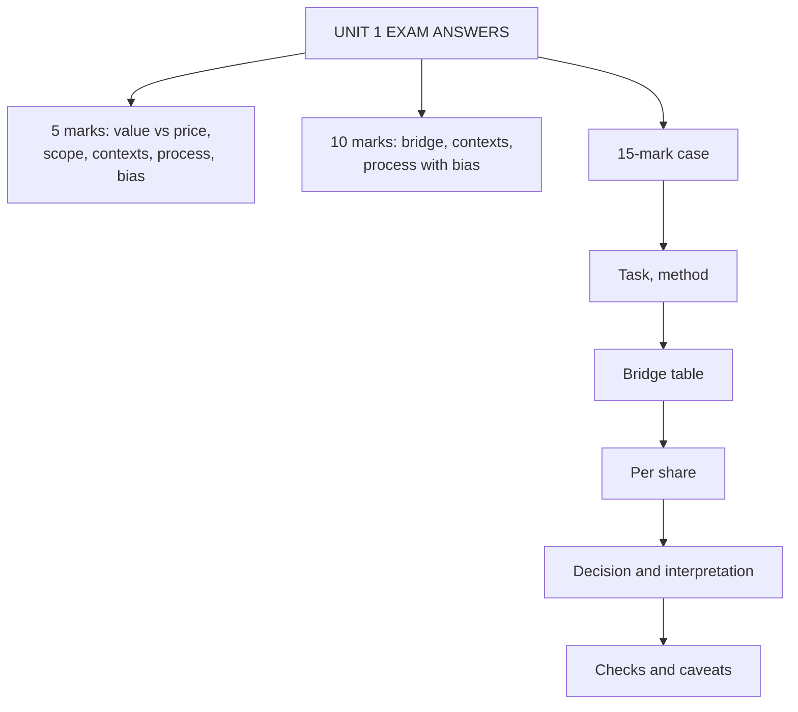

# VF-5: Unit 1 Exam Answers

Covers: what the ESE will ask from Unit 1, 5-mark and 10-mark skeletons, and a 15-mark case layout with a model answer. Numbers come from VF-1 to VF-4.

## What the test will ask

The syllabus pattern is Section A: 3 questions of 5 marks (internal choice), Section B: 2 questions (the syllabus prints "5 marks each = 20", which does not add up, so 2 × 10 is assumed), Section C: one 15-mark case. Unit 1 mostly supplies Section A definitions and the bridge. Confirm the Section B marks with the faculty. The case is most likely **"value the equity from an EV and advise"**, so the bridge decides marks.

## Five-mark answer skeletons

**1. Value, price and intrinsic value (VF-1).** Table with price (market, observed), value (valuer, assumption-based), intrinsic value (PV of cash flows at a risk-adjusted rate). Decision rule V vs P. One example: ₹6 growing 5% at Ke 11%, 12%, 13% gives ₹100, ₹85.71, ₹75: value is a range.

**2. Scope and objectives of valuation (VF-1).** Scope: firm, equity, division, project, private and listed. Objectives: investing, transactions, corporate finance, value management, compliance.

**3. Contexts of valuation (VF-2).** M&A, IPO, VC and PE, succession, disputes; for each: who values, the special issue, method. Add VC method one-liner (₹300 crore exit, 40% IRR gives 17.93% stake for ₹10 crore).

**4. Enterprise value versus equity value (VF-3).** Definition of each; bridge formula; three items with reasons (NCI at market, surplus cash only, leases consistent); short numeric (5,000 to 4,150).

**5. Valuation process (VF-4).** Eight steps in a flow; end with "match cash flow, discount rate and claim".

**6. Bias, subjectivity and uncertainty (VF-4).** Where bias enters (before, during, after); the subjective inputs; three uncertainty sources; defences.

## Ten-mark answer skeletons

**A. "Explain the EV to equity bridge with an example" (VF-3).**
1. Define EV and equity value (2).
2. Bridge formula and the meaning of each item (3).
3. Numerical layout: Aarav Packaging, 5,000 − 1,250 + 400 = 4,150, ₹41.50 per share (3).
4. Leases under Ind AS 116 and the consistency rule; one trap (2).

**B. "Discuss contexts in which valuation is used" (VF-2).**
1. Table of five contexts with who, issue and method (5).
2. Worked VC or IPO line (3).
3. Need and importance, regulator note flagged [VERIFY] (2).

**C. "Valuation process and how bias and uncertainty affect it" (VF-4).**
1. Eight steps (4). 2. Model choice table, four rows (2). 3. Bias, subjectivity, uncertainty (2). 4. Sensitivity example and report-a-range conclusion (2).

## Fifteen-mark case layout

Use this order for any Unit 1 case:

1. **Task and method (2 marks):** one line on what is asked and why FCFF-based EV needs a bridge.
2. **Bridge table (6 marks):** each item with its working (minority at market, pension after tax, lease treatment stated).
3. **Value per share (2 marks):** equity ÷ diluted shares.
4. **Decision with interpretation (3 marks):** compare with price; margin of safety; range.
5. **Checks and caveats (2 marks):** consistency of leases, cash and cash flow, assumptions that move the answer.

### Model case

*Hypothetical.* Malabar Cement Ltd (fictional) has a DCF enterprise value of ₹3,600 crore (FCFF before lease payments, discounted at a WACC that includes leases). Data in ₹ crore: borrowings 700; lease liabilities (Ind AS 116) 90; unfunded gratuity 20 before tax (tax 25%); cash 150; liquid mutual funds 60; associate at fair value 110. Subsidiary net profit 30, minority holds 20%, listed peers trade at P/E 10. 40 crore shares; current price ₹68. **Advise whether the share is cheap, and name the biggest risk to your answer.**

**Model answer**

**1. Task.** FCFF at WACC gives value to all capital providers, so equity value must be derived by the bridge before comparing with the per-share price.

**2. Bridge.**
- Minority at market = 30 × 0.20 × 10 = 60.
- Gratuity post-tax = 20 × 0.75 = 15.
- Leases are subtracted because FCFF is before lease payments.

| Line | ₹ crore |
|---|---|
| Enterprise value | 3,600 |
| Less borrowings | (700) |
| Less lease liabilities | (90) |
| Less minority interest at market | (60) |
| Less gratuity deficit, post-tax | (15) |
| Add cash | 150 |
| Add liquid mutual funds | 60 |
| Add associate at fair value | 110 |
| **Equity value** | **3,055** |

**3. Per share.** 3,055 ÷ 40 = **₹76.38** (76.375).

**4. Decision.** Price ₹68 is below ₹76.38. Upside = (76.38 − 68) ÷ 68 = **12.3%**; margin of safety = (76.38 − 68) ÷ 76.38 = **11.0%**. The share is undervalued on this estimate, but the margin is within the normal error of a DCF. **Recommend: buy only if the analyst's own range (see 5) stays above ₹68.**

**5. Checks.**
- Consistency: leases subtracted and also in WACC (treatment A). Ignoring the lease deduction would give 3,145 ÷ 40 = ₹78.63, an overstatement of ₹2.25 per share.
- Leaving out the minority would give 3,115 ÷ 40 = ₹77.88.
- Biggest risk: the ₹3,600 crore EV itself. A 1-point change in WACC moves EV by far more than all bridge items together (see VF-4 sensitivity), so the recommendation rests on the EV range, not on the bridge.

**Interpretation line to write:** "The bridge turns ₹3,600 crore of enterprise value into ₹3,055 crore for ordinary shareholders; ₹76.38 per share against ₹68 suggests undervaluation of about 11% of value, which is a buy only with a confirmed EV range."

## Self-test

- Redo the Aarav Packaging bridge without looking: do you get ₹4,150 crore and ₹41.50?
- Without the table, state the lease rule in one sentence.
- Say aloud the three examples of bias and the three of uncertainty.

## What to remember

- Section A answers: a table plus one numeric example.
- Bridge table is worth more than the final number: show every working line.
- Malabar case: 3,600 → 3,055 crore → ₹76.38; upside 12.3%, margin of safety 11.0%.
- Always say which lease treatment you used.
- End with the risk to the EV, not only to the bridge.

## Concept map

## Flashcards
Q: Section B of the syllabus prints "2 × 5 marks = 20". What do we assume?
A: 2 × 10 marks = 20; confirm with the faculty.

Q: Malabar Cement bridge result?
A: EV 3,600 less 700, 90, 60, 15 plus 150, 60, 110 gives 3,055; ₹76.38 per share.

Q: Upside and margin of safety at ₹68 versus ₹76.38?
A: Upside 12.3% on price; margin of safety 11.0% on value.

Q: What if lease liability were not subtracted in the Malabar case?
A: Equity 3,145, ₹78.63 per share, an overstatement of ₹2.25.

Q: What goes first in a 15-mark valuation case?
A: Task and method in one line, then the bridge table with workings.

Q: What closes the answer?
A: Decision with interpretation, then checks and the risk to the EV estimate.

Q: How are the 10 marks split in the bridge answer?
A: Definitions 2, bridge items 3, numerical layout 3, lease rule and a trap 2.

Q: Which Unit 1 topic is the likely numerical?
A: The EV to equity bridge, and the VC or IPO line in contexts.

## Sources
- BBA304F-6 syllabus (ESE pattern, Unit 1)
- Nodes VF-1 to VF-4 in this unit
- Previous: [[Corporate Valuation Unit 1 - VF-4 Valuation Process Bias and Uncertainty]]
- [[Corporate Valuation Unit 1 - Framework MOC (Node Map)]]
