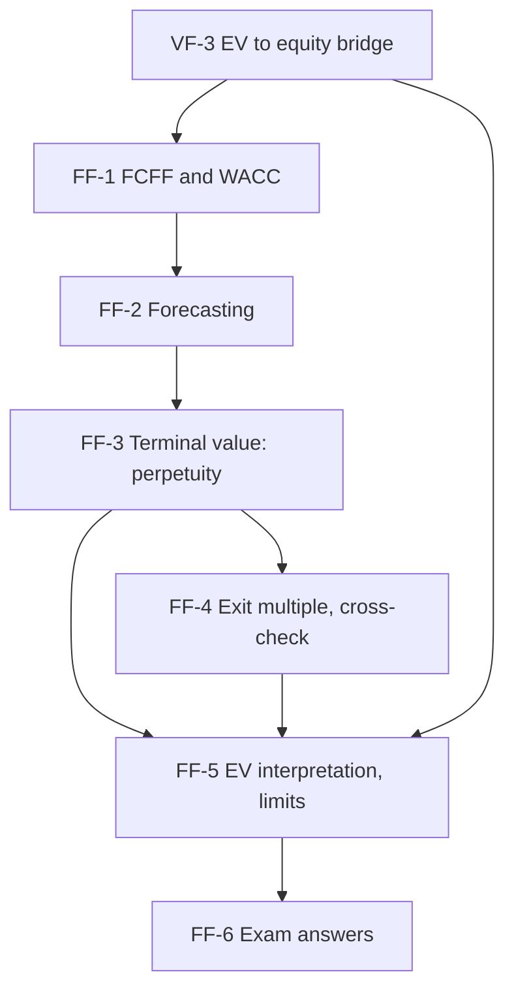

# Corporate Valuation Unit 2: Enterprise DCF, node map

ESE: 50 marks; Section A 3 × 5, Section B 2 × 10 (assumed), Section C one 15-mark case. Unit 2 is CO2 (apply DCF) and the likeliest source of the case. All examples are **hypothetical numbers** (Nilgiri Engineering and Harbour Logistics are fictional). No faculty slides yet, so content is labelled (syllabus) or (textbook).

## Nodes

| Node | Topic | Deps | Minutes | Exam focus |
|---|---|---|---|---|
| FF-1 | Intrinsic Logic, FCFF and WACC | VF-3 | 35 | yes |
| FF-2 | Forecasting Operating Cash Flows | FF-1 | 35 | yes |
| FF-3 | Terminal Value, Perpetuity Method | FF-2 | 45 | yes |
| FF-4 | Exit Multiple and Cross-Check | FF-3 | 35 | yes |
| FF-5 | Enterprise Value Interpretation and Limits | FF-3, FF-4, VF-3 | 30 | yes |
| FF-6 | Unit 2 Exam Answers | FF-1 to FF-5 | 35 | yes |

Total reading time: about 215 minutes.

## Dependency graph

## Headline numbers to know

- FCFF: EBIT 240, NOPAT 180, FCFF 120 three ways. WACC 600/400 at 14% and 9%: 11.1%.
- Nilgiri five-year PV sum ₹710.3 crore; TV ₹3,934.9 crore; PV of TV ₹2,231.1 crore; EV ₹2,941.4 crore; TV share 75.9%.
- ROIC = WACC: TV 3,443.0 (EV 2,662.5). No reinvestment: TV 5,902.3, EV overstated 37.9%.
- Implied multiple 5.71x; 7x exit gives EV 3,443.4 and implied g 6.29%, rejected; 6x gives 3,052.9.
- Bridge: equity 2,471.4, ₹49.43 vs ₹42, margin of safety 15.0%; at WACC 13% ₹41.80.
- Harbour case: EV 1,143.5, equity 833.5, ₹33.34 vs ₹28; TV share 86.2%.

## Links
- [[Corporate Valuation MOC]]
