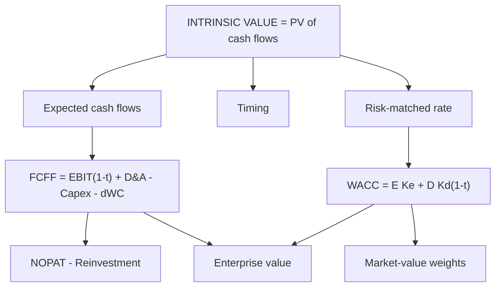

# FF-1: Logic of Intrinsic Valuation, FCFF and WACC

Covers: why a firm is worth the present value of its free cash flows, the definition and three ways of computing FCFF, the discount rate (WACC) and the error-proof way to compute it. **(syllabus + textbook)**

## Where this fits in the ESE

FCFF from given data and WACC are 5-mark staples, and every DCF case starts here. The ability to compute FCFF three ways and get the same answer is a quick self-check.

## The logic of intrinsic valuation

An asset is worth the cash it will give its owner, discounted for time and risk.

**Value = Σ CFₜ ÷ (1 + r)ᵗ**

Three inputs only: **expected cash flows**, **timing**, **discount rate** that matches the risk. Everything else in Unit 2 is a way to estimate those three well. Enterprise DCF values the **operating business** for all capital providers; the claims are subtracted afterwards (VF-3).

## FCFF: concept and components

**Free cash flow to the firm** is the operating cash left after tax and after reinvestment, available to all capital providers.

**FCFF = EBIT × (1 − t) + D&A − Capex − Δ Non-cash working capital**

- **EBIT(1 − t) = NOPAT**, the after-tax operating profit **as if the firm had no debt** (so interest tax shield is not counted here; it goes into WACC).
- **Reinvestment = Capex − D&A + Δ working capital.** So **FCFF = NOPAT − Reinvestment.**
- **Reinvestment rate = Reinvestment ÷ NOPAT.**

Equivalent forms:
- **From net income:** FCFF = NI + D&A + Interest × (1 − t) − Capex − Δ WC.
- **From operating cash flow (Ind AS 7):** FCFF = CFO + Interest × (1 − t) − Capex, when interest is inside CFO **[VERIFY]** where the firm classifies interest paid.

**Components, with traps**
- Use **operating** tax on EBIT, not the tax actually paid after the interest shield.
- Working capital means **non-cash** operating items; cash is valued separately (VF-3).
- Capex includes acquisitions of operating assets; exclude purchase of non-operating investments.
- Under Ind AS 116 the FCFF is before lease payments unless rent is deducted (see VF-3).

## Worked example 1: FCFF three ways

*Hypothetical.* Net income ₹150 crore; interest ₹40 crore; tax rate 25%; D&A ₹60 crore; capex ₹100 crore; increase in working capital ₹20 crore.

**Step 1.** Profit before tax = 150 ÷ 0.75 = 200; so EBIT = 200 + 40 = **240**.
**Step 2.** NOPAT = 240 × 0.75 = **180**.

| Route | Working | FCFF |
|---|---|---|
| From EBIT | 180 + 60 − 100 − 20 | **120** |
| From net income | 150 + 60 + 40×0.75 − 100 − 20 = 150 + 60 + 30 − 100 − 20 | **120** |
| From operating cash flow | CFO = 150 + 60 − 20 = 190; 190 + 30 − 100 | **120** |

**Decision line:** all three agree at ₹120 crore, so the data are consistent. Reinvestment = 100 − 60 + 20 = 60; reinvestment rate = 60 ÷ 180 = 33.3%. A ₹120 crore FCFF is what a buyer of the whole firm receives each year before paying lenders.

## The discount rate: WACC

**WACC = (E ÷ V) × Ke + (D ÷ V) × Kd × (1 − t)**, with **market-value** weights.

- **Ke** from CAPM: Rf + β × ERP. For beta, use the bottom-up and relevering approach (AV-1).
- **Kd** is the pre-tax cost of borrowing today (not the old coupon).
- Include lease liabilities in D if leases are treated as debt.
- Use the target (long-run) capital structure when it differs from today's.

**Error-proof route (avoid rounded weights).** Compute **capital charge in rupees**, then divide by total capital:

**WACC = (Equity × Ke + Debt × Kd × (1 − t)) ÷ (Equity + Debt)**

*Example:* market value of equity ₹600 crore, debt ₹400 crore, Ke 14%, Kd 9%, tax 25%.
- Equity charge = 600 × 0.14 = 84.0; debt charge = 400 × 0.09 × 0.75 = 27.0.
- WACC = (84 + 27) ÷ 1,000 = **11.1%**.

*Why not round the weights?* With equity ₹800 crore and debt ₹400 crore the weights are 2/3 and 1/3. Rounded to 0.667 and 0.333, with Ke 14% and post-tax Kd 6.75%, WACC = 11.5858%; the exact figure is (800 × 14% + 400 × 6.75%) ÷ 1,200 = (112 + 27) ÷ 1,200 = **11.5833%**. The gap is small but it will not match an answer key that uses the rupee route, and it grows with firm size once you capitalise a perpetuity. Keep the rupee route.

## Strengths of enterprise DCF at this stage

- Uses cash, not accounting profit.
- Separates operating performance from financing.
- Forces explicit assumptions on growth, margin and reinvestment.

## Traps

1. **Using NI-based FCFE cash flows with WACC** (or FCFF with Ke): see EQ-4.
2. **Interest tax shield counted twice:** in cash flow and in WACC. FCFF uses EBIT(1 − t) with the full tax on EBIT.
3. **Book-value weights in WACC.** Use market value.
4. **Pre-tax Kd in WACC.**
5. **Subtracting the capex but not D&A add-back, or double counting working capital.** Reinvestment = capex − D&A + ΔWC.

## What to remember

- Value = PV of expected cash flows at a risk-matched rate; FCFF values the operating business.
- FCFF = EBIT(1 − t) + D&A − capex − ΔWC = NOPAT − reinvestment.
- Three routes (EBIT, net income, CFO) must agree: ₹120 crore in the example.
- WACC = (E × Ke + D × Kd(1 − t)) ÷ (E + D) on market values: 11.1% for 600 and 400.
- Compute the rupee capital charge to avoid rounded weights.

## Concept map

## Flashcards
Q: Formula for FCFF?
A: EBIT(1 − t) + D&A − Capex − Δ non-cash working capital; equals NOPAT minus reinvestment.

Q: What is reinvestment?
A: Capex − D&A + change in non-cash working capital; reinvestment rate = reinvestment ÷ NOPAT.

Q: NI 150, interest 40, t 25%, D&A 60, capex 100, ΔWC 20. FCFF?
A: EBIT 240, NOPAT 180; FCFF = 180 + 60 − 100 − 20 = ₹120 crore.

Q: FCFF from net income?
A: NI + D&A + Interest(1 − t) − Capex − ΔWC.

Q: Formula for WACC?
A: (E ÷ V) Ke + (D ÷ V) Kd (1 − t), with market-value weights.

Q: E 600, D 400, Ke 14%, Kd 9%, t 25%. WACC?
A: (84 + 27) ÷ 1,000 = 11.1%.

Q: Why use the capital-charge route?
A: It avoids rounding the weights (such as 0.667 and 0.333).

Q: Why does FCFF use EBIT(1 − t) and not tax actually paid?
A: The interest tax shield belongs in WACC; counting it in cash flow too double counts it.

## Sources
- BBA304F-6 syllabus, Unit 2 (concept and logic of intrinsic valuation; FCFF concept and components)
- Damodaran, *Investment Valuation*, chapters on cost of capital, FCFF; Koller et al., *Valuation*, relevant chapters
- Previous unit: [[Corporate Valuation Unit 1 - VF-3 EV to Equity Bridge]] · Next: [[Corporate Valuation Unit 2 - FF-2 Forecasting Operating Cash Flows]]
- [[Corporate Valuation Unit 2 - Enterprise DCF MOC (Node Map)]]
