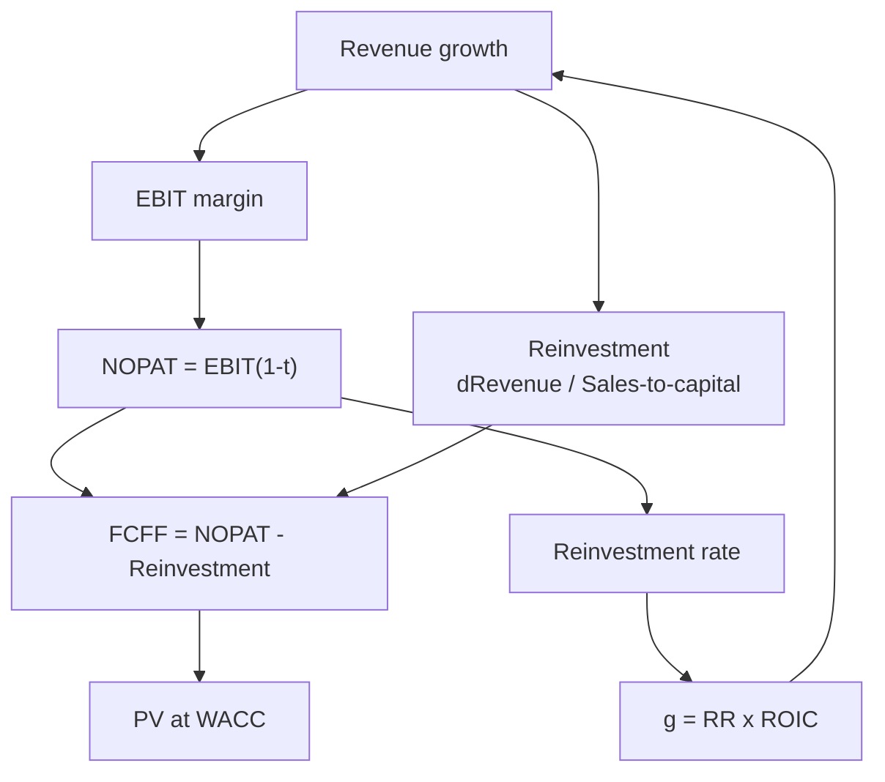

# FF-2: Forecasting Operating Cash Flows

Covers: the drivers of a five-year FCFF forecast (growth, margin, tax, reinvestment), the link to ROIC, the length of the explicit period, and a full year-by-year table with present values. **(syllabus + textbook)**

## Where this fits in the ESE

A forecast table with present values is the core of the Section B numerical and the 15-mark case. The table below is the layout to copy: one row per year, one column per driver, PV at the bottom.

## The driver chain

Forecast in this order. Each step feeds the next.

1. **Revenue growth** by year: from market size, share, price and volume, then fading toward the long-run growth rate.
2. **Operating margin** (EBIT ÷ revenue): converge toward the sustainable margin for the industry.
3. **Tax rate** on EBIT: use the marginal or effective cash rate, move to marginal in stable growth. Statutory rate for Indian companies is 25.17% under the concessional regime **[VERIFY]**; examples here use 25% for clean arithmetic.
4. **Reinvestment:** how much capital must be added to support the growth. Two methods:
   - **Sales-to-capital ratio:** Reinvestment = ΔRevenue ÷ (Sales ÷ Capital).
   - **Item by item:** capex − D&A + Δ working capital.
5. **FCFF = NOPAT − Reinvestment.**

**The link that keeps a forecast honest:**
**Growth in NOPAT = Reinvestment rate × Return on new capital (ROIC)**, so **g = RR × ROIC**.
If the forecast has high growth and low reinvestment, it silently assumes an impossible ROIC. Check **marginal ROIC = ΔNOPAT ÷ reinvestment** in each year.

## How long is the explicit period?

- Use **5 to 10 years** for a firm still growing faster than the economy.
- Stop when the firm reaches **stable growth** (growth not above the economy and a ROIC close to its cost of capital, or at a defended premium).
- Longer periods suit firms with a durable competitive advantage; shorter ones, firms in cyclical or fast-changing markets.
- Everything beyond the horizon sits in the terminal value (FF-3), which is why that number deserves the effort.

## Worked example: five-year FCFF table

*Hypothetical.* Nilgiri Engineering Ltd (fictional). Revenue today ₹2,000 crore. Assumptions:

- Revenue growth: 12%, 12%, 10%, 10%, 8% (revenue rounded to whole crore).
- EBIT margin 16%; tax 25%, so NOPAT = 12% of revenue.
- Sales-to-capital 2.0, so reinvestment = ΔRevenue ÷ 2.
- WACC 12% (Ke 14%, Kd 8% pre-tax so 6% post-tax, equity 75% and debt 25%: 0.75 × 14 + 0.25 × 6 = 12.0).
- Discount factors at 12% to three decimals: 0.893, 0.797, 0.712, 0.636, 0.567.

**Step 1.** Revenue: 2,240; 2,509; 2,760; 3,036; 3,279.
**Step 2.** EBIT and NOPAT each year (16% and 12% of revenue).
**Step 3.** Reinvestment = ΔRevenue ÷ 2.
**Step 4.** FCFF = NOPAT − reinvestment; PV = FCFF × DF.

| Year | Revenue | EBIT | NOPAT | Reinvestment | FCFF | DF at 12% | PV |
|---|---|---|---|---|---|---|---|
| 1 | 2,240 | 358.4 | 268.8 | 120.0 | 148.8 | 0.893 | 132.9 |
| 2 | 2,509 | 401.4 | 301.1 | 134.5 | 166.6 | 0.797 | 132.8 |
| 3 | 2,760 | 441.6 | 331.2 | 125.5 | 205.7 | 0.712 | 146.5 |
| 4 | 3,036 | 485.8 | 364.3 | 138.0 | 226.3 | 0.636 | 143.9 |
| 5 | 3,279 | 524.6 | 393.5 | 121.5 | 272.0 | 0.567 | 154.2 |
| | | | | | | **Sum of PV** | **710.3** |

(₹ crore. PVs use the three-decimal factor and unrounded FCFF to two decimals; recomputing with exact factors changes the sum by about 0.1%.)

**Checks on the forecast**
- Reinvestment rate year 5 = 121.5 ÷ 393.5 = 30.9%. Marginal ROIC = ΔNOPAT ÷ reinvestment = (393.5 − 364.3) ÷ 121.5 = 24%, which equals NOPAT margin 12% × sales-to-capital 2.0. That is well above the 15% long-run ROIC used for the terminal value (FF-3), so say so: the fade is a stated assumption.
- FCFF grows faster than revenue because reinvestment per rupee of growth falls as growth fades. That is the correct direction.

**Decision line:** the explicit period contributes ₹710.3 crore. It is the smaller part of value (about a quarter of the ₹2,941.4 crore enterprise value found in FF-3), so the terminal value decides the answer. Interpretation: a forecast with a clear driver chain and a ROIC check earns the marks even if the final number differs from the key.

## Common forecasting errors

1. **Growth without reinvestment** (g from nowhere): breaks g = RR × ROIC.
2. **Margins rising for ever.** They must converge to an industry-supported level.
3. **Using book depreciation as capex.** In growth, capex exceeds D&A.
4. **Tax at zero for ever** in a loss-making start-up; move to the marginal rate (AD-2).
5. **Nominal cash flows with a real discount rate** (or the reverse). Keep the currency and inflation basis the same.
6. **Ignoring working capital** growth in a growing firm.

## What to remember

- Forecast order: growth, margin, tax, reinvestment, FCFF = NOPAT − reinvestment.
- g = reinvestment rate × ROIC. Check marginal ROIC every year.
- Reinvestment by sales-to-capital: ΔRevenue ÷ 2.0 in the example.
- Five-year PV sum in the example is ₹710.3 crore on 12% WACC.
- The explicit period is the smaller part of value; the terminal value needs the most care.

## Concept map

## Flashcards
Q: Order of an FCFF forecast?
A: Revenue growth, operating margin, tax, reinvestment, then FCFF = NOPAT − reinvestment.

Q: Reinvestment using sales-to-capital?
A: ΔRevenue ÷ (Sales ÷ Capital ratio).

Q: Link between growth, reinvestment and return?
A: g = reinvestment rate × ROIC.

Q: Revenue 2,240 to 2,509, sales-to-capital 2. Reinvestment?
A: (2,509 − 2,240) ÷ 2 = ₹134.5 crore.

Q: Nilgiri year 1: NOPAT 268.8, reinvestment 120.0. FCFF and PV at 12%?
A: FCFF 148.8; PV = 148.8 × 0.893 = ₹132.9 crore.

Q: Sum of the five-year PVs in the Nilgiri table?
A: ₹710.3 crore.

Q: What check catches "growth without reinvestment"?
A: Marginal ROIC = ΔNOPAT ÷ reinvestment; if it is implausibly high, the forecast is wrong.

Q: How long should the explicit forecast period be?
A: 5 to 10 years, until the firm reaches stable growth; longer for durable advantages.

## Sources
- BBA304F-6 syllabus, Unit 2 (forecasting operating cash flows)
- Damodaran, *Investment Valuation*, chapters on estimating growth, reinvestment; Koller et al., *Valuation*, forecasting chapters
- Previous: [[Corporate Valuation Unit 2 - FF-1 Intrinsic Logic FCFF and WACC]] · Next: [[Corporate Valuation Unit 2 - FF-3 Terminal Value Perpetuity Method]]
- [[Corporate Valuation Unit 2 - Enterprise DCF MOC (Node Map)]]
