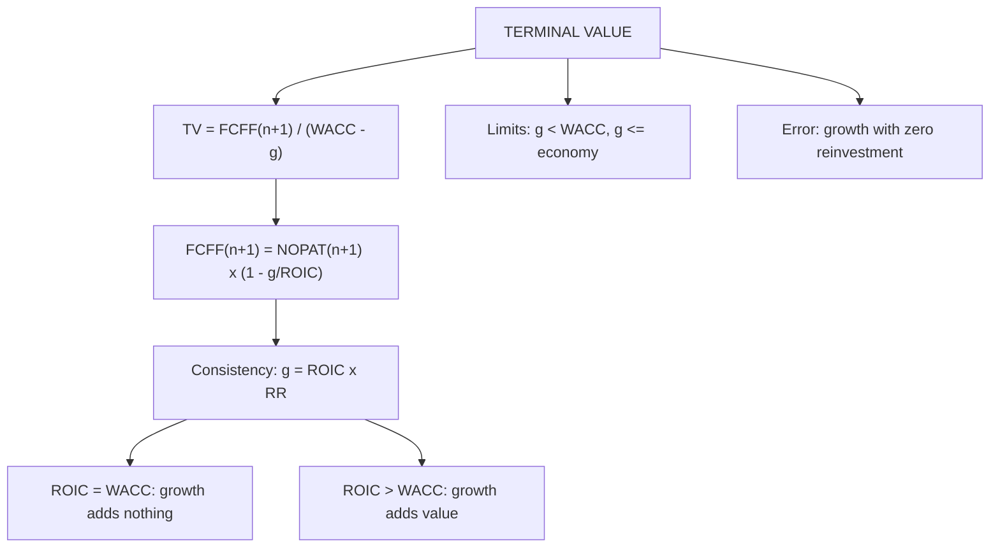

# FF-3: Terminal Value by the Constant-Growth (Perpetuity) Method

Covers: the terminal value formula, the consistency condition g = ROIC × reinvestment rate, the value driver form, limits on g, and the errors that inflate terminal value. This is one of the most-tested and most-misused steps. **(syllabus + textbook)**

## Where this fits in the ESE

Terminal value is 60% to 80% of enterprise value in most DCFs, so every case asks about it. A good answer states the formula, shows that reinvestment is consistent with growth, and says how much of the value rests on it.

## The formula

**TVₙ = FCFFₙ₊₁ ÷ (WACC − g)**, with FCFFₙ₊₁ = NOPATₙ₊₁ × (1 − reinvestment rate).

- TVₙ is the value at the end of year n of all cash flows from year n + 1 onwards.
- **PV of TV = TVₙ × discount factor for year n.**
- WACC must exceed g. If g is close to WACC the value explodes.

## The consistency rule

In stable growth, **g = Reinvestment rate × ROIC**, so **reinvestment rate = g ÷ ROIC**.

**Value driver form:**
**TVₙ = NOPATₙ₊₁ × (1 − g ÷ ROIC) ÷ (WACC − g)**

What this says:
- Growth is not free. To grow at g the firm must reinvest g ÷ ROIC of its NOPAT.
- **If ROIC = WACC**, extra growth adds **no value**: TV = NOPATₙ₊₁ ÷ WACC whatever g is. (Put ROIC = WACC in the formula: (1 − g/WACC) ÷ (WACC − g) = 1 ÷ WACC.)
- **If ROIC > WACC** the firm has a lasting competitive advantage and growth adds value; the higher the ROIC, the more growth is worth.
- **If ROIC < WACC**, growth destroys value.
- A prudent default for terminal ROIC is a value close to WACC; assume a higher number only with a stated reason (brand, regulatory moat, scale).

## Limits on terminal growth

1. **g < WACC**, and in practice **g ≤ long-run nominal growth of the economy** (or the risk-free rate in the same currency). In India a risk-free rate near the 10-year government bond yield and nominal GDP growth are both reference points **[VERIFY]** current figures before quoting.
2. A firm cannot outgrow the economy for ever; otherwise it becomes the economy.
3. Currency consistency: rupee cash flows, rupee g and rupee WACC.

## Worked example: terminal value for Nilgiri Engineering

Continue FF-2: year 5 revenue ₹3,279 crore, NOPAT 12% of revenue, WACC 12%, discount factor for year 5 = 0.567, PV of years 1 to 5 = ₹710.3 crore. Terminal assumptions: **g = 5%, terminal ROIC = 15%.**

**Step 1.** Year 6 revenue = 3,279 × 1.05 = **3,443**.
**Step 2.** NOPAT₆ = 3,443 × 12% = **413.16**.
**Step 3.** Reinvestment rate = g ÷ ROIC = 5% ÷ 15% = **33.3%**.
**Step 4.** FCFF₆ = 413.16 × (1 − 1/3) = **275.44**.
**Step 5.** TV₅ = 275.44 ÷ (0.12 − 0.05) = **₹3,934.9 crore**.
**Step 6.** PV of TV = 3,934.9 × 0.567 = **₹2,231.1 crore**.
**Step 7.** EV = 710.3 + 2,231.1 = **₹2,941.4 crore**.

| Item | ₹ crore |
|---|---|
| PV of FCFF years 1 to 5 | 710.3 |
| Terminal value at year 5 | 3,934.9 |
| PV of terminal value (× 0.567) | 2,231.1 |
| **Enterprise value** | **2,941.4** |
| Terminal value as % of EV | 75.9% |

**Decision line:** about three quarters of value sits beyond year 5, so the conclusion is only as good as g, ROIC and WACC. The valuation passes the consistency test (growth of 5% is supported by 33.3% reinvestment at 15% ROIC). The bridge to equity is in FF-5.

## What ROIC does to value (same firm, g = 5%)

| Terminal ROIC | Reinvestment rate | FCFF₆ | TV₅ | PV of TV | EV |
|---|---|---|---|---|---|
| 12% (= WACC) | 41.7% | 241.0 | 3,443.0 | 1,952.2 | 2,662.5 |
| 15% | 33.3% | 275.4 | 3,934.9 | 2,231.1 | 2,941.4 |
| 20% | 25.0% | 309.9 | 4,426.7 | 2,509.9 | 3,220.2 |
| 30% | 16.7% | 344.3 | 4,918.6 | 2,788.8 | 3,499.1 |

At ROIC = WACC the TV equals NOPAT₆ ÷ WACC = 413.16 ÷ 0.12 = 3,443.0: growth contributes nothing. Moving ROIC from 15% to 20% adds ₹278.8 crore to EV, with diminishing returns after that.

## The error that overstates value most

**Growing FCFF without reinvestment.** If an analyst takes NOPAT₆ as the cash flow and still grows it at 5%:
- TV₅ = 413.16 ÷ 0.07 = **5,902.3** (vs 3,934.9, 50% too high).
- PV = 5,902.3 × 0.567 = 3,346.6; EV = 710.3 + 3,346.6 = **4,056.9** vs 2,941.4, so value is overstated by 37.9%.
This is equivalent to assuming infinite ROIC. It is the single most common terminal value mistake.

## Sensitivity (exact discount factors, ROIC 15%)

| EV (₹ crore) | g = 4% | g = 5% | g = 6% |
|---|---|---|---|
| WACC 11% | 3,274 | 3,454 | 3,700 |
| WACC 12% | 2,839 | 2,943 | 3,077 |
| WACC 13% | 2,501 | 2,560 | 2,632 |

(The 2,943 centre uses exact discount factors; the 3-decimal table value is 2,941.4.) One point of WACC moves EV by about 12% to 17%; one point of g moves it by about 2% to 7%. Present this grid with the answer when time allows.

## Traps

1. **No reinvestment in the terminal year** (error above).
2. **g above the risk-free rate or the economy's growth.**
3. **ROIC far above WACC for ever** without a reason.
4. **Using year-5 FCFF × (1 + g)** when year 5 still reflects 8% growth reinvestment. It happens to be close here (271.98 × 1.05 = 285.6 vs 275.4) but is wrong in principle: rebuild the terminal-year cash flow from NOPAT and the reinvestment rate.
5. **Discounting TV with the wrong year's factor.** TV at the end of year n uses the year n factor.
6. **Terminal capex below depreciation** for ever (assets shrink while sales grow).

## What to remember

- TVₙ = FCFFₙ₊₁ ÷ (WACC − g), PV with the year-n factor.
- g = ROIC × reinvestment rate, so TV = NOPATₙ₊₁(1 − g/ROIC) ÷ (WACC − g).
- ROIC = WACC means growth adds nothing: TV = NOPAT ÷ WACC.
- Nilgiri: TV ₹3,934.9 crore, PV ₹2,231.1 crore, EV ₹2,941.4 crore, TV is 75.9% of EV.
- No reinvestment in the terminal year overstates EV by 37.9% in the example.
- Cap g at the long-run nominal growth or risk-free rate.

## Concept map

## Flashcards
Q: Terminal value formula?
A: TVₙ = FCFFₙ₊₁ ÷ (WACC − g).

Q: Consistency rule for stable growth?
A: g = reinvestment rate × ROIC, so reinvestment rate = g ÷ ROIC.

Q: Value driver form of TV?
A: NOPATₙ₊₁ × (1 − g ÷ ROIC) ÷ (WACC − g).

Q: What happens to TV if ROIC equals WACC?
A: Growth adds no value: TV = NOPATₙ₊₁ ÷ WACC for any g.

Q: g 5%, ROIC 15%. Reinvestment rate?
A: 5 ÷ 15 = 33.3%.

Q: NOPAT₆ 413.16, g 5%, ROIC 15%, WACC 12%. TV₅?
A: FCFF₆ = 413.16 × 2/3 = 275.44; TV₅ = 275.44 ÷ 0.07 = ₹3,934.9 crore.

Q: Same firm, growth with no reinvestment. TV₅ and error?
A: 413.16 ÷ 0.07 = 5,902.3, 50% too high; EV overstated 37.9%.

Q: What caps terminal growth?
A: It must be below WACC and not above long-run nominal growth of the economy or the risk-free rate.

Q: Which year's discount factor applies to TV?
A: The factor for year n, the last explicit year.

## Sources
- BBA304F-6 syllabus, Unit 2 (terminal value estimation: constant growth method)
- Damodaran, *Investment Valuation*, chapters on closure in valuation; Koller et al., *Valuation*, continuing value and value driver formula
- Previous: [[Corporate Valuation Unit 2 - FF-2 Forecasting Operating Cash Flows]] · Next: [[Corporate Valuation Unit 2 - FF-4 Exit Multiple and Cross-Check]]
- [[Corporate Valuation Unit 2 - Enterprise DCF MOC (Node Map)]]
