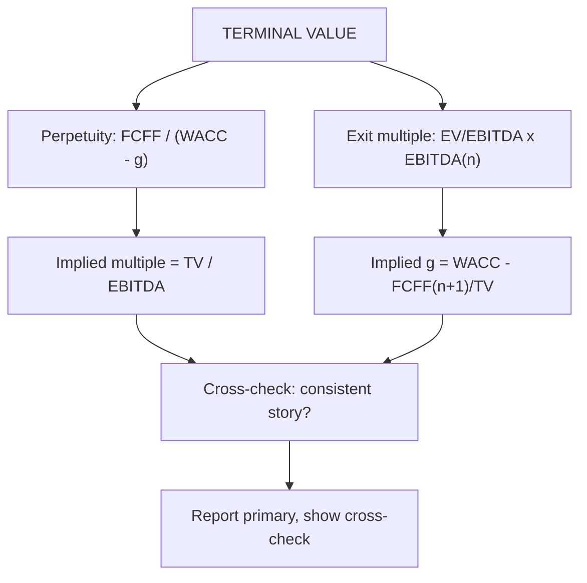

# FF-4: Exit Multiple Method and the Cross-Check with the Perpetuity Method

Covers: terminal value from an exit multiple (EV/EBITDA), choosing the multiple, converting between the two methods (implied growth and implied multiple), and how to reconcile them. **(syllabus + textbook)**

## Where this fits in the ESE

The syllabus names two terminal value methods, so a 5-mark "compare the perpetuity and exit multiple methods" is likely. In a case, the cross-check line (implied g or implied multiple) separates a full answer from a mechanical one.

## The exit multiple method

**TVₙ = Exit multiple × metricₙ**, usually **EV/EBITDA** (also EV/EBIT, EV/Sales).

- The metric is the **final explicit year's** figure (EBITDAₙ), not next year's, unless the multiple is a forward multiple.
- Take the multiple from **mature, comparable listed firms**, on the same basis (Ind AS 116 treatment, same EV definition, VF-3).
- PV of TV = TVₙ × discount factor for year n.

**Why it is dangerous:** a multiple observed today carries today's market mood and the peer's growth. Applying it in year n assumes the firm is still priced like a peer in the same stage then. If peers are high-growth today but the firm will be mature in year n, the multiple is too high.

## Cross-check 1: implied growth from an exit multiple

Holding FCFFₙ₊₁ fixed, the growth rate that the multiple implies is:
**g(implied) = WACC − FCFFₙ₊₁ ÷ TVₙ**

Holding FCFF₆ fixed understates the true implied growth slightly (faster growth would need more reinvestment and lower FCFF), so treat the result as a floor.

## Cross-check 2: implied multiple from the perpetuity method

**Implied EV/EBITDA = TVₙ(perpetuity) ÷ EBITDAₙ.**
Also, from the value driver form: **TV ÷ NOPATₙ₊₁ = (1 − g/ROIC) ÷ (WACC − g)**.

## Worked example: Nilgiri Engineering, both terminal values

Data from FF-3: PV of years 1 to 5 = 710.3; year 5 revenue 3,279; D&A is 5% of revenue and EBIT margin 16%, so EBITDA margin = 21%; WACC 12%; FCFF₆ = 275.44; DF₅ = 0.567.

**Step 1.** EBITDA₅ = 3,279 × 21% = **688.6**.
**Step 2.** Perpetuity TV₅ = 3,934.9, so implied multiple = 3,934.9 ÷ 688.6 = **5.71x**. Also TV ÷ NOPAT₆ = 3,934.9 ÷ 413.16 = 9.52x = (2/3) ÷ 0.07.
**Step 3.** Test peer multiples 5x to 8x.

| Exit multiple | TV₅ | PV of TV | EV | TV as % of EV | Implied g |
|---|---|---|---|---|---|
| 5x | 3,443.0 | 1,952.2 | 2,662.5 | 73.3% | 4.00% |
| 6x | 4,131.6 | 2,342.6 | 3,052.9 | 76.7% | 5.33% |
| 7x | 4,820.2 | 2,733.1 | 3,443.4 | 79.4% | 6.29% |
| 8x | 5,508.8 | 3,123.5 | 3,833.8 | 81.5% | 7.00% |
| *Perpetuity* | *3,934.9* | *2,231.1* | *2,941.4* | *75.9%* | *5.00%* |

(Implied g = 12% − 275.44 ÷ TV.)

**Step 4.** Interpret. Suppose mature peers trade at 7x EBITDA. At 7x the terminal value implies growth of at least 6.3% for ever, above the 5% assumed and above plausible long-run nominal growth, so 7x is not consistent with the firm's fundamentals. A multiple near **5.7x** reproduces the perpetuity answer; **6x** (implied g 5.33%) is the upper edge of the defensible range.

**Decision line:** report the enterprise value as **₹2,941 crore (perpetuity) with ₹3,053 crore (6x exit multiple) as the upper cross-check**, a range of about 4%. Explain why a 7x multiple is rejected: it would add ₹502 crore (3,443.4 − 2,941.4), all from an unsupported terminal growth rate. The rubric pays for this reconciliation.

## Which method to prefer

| | Perpetuity (Gordon) | Exit multiple |
|---|---|---|
| Basis | Fundamentals: g, ROIC, WACC | Market pricing of peers |
| Strength | Internally consistent, transparent | Quick, reflects market mood |
| Weakness | Very sensitive to g and WACC | Imports peer sentiment; circular because it assumes a price to find a price |
| Use | Primary for intrinsic value | Cross-check; primary in M&A and PE work |

Practitioners (Koller et al.) prefer the value driver formula as the main method and use multiples as a check. Banks and PE funds often present the exit multiple as the main case. In your answer, state which one you chose and why.

## Traps

1. **Using a high-growth peer multiple** for a mature terminal year.
2. **Mismatch of basis:** a post-Ind AS 116 EV/EBITDA applied to a pre-116 EBITDA (VF-3).
3. **Applying the multiple to forward EBITDA while discounting from the end of year n** without adjusting.
4. **Not testing implied g.** A 25x multiple can imply growth above WACC, a mathematical impossibility.
5. **Reporting two numbers and not choosing.** Pick one as primary and call the other the cross-check.

## What to remember

- Exit multiple TV = multiple × final-year EBITDA (EV/EBITDA); PV with the year-n factor.
- Implied g = WACC − FCFFₙ₊₁ ÷ TV (a floor); implied multiple = perpetuity TV ÷ EBITDAₙ.
- Nilgiri: perpetuity TV 3,934.9 is 5.71x EBITDA; 7x implies g of 6.29% and is rejected; 6x gives EV 3,052.9.
- The two methods must tell a consistent story; reconcile before concluding.
- Perpetuity is intrinsic, exit multiple is relative; use one as primary, the other as check.

## Concept map

## Flashcards
Q: Formula for terminal value by exit multiple?
A: TVₙ = exit multiple (usually EV/EBITDA) × final-year metric; discount with the year-n factor.

Q: How do you find the growth implied by an exit multiple?
A: g(implied) = WACC − FCFFₙ₊₁ ÷ TVₙ (a floor, holding FCFF fixed).

Q: How do you find the multiple implied by the perpetuity TV?
A: TVₙ ÷ EBITDAₙ. Nilgiri: 3,934.9 ÷ 688.6 = 5.71x.

Q: 7x EBITDA exit for Nilgiri. TV, PV, EV and implied g?
A: TV 4,820.2; PV 2,733.1; EV 3,443.4; implied g 6.29%, so reject.

Q: What does TV ÷ NOPATₙ₊₁ equal under the value driver formula?
A: (1 − g/ROIC) ÷ (WACC − g); Nilgiri: (2/3) ÷ 0.07 = 9.52x.

Q: Why is an exit multiple partly circular?
A: It uses a market price today to estimate a price in the future, importing current sentiment and peer growth.

Q: Which method is primary for intrinsic value?
A: The perpetuity (value driver) method; the exit multiple is the cross-check.

Q: A multiple implies growth above WACC. What does that mean?
A: The multiple is mathematically inconsistent with the discount rate; reject it.

## Sources
- BBA304F-6 syllabus, Unit 2 (terminal value estimation: constant growth method; exit multiple method)
- Damodaran, *Investment Valuation*, relevant chapters; Koller et al., *Valuation*, continuing value chapter
- Previous: [[Corporate Valuation Unit 2 - FF-3 Terminal Value Perpetuity Method]] · Next: [[Corporate Valuation Unit 2 - FF-5 Enterprise Value Interpretation and Limits]]
- [[Corporate Valuation Unit 2 - Enterprise DCF MOC (Node Map)]]
