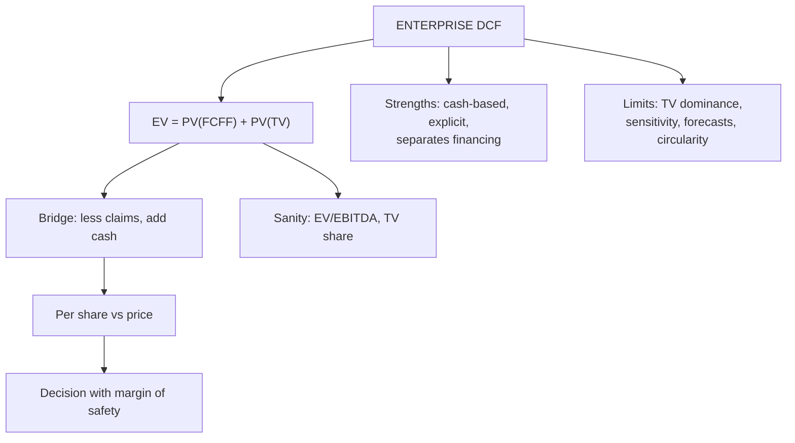

# FF-5: Estimating and Interpreting Enterprise Value, Strengths and Limits

Covers: assembling the enterprise DCF end to end, converting to a per-share value with the VF-3 bridge, reading the result, and the strengths and limitations of enterprise DCF. **(syllabus + textbook)**

## Where this fits in the ESE

This node supplies the final lines of any DCF answer: the bridge, the decision and the caveats. "Strengths and limitations of enterprise DCF" is a standard 5-mark question.

## Assembling the valuation (checklist)

1. FCFF for each explicit year (FF-2).
2. WACC and discount factors (FF-1).
3. Terminal value, consistency-checked (FF-3) and cross-checked (FF-4).
4. **EV = Σ PV(FCFF) + PV(TV).**
5. **Equity value = EV − claims + non-operating assets** (VF-3).
6. **Per share = equity ÷ diluted shares**, compared with the market price.
7. Sanity checks, sensitivity, recommendation.

## Worked example: from EV to a recommendation

Continue Nilgiri Engineering (fictional, hypothetical numbers). EV from FF-3 = ₹2,941.4 crore. Balance sheet items in ₹ crore: borrowings 450; lease liabilities 100 (FCFF is before lease payments, so leases are treated as debt, treatment A in VF-3); cash and equivalents 80 (no other non-operating assets, no minorities). Shares 50 crore; market price ₹42.

**Step 1.** Equity value = 2,941.4 − 450 − 100 + 80 = **₹2,471.4 crore**.
**Step 2.** Value per share = 2,471.4 ÷ 50 = **₹49.43**.
**Step 3.** Upside to price = (49.43 − 42) ÷ 42 = **17.7%**; margin of safety = (49.43 − 42) ÷ 49.43 = **15.0%**.
**Step 4.** Sanity check against multiples: EV ÷ current EBITDA (2,000 × 21% = 420) = **7.0x**; EV ÷ current NOPAT (2,000 × 12% = 240) = **12.3x**. Compare these with the peer range before accepting.
**Step 5.** Range: perpetuity EV 2,941.4 and the 6x exit-multiple cross-check 3,052.9 give per-share values of ₹49.43 and ₹51.66 ((3,052.9 − 470) ÷ 50).

| Line | ₹ crore |
|---|---|
| Enterprise value | 2,941.4 |
| Less borrowings | (450.0) |
| Less lease liabilities | (100.0) |
| Add cash | 80.0 |
| **Equity value** | **2,471.4** |
| Per share (50 crore shares) | ₹49.43 |
| Market price | ₹42.00 |

**Decision line:** intrinsic value of about ₹49 to ₹52 is above the ₹42 price, with a 15% margin of safety on the lower figure. Recommend **buy**, conditional on three things: terminal growth of 5% is defensible, terminal ROIC of 15% holds, and the WACC of 12% is right.

**Test the discount rate.** At WACC 13% and g 5% (exact discount factors, FF-3 grid) EV ≈ 2,560, so equity = 2,560 − 470 = 2,090 (net claims 450 + 100 − 80 = 470) and the per-share value is **₹41.80**, just below ₹42. The buy call therefore reverses if WACC is one point higher. Saying so is the interpretation the rubric pays for.

**Optional timing note (textbook).** Cash flows arrive through the year, not on the last day. The **mid-year convention** discounts each flow by half a year less, which lifts EV by a factor of (1 + WACC)^0.5 = 1.058 at 12%. Use end-of-year discounting in the exam unless told otherwise, and say which you used.

## What the number means

- **EV is the value of operations to all capital providers, not a share price.** It becomes a per-share value only after the bridge.
- **Value depends on the cash flow forecast and the discount rate**, so the conclusion is a range with a stated probability of being right, not a fact.
- **Terminal value share (75.9%)** tells you how much rests on assumptions beyond year 5.
- Compare with the **market-implied** view: what growth or WACC would the current market price need? If a modest change in inputs explains the price, the market and the analyst do not really disagree.

## Strengths of enterprise DCF

1. Based on cash and the fundamentals of the business, not accounting accruals or market mood.
2. Separates operations from financing, so firms with different capital structures are comparable.
3. Makes assumptions explicit (growth, margins, reinvestment, risk), which forces discussion.
4. Works for firms with no good comparables and for unlisted firms.
5. Flexible: scenarios and changes in strategy can be valued.

## Limitations

1. **Terminal value dominance:** 60% to 80% of value rests on distant assumptions.
2. **Input sensitivity:** one point of WACC or g can move value 5% to 17% (FF-3 grid).
3. **Forecast difficulty** for young, cyclical or loss-making firms (AD-2).
4. **Circularity:** WACC uses market-value weights that depend on the value being estimated.
5. **Not suited to financial firms**, where debt is a raw material (use equity DCF, Unit 3).
6. **False precision and bias:** a point estimate to two decimals looks exact but is not (VF-4).
7. **Does not capture options** such as the flexibility to expand or abandon, unless added separately.

## Traps

- **Giving EV as the answer** when the question asks for the value per share.
- **Subtracting lease liability twice or not at all** (VF-3).
- **Reporting a "buy" without testing the discount rate.**
- **Using the cross-check range without saying which figure is the answer.**

## What to remember

- EV = Σ PV(FCFF) + PV(TV); equity = EV − claims + non-operating assets; per share = equity ÷ diluted shares.
- Nilgiri: EV 2,941.4 → equity 2,471.4 → ₹49.43 vs ₹42, margin of safety 15.0%.
- At WACC 13% the per-share value falls to ₹41.80, below the price: always test the discount rate.
- Sanity check with EV/EBITDA (7.0x) and the terminal value share (75.9%).
- Strengths: cash-based, explicit assumptions, separates operations from financing. Limits: terminal value dominance, input sensitivity, forecasting difficulty, circularity.

## Concept map

## Flashcards
Q: Steps to a per-share value from FCFF?
A: Sum PV of FCFF and TV for EV, apply the bridge to equity value, divide by diluted shares, compare with price.

Q: Nilgiri EV 2,941.4, borrowings 450, leases 100, cash 80. Equity value?
A: 2,941.4 − 450 − 100 + 80 = ₹2,471.4 crore.

Q: Value per share on 50 crore shares and margin of safety at ₹42?
A: ₹49.43; margin of safety 15.0% (upside 17.7%).

Q: What happens if WACC is 13% instead of 12%?
A: EV about 2,560, per share about ₹41.80, below ₹42: the buy call reverses.

Q: Why is terminal value share worth reporting?
A: It shows how much of EV depends on assumptions beyond the explicit period (75.9% here).

Q: Give three strengths of enterprise DCF.
A: Cash-based fundamentals, explicit assumptions, separation of operating performance from financing.

Q: Give three limitations of enterprise DCF.
A: Terminal value dominance, sensitivity to WACC and g, difficulty forecasting young or cyclical firms; also circularity.

Q: Why is enterprise DCF unsuitable for banks?
A: Debt is raw material for banks, so FCFF and WACC are not meaningful; use dividends or FCFE at Ke.

## Sources
- BBA304F-6 syllabus, Unit 2 (estimation and interpretation of enterprise value; strengths and limitations)
- Damodaran, *Investment Valuation*, chapters on DCF valuation; the building blocks; Koller et al., *Valuation*
- Previous: [[Corporate Valuation Unit 2 - FF-4 Exit Multiple and Cross-Check]] · Next: [[Corporate Valuation Unit 2 - FF-6 Unit 2 Exam Answers]]
- [[Corporate Valuation Unit 2 - Enterprise DCF MOC (Node Map)]]
