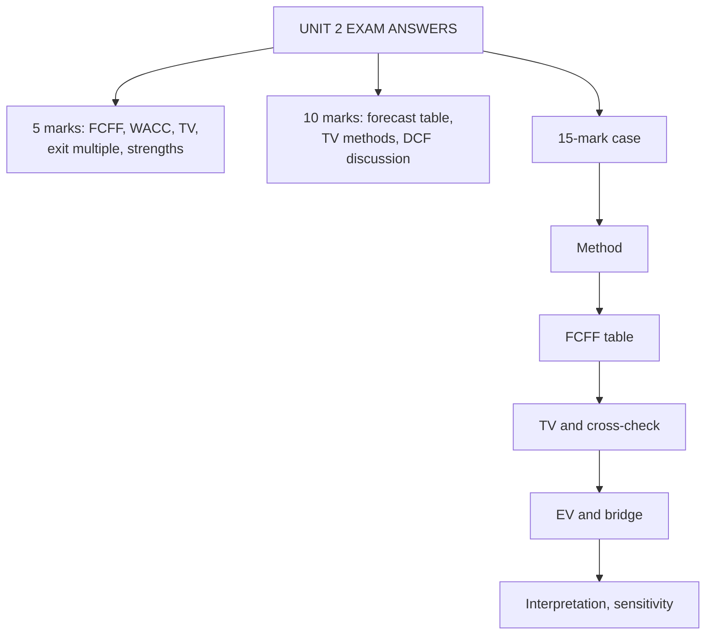

# FF-6: Unit 2 Exam Answers

Covers: what the ESE will ask from Unit 2, 5-mark and 10-mark skeletons, and a 15-mark enterprise DCF case with a model answer. Numbers come from FF-1 to FF-5.

## What the test will ask

Unit 2 carries the longest teaching time (10 hours) and is CO2 (apply DCF). Expect a 10-mark FCFF numerical in Section B and a DCF case in Section C. Confirm the Section B mark split with the faculty (the syllabus text is inconsistent). The usual failure points are: not showing the bridge, no reinvestment in the terminal year, and no interpretation.

## Five-mark answer skeletons

**1. Define FCFF and compute it (FF-1).** Formula EBIT(1 − t) + D&A − capex − ΔWC = NOPAT − reinvestment. Numerical: EBIT 240, D&A 60, capex 100, ΔWC 20, t 25% gives 120.

**2. WACC calculation (FF-1).** Formula with market weights; rupee route; E 600, D 400, Ke 14%, Kd 9%, t 25% gives 11.1%.

**3. Terminal value by the perpetuity method (FF-3).** Formula; g = ROIC × RR; reinvestment 33.3% at ROIC 15%; TV = 275.44 ÷ 0.07 = 3,934.9.

**4. Exit multiple method and cross-check (FF-4).** Formula; implied g and implied multiple; one line on why 7x was rejected.

**5. Strengths and limitations of enterprise DCF (FF-5).** Three and three, plus "terminal value is 60% to 80% of EV".

**6. Steps from FCFF to value per share (FF-5, VF-3).** Seven-step flow with the bridge.

## Ten-mark answer skeletons

**A. "Estimate enterprise value from a five-year forecast with terminal value" (FF-2, FF-3).**
1. Table: revenue, EBIT, NOPAT, reinvestment, FCFF, DF, PV (4).
2. Terminal value with consistency check g = RR × ROIC (3).
3. EV sum and interpretation: TV share, sensitivity (3).

**B. "Explain terminal value methods and their consistency" (FF-3, FF-4).**
1. Perpetuity: formula, value driver form, limits on g (4). 2. Exit multiple: formula, source, danger (3). 3. Reconcile with implied g or multiple, choose one as primary (3).

**C. "Discuss the strengths and limits of enterprise DCF, with a numerical illustration" (FF-5).**
1. Strengths (3). 2. Limits with the 75.9% terminal share and the sensitivity grid (4). 3. Numerical illustration of EV to per share (3).

## Fifteen-mark case layout

1. **Task and method (2 marks):** name FCFF at WACC and the two terminal methods.
2. **FCFF table (4 marks):** one row per year, show NOPAT − reinvestment, PV.
3. **Terminal value (3 marks):** reinvestment rate from g ÷ ROIC, TV, PV of TV; exit multiple as cross-check.
4. **EV and bridge to per share (3 marks):** every claim shown.
5. **Interpretation (3 marks):** price comparison, margin of safety, terminal share, what flips the decision.

### Model case

*Hypothetical.* Harbour Logistics Ltd (fictional). Revenue today ₹1,000 crore, growing 10% a year for 3 years. EBIT margin 12%, tax 25%, so NOPAT = 9% of revenue. Sales-to-capital 2.5 (reinvestment = ΔRevenue ÷ 2.5). WACC 11% (discount factors 0.901, 0.812, 0.731). After year 3, growth is 5% for ever with ROIC 14%. D&A is 6% of revenue, so EBITDA margin is 18%. Mature peers trade at 7x EV/EBITDA. Borrowings ₹300 crore; lease liabilities ₹50 crore (FCFF is before lease payments); cash ₹40 crore; 25 crore shares; price ₹28. **Value the equity, cross-check the terminal value and advise.**

**Model answer**

**1. Method.** Enterprise DCF: FCFF at WACC for three years plus terminal value; then the bridge, as FCFF is before lease payments and covers all capital providers.

**2. FCFF table (₹ crore).**

| Year | Revenue | EBIT | NOPAT | Reinvestment | FCFF | DF | PV |
|---|---|---|---|---|---|---|---|
| 1 | 1,100 | 132.0 | 99.0 | 40.0 | 59.0 | 0.901 | 53.2 |
| 2 | 1,210 | 145.2 | 108.9 | 44.0 | 64.9 | 0.812 | 52.7 |
| 3 | 1,331 | 159.7 | 119.8 | 48.4 | 71.4 | 0.731 | 52.2 |
| | | | | | | **Sum** | **158.1** |

**3. Terminal value (perpetuity).**
- Revenue year 4 = 1,331 × 1.05 = 1,398 (rounded); NOPAT₄ = 1,398 × 9% = 125.82.
- Reinvestment rate = g ÷ ROIC = 5% ÷ 14% = 35.7%; FCFF₄ = 125.82 × (1 − 0.357) = 125.82 × 9/14 = **80.88**.
- TV₃ = 80.88 ÷ (0.11 − 0.05) = **₹1,348.0 crore**; PV = 1,348.0 × 0.731 = **985.4**.

**Cross-check (exit multiple).** EBITDA₃ = 1,331 × 18% = 239.6. Perpetuity TV implies 1,348.0 ÷ 239.6 = **5.63x**. At the peer 7x, TV = 1,677.2, EV = 158.1 + 1,226.0 = 1,384.1, implied growth = 11% − 80.88 ÷ 1,677.2 = **6.18%**, above the 5% assumed and above plausible nominal growth. At 6x: TV 1,437.6, EV 1,209.0, implied g 5.37%.

**4. EV and bridge.**

| Line | ₹ crore |
|---|---|
| PV of FCFF years 1 to 3 | 158.1 |
| PV of terminal value | 985.4 |
| **Enterprise value** | **1,143.5** |
| Less borrowings | (300.0) |
| Less lease liabilities | (50.0) |
| Add cash | 40.0 |
| **Equity value** | **833.5** |
| Per share (25 crore shares) | **₹33.34** |

**5. Interpretation.**
- ₹33.34 vs ₹28: upside 19.1%; margin of safety (33.34 − 28) ÷ 33.34 = 16.0%. **Recommend buy.**
- Terminal value is 985.4 ÷ 1,143.5 = **86.2%** of EV, because the explicit period is only three years. Extend the forecast to five years for a firm still growing 10%.
- At WACC 12% (exact factors) EV falls to about 977 and the value per share to ₹26.70 ((977 − 310) ÷ 25), below ₹28. The buy rests on the 11% WACC; say so.
- The 7x peer multiple is rejected: it implies growth above 6% for ever. The 6x multiple gives ₹35.96 per share ((1,209.0 − 310) ÷ 25) and is the upper cross-check.
- If NOPAT had been grown without reinvestment, TV would be 125.82 ÷ 0.06 = 2,097.0, 55.6% too high.

**Interpretation line to write:** "Enterprise value ₹1,143.5 crore gives ₹33.34 a share against ₹28, a 16% margin of safety, but 86% of value is terminal, so the buy call holds only if WACC stays below about 11.8% and terminal ROIC stays at 14%."

*Note on the 11.8%:* solving 25 × ₹28 + 310 = ₹1,010 crore as the break-even EV gives a WACC of about 11.8% (exact discount factors). Without time to solve, write "below 12%".

## Self-test

- Rebuild the Harbour table from the data without looking.
- Say why the terminal-year cash flow is 80.88 and not 125.82.
- Explain in two sentences why the 7x multiple fails the cross-check.

## What to remember

- Layout: method, FCFF table, terminal value with consistency check, EV and bridge, interpretation.
- Harbour: PV of FCFF 158.1, TV 1,348.0, PV of TV 985.4, EV 1,143.5, equity 833.5, ₹33.34.
- Cross-check: implied multiple 5.63x; 7x implies g 6.18% and is rejected; 6x gives ₹35.96.
- Terminal share 86.2%; at WACC 12% the value falls to ₹26.70 below price ₹28.
- Always state the lease treatment and test the discount rate.

## Concept map

## Flashcards
Q: Harbour Logistics year 1 FCFF and PV?
A: NOPAT 99.0 − reinvestment 40.0 = 59.0; PV = 59.0 × 0.901 = 53.2.

Q: Harbour terminal-year FCFF?
A: NOPAT₄ 125.82 × (1 − 5/14) = 80.88.

Q: Harbour TV₃ and PV of TV?
A: 80.88 ÷ 0.06 = ₹1,348.0 crore; PV = 985.4.

Q: Harbour enterprise value and equity value?
A: EV 1,143.5; equity 1,143.5 − 300 − 50 + 40 = 833.5.

Q: Harbour value per share and decision?
A: ₹33.34 vs ₹28: buy, margin of safety 16.0%.

Q: Why is the 7x exit multiple rejected?
A: It implies terminal growth of 6.18%, above the assumed 5% and above long-run nominal growth.

Q: What share of Harbour EV is terminal value, and what does it tell you?
A: 86.2%; the forecast period is short, so the conclusion rests on distant assumptions.

Q: What is the first mark-earning line of a Section C DCF case?
A: Name the method (FCFF at WACC, two terminal methods) and why the bridge is needed.

## Sources
- BBA304F-6 syllabus (ESE pattern, Unit 2)
- Nodes FF-1 to FF-5 in this unit
- Previous: [[Corporate Valuation Unit 2 - FF-5 Enterprise Value Interpretation and Limits]]
- [[Corporate Valuation Unit 2 - Enterprise DCF MOC (Node Map)]]
