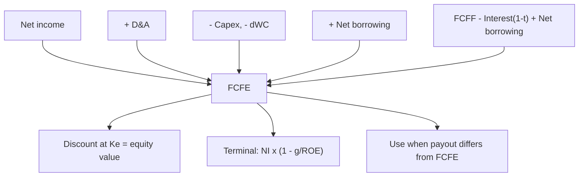

# EQ-1: Free Cash Flow to Equity (FCFE)

Covers: the definition of FCFE, the net-income route and the FCFF route, net borrowing, valuing equity directly at the cost of equity, terminal FCFE, and when FCFE beats the dividend model. **(syllabus + textbook)**

## Where this fits in the ESE

FCFE from given data is a likely 5-mark numerical, and the FCFE valuation is half of any Unit 3 case. The link to FCFF (EQ-4) is the usual 10-mark theory question.

## Definition

**FCFE is the cash left for ordinary shareholders after operating needs, reinvestment, interest and net debt repayment.** It is the amount that could be paid out as dividends. Discount it at the **cost of equity (Ke)** to get the **equity value directly**, with no bridge.

**FCFE = Net income + D&A − Capex − Δ Non-cash working capital + Net borrowing**

**Net borrowing = new debt raised − debt repaid.**

**Alternative from FCFF:** **FCFE = FCFF − Interest × (1 − t) + Net borrowing.**

**Equity reinvestment** = Capex − D&A + ΔWC − Net borrowing (the part financed from equity). **Equity reinvestment rate = Equity reinvestment ÷ Net income.** In stable growth, **g = equity reinvestment rate × ROE**, so FCFE = NI × (1 − g ÷ ROE).

## Net borrowing: the line students get wrong

- It is the **change in debt in the year**, not the interest.
- If a question says "the firm finances 30% of its net reinvestment (capex − D&A + ΔWC) with debt", then net borrowing = 0.30 × (capex − D&A + ΔWC).
- A firm repaying debt has a **negative** net borrowing and FCFE falls.
- Interest is already inside net income, so do not subtract it again.

## Worked example: FCFE from components

*Hypothetical.* A firm has net income ₹180 crore; D&A ₹60 crore; capex ₹110 crore; increase in non-cash working capital ₹20 crore; debt finances 30% of net reinvestment. Ke 14%; stable growth 5%.

**Step 1.** Net reinvestment = capex − D&A + ΔWC = 110 − 60 + 20 = **70**.
**Step 2.** Net borrowing = 0.30 × 70 = **21**.
**Step 3.** FCFE = 180 + 60 − 110 − 20 + 21 = **₹131 crore**.
**Step 4.** Check: equity reinvestment = 70 − 21 = 49; payout of FCFE = NI − equity reinvestment = 180 − 49 = 131 ✓.
**Step 5.** Value of equity with FCFE₀ = 131 growing 5%: FCFE₁ = 131 × 1.05 = 137.55; equity = 137.55 ÷ (0.14 − 0.05) = **₹1,528.3 crore**.

| Line | ₹ crore |
|---|---|
| Net income | 180 |
| Add D&A | 60 |
| Less capex | (110) |
| Less increase in working capital | (20) |
| Add net borrowing | 21 |
| **FCFE** | **131** |

**Decision line:** equity worth ₹1,528.3 crore, to be divided by the share count and compared with market capitalisation. If the firm actually paid dividends of only ₹80 crore, the DDM would give 80 × 1.05 ÷ 0.09 = ₹933.3 crore: the gap of ₹595.0 crore is the cash not paid out. Which is right depends on what the firm does with the unpaid ₹51 crore (131 − 80): if it holds it at a rate below Ke, value leaks and the DDM figure is nearer reality; if it is a genuine surplus that will be returned or reinvested at Ke, the FCFE figure holds. Say which assumption you make.

## FCFE from FCFF

*Hypothetical.* FCFF ₹300 crore, interest ₹40 crore, tax 25%, net borrowing ₹25 crore.
FCFE = 300 − 40 × 0.75 + 25 = 300 − 30 + 25 = **₹295 crore**.

## Terminal FCFE

In stable growth, use the equity form of the consistency rule:
**FCFE = NI × (1 − g ÷ ROE).**
*Example:* NI₆ = ₹200 crore, g = 5%, ROE = 15% gives equity reinvestment rate 33.3%, FCFE₆ = 200 × 2/3 = **133.3**; TV₅ = 133.3 ÷ (0.14 − 0.05) = **₹1,481.5 crore**.

Net borrowing is already built into ROE through leverage, so do not add it again here. Keep debt ratio and ROE consistent.

## When to use FCFE instead of dividends

| Situation | Use |
|---|---|
| Dividends roughly equal FCFE | DDM (simpler, EQ-2) |
| Dividends well below FCFE (cash piling up) | FCFE |
| Dividends above FCFE (financed by borrowing or issues) | FCFE |
| Control view: a buyer can change payout | FCFE |
| Financial firms | Special treatment: regulatory capital, so FCFE is dividends the capital rules allow **(textbook)** |

## Traps

1. **Subtracting interest again** from net income.
2. **Ignoring net borrowing** or adding the full debt raised without deducting repayments.
3. **Discounting FCFE at WACC** (EQ-4).
4. **Net borrowing in terminal FCFE added on top of NI(1 − g/ROE).**
5. **Treating negative FCFE as impossible.** It happens in growth; the shortfall is funded by new equity, and the PV of negative FCFE reduces value correctly.

## What to remember

- FCFE = NI + D&A − capex − ΔWC + net borrowing = FCFF − Interest(1 − t) + net borrowing.
- Discount at Ke to get equity value directly; no bridge.
- Net borrowing is the change in debt, not interest. Example: 0.30 × 70 = 21, so FCFE ₹131 crore.
- Terminal FCFE = NI × (1 − g ÷ ROE): 200 × 2/3 = 133.3, TV ₹1,481.5 crore.
- Use FCFE rather than dividends when payout differs from FCFE.

## Concept map

## Flashcards
Q: Formula for FCFE from net income?
A: NI + D&A − capex − Δ non-cash working capital + net borrowing.

Q: FCFE from FCFF?
A: FCFF − Interest × (1 − t) + net borrowing.

Q: NI 180, D&A 60, capex 110, ΔWC 20, debt funds 30% of net reinvestment. FCFE?
A: Net reinvestment 70, net borrowing 21; FCFE = 180 + 60 − 110 − 20 + 21 = ₹131 crore.

Q: FCFF 300, interest 40, t 25%, net borrowing 25. FCFE?
A: 300 − 30 + 25 = ₹295 crore.

Q: FCFE₀ 131, g 5%, Ke 14%. Equity value?
A: 131 × 1.05 ÷ 0.09 = ₹1,528.3 crore.

Q: Terminal FCFE formula and example?
A: NI × (1 − g ÷ ROE); NI 200, g 5%, ROE 15% gives 133.3; TV = 133.3 ÷ 0.09 = ₹1,481.5 crore.

Q: Which discount rate for FCFE?
A: Cost of equity, because the cash flow belongs to equity holders after debt service.

Q: When is FCFE better than the dividend model?
A: When dividends differ from FCFE, for example cash piling up, or dividends financed by borrowing.

## Sources
- BBA304F-6 syllabus, Unit 3 (free cash flow to equity)
- Damodaran, *Investment Valuation*, chapters on FCFE valuation models; Koller et al., *Valuation*, equity DCF
- Previous unit: [[Corporate Valuation Unit 2 - FF-1 Intrinsic Logic FCFF and WACC]] · Next: [[Corporate Valuation Unit 3 - EQ-2 Dividend Discount Models Zero and Constant Growth]]
- [[Corporate Valuation Unit 3 - Equity DCF MOC (Node Map)]]
