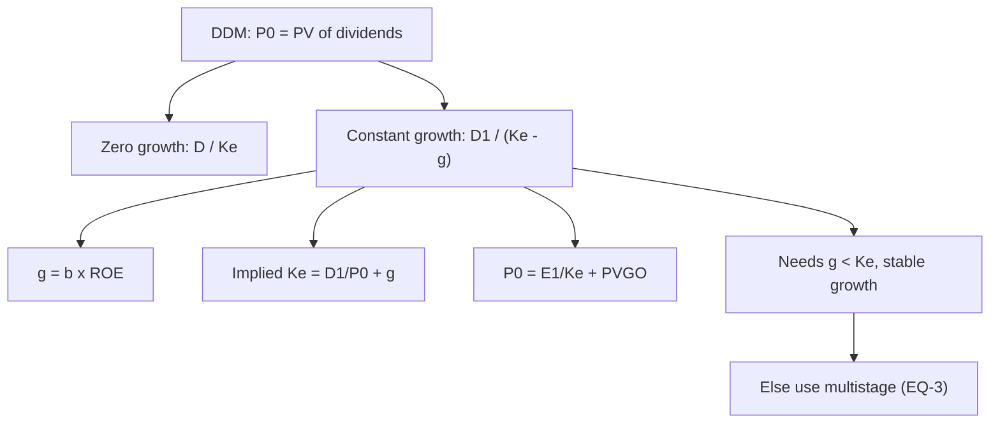

# EQ-2: Dividend Discount Models, Zero Growth and Constant Growth

Covers: the general DDM, the zero-growth model, the constant-growth (Gordon) model, sustainable growth g = retention × ROE, implied return, value of growth opportunities, and the limits of the Gordon model. **(syllabus + textbook)**

## Where this fits in the ESE

The Gordon model is a near-certain 5-mark sum (the same formula appears in SAPM, so check the notation your faculty uses for Unit 3). It is also the base for the multistage models in EQ-3.

## The general model

**P₀ = Σ Dₜ ÷ (1 + Ke)ᵗ** over all future dividends, including the price at the end of the holding period. Everything below is a special case.

## Zero-growth model

Dividend is constant for ever: **P₀ = D ÷ Ke.**
*Example:* a perpetual ₹9 dividend at Ke 12%: P₀ = 9 ÷ 0.12 = **₹75**. This is the model for preference shares and no-growth firms.

## Constant-growth (Gordon) model

**P₀ = D₁ ÷ (Ke − g) = D₀ × (1 + g) ÷ (Ke − g)**, valid when **g < Ke** and growth is stable.

Rearranged for the **implied return:** **Ke = D₁ ÷ P₀ + g.**

**Sustainable growth:** **g = Retention ratio × ROE = b × ROE.** Payout ratio = 1 − b.

## Worked example 1: Gordon

*Hypothetical.* Last dividend D₀ = ₹8. Retention 40%, ROE 15%, Ke 13%.

**Step 1.** g = 0.40 × 15% = **6%**.
**Step 2.** D₁ = 8 × 1.06 = **₹8.48** (the trap is using D₀ in the numerator).
**Step 3.** P₀ = 8.48 ÷ (0.13 − 0.06) = 8.48 ÷ 0.07 = **₹121.14**.
**Step 4.** If the market price is ₹100, implied Ke = 8.48 ÷ 100 + 6% = **14.48%**, above the required 13%, so the share offers more than required: undervalued.

| Step | Working | Result |
|---|---|---|
| Growth | 0.40 × 15% | 6% |
| Next dividend | 8 × 1.06 | ₹8.48 |
| Value | 8.48 ÷ 0.07 | ₹121.14 |
| Price | given | ₹100 |
| Margin of safety | (121.14 − 100) ÷ 121.14 | 17.5% |

**Decision line:** value ₹121.14 against ₹100: buy. The upside to price is 21.1%, margin of safety 17.5%. The conclusion is sensitive to Ke and g (grid below), so give a range.

## Sensitivity (D₀ = ₹8)

| Ke \ g | 5% | 6% | 7% |
|---|---|---|---|
| 12% | 120.00 | 141.33 | 171.20 |
| 13% | 105.00 | 121.14 | 142.67 |
| 14% | 93.33 | 106.00 | 122.29 |

At Ke 14%, g 5%, value is ₹93.33, below ₹100: the buy depends on the inputs.

## Value of growth opportunities

**P₀ = E₁ ÷ Ke + PVGO.** The first term is the value of the firm if it paid out all earnings and did not grow.
*Example:* payout 60% so EPS₀ = 8 ÷ 0.6 = 13.33, EPS₁ = 13.33 × 1.06 = 14.13. No-growth value = 14.13 ÷ 0.13 = ₹108.72. **PVGO = 121.14 − 108.72 = ₹12.42**, about 10% of price. Growth adds value here because ROE (15%) exceeds Ke (13%); if ROE equalled Ke, PVGO would be zero.

## When the Gordon model works

- Dividend-paying, stable firms with growth not above the economy.
- Payout and ROE consistent with g (g = b × ROE).
- **Fails** when g is close to or above Ke (value explodes or turns negative), when the firm pays no dividends, or when growth is temporarily high (use EQ-3).

## Traps

1. **Using D₀ for D₁.** Always grow the last dividend once.
2. **g ≥ Ke.** The formula gives a negative or infinite price; the model is invalid.
3. **g not matched to retention and ROE.** A 60% payout cannot support 10% growth at 15% ROE (0.4 × 15% = 6%).
4. **Using book value of ROE for the whole life of the firm** without a reason.
5. **Mixing "dividend today" and "dividend next year"** when the question gives D₁ directly.

## What to remember

- Zero growth: P₀ = D ÷ Ke (₹9 at 12% = ₹75).
- Gordon: P₀ = D₀(1 + g) ÷ (Ke − g); D₀ ₹8, g 6%, Ke 13% gives ₹121.14.
- g = b × ROE; implied Ke = D₁ ÷ P₀ + g (14.48% at ₹100).
- P₀ = E₁ ÷ Ke + PVGO; PVGO ₹12.42 here, positive because ROE > Ke.
- Valid only for g < Ke and stable growth; give a range because the result is very sensitive.

## Concept map

## Flashcards
Q: Zero-growth DDM formula?
A: P₀ = D ÷ Ke.

Q: Gordon model formula?
A: P₀ = D₁ ÷ (Ke − g) = D₀(1 + g) ÷ (Ke − g), with g < Ke.

Q: Sustainable growth rate?
A: g = retention ratio × ROE.

Q: D₀ ₹8, retention 40%, ROE 15%, Ke 13%. Value?
A: g 6%, D₁ 8.48, P₀ = 8.48 ÷ 0.07 = ₹121.14.

Q: Price ₹100, D₁ ₹8.48, g 6%. Implied return?
A: 8.48 ÷ 100 + 6% = 14.48%.

Q: A perpetual ₹9 dividend at Ke 12%. Value?
A: ₹75.

Q: What is PVGO and how large in the example?
A: Value of growth opportunities = P₀ − E₁ ÷ Ke = 121.14 − 108.72 = ₹12.42.

Q: When does PVGO equal zero?
A: When the return on new investment (ROE) equals Ke.

Q: Why does Gordon fail when g ≥ Ke?
A: The denominator becomes zero or negative; the growth assumption cannot hold for ever.

## Sources
- BBA304F-6 syllabus, Unit 3 (dividend discount models: zero-growth and constant growth)
- Damodaran, *Investment Valuation*, chapters on dividend discount models; Gordon (1962)
- Previous: [[Corporate Valuation Unit 3 - EQ-1 Free Cash Flow to Equity]] · Next: [[Corporate Valuation Unit 3 - EQ-3 Multistage DDM and Transition Years]]
- [[Corporate Valuation Unit 3 - Equity DCF MOC (Node Map)]]
