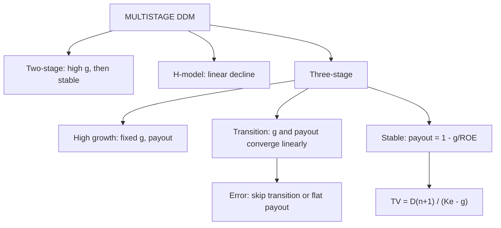

# EQ-3: Multistage Dividend Discount Models and the Transition Step

Covers: the two-stage model, the three-stage model with a transition period (the step students skip), the H-model shortcut, and the errors that distort multistage values. **(syllabus + textbook)**

## Where this fits in the ESE

Multistage DDM is a Section B numerical, and the three-stage layout is the extra-marks answer. The common loss of marks is in the transition years: payout and growth must **both** move to their stable values.

## When to use which model

| Model | Use when | Phases |
|---|---|---|
| Gordon (EQ-2) | Stable growth now | One |
| **Two-stage** | High growth for n years, then abrupt drop to stable growth | Two |
| **H-model** | Growth declines linearly from high to stable | Two, approximated |
| **Three-stage** | High growth, a transition period of declining growth, then stable | Three |

## Two-stage model

**P₀ = Σ (t = 1 to n) Dₜ ÷ (1 + Ke)ᵗ + [D(n+1) ÷ (Ke − g_stable)] ÷ (1 + Ke)ⁿ**

### Worked example 1: two-stage

*Hypothetical.* D₀ = ₹4. Dividends grow 20% for 3 years, then 7% for ever. Ke 13%. Discount factors: 0.885, 0.783, 0.693.

**Step 1.** Dividends: D₁ = 4 × 1.20 = 4.80; D₂ = 5.76; D₃ = 6.91 (6.912).
**Step 2.** PV of dividends: 4.80 × 0.885 = 4.25; 5.76 × 0.783 = 4.51; 6.91 × 0.693 = 4.79. Sum = **13.55**.
**Step 3.** D₄ = 6.912 × 1.07 = 7.40.
**Step 4.** TV₃ = 7.40 ÷ (0.13 − 0.07) = **123.33**; PV = 123.33 × 0.693 = **85.47**.
**Step 5.** P₀ = 13.55 + 85.47 = **₹99.02**.

| Year | Dividend | DF at 13% | PV |
|---|---|---|---|
| 1 | 4.80 | 0.885 | 4.25 |
| 2 | 5.76 | 0.783 | 4.51 |
| 3 | 6.91 | 0.693 | 4.79 |
| TV at year 3 | 123.33 | 0.693 | 85.47 |
| **Value** | | | **99.02** |

**Decision line:** at a market price of ₹90 the margin of safety is (99.02 − 90) ÷ 99.02 = 9.1%: modest buy. Terminal value is 86% of the answer (85.47 ÷ 99.02), so the 7% stable growth carries the result.

## Three-stage model: the transition step

*The transition period is where growth and payout both converge.* Four moves:

1. **Growth** falls **linearly** from the high rate to the stable rate over the transition years.
   Step = (g_high − g_stable) ÷ number of transition years.
2. **Payout** rises **linearly** from the high-growth payout to the **stable payout = 1 − g_stable ÷ ROE_stable** over the same years.
3. EPS grows at each year's g; DPS = EPS × that year's payout.
4. At the end of transition, g equals the stable rate, and TV uses the stable payout.

(Many textbooks also let beta, and so Ke, fall during transition. Use that only if the question gives it.)

### Worked example 2: three-stage

*Hypothetical.* EPS₀ = ₹10. Ke 13% throughout.
- **High growth, years 1 to 3:** growth 20%, payout 30%.
- **Transition, years 4 to 7:** growth falls from 20% to 6%; payout rises from 30% to the stable payout.
- **Stable, from year 8:** growth 6%, ROE 15%.

**Step 1.** Stable payout = 1 − 6% ÷ 15% = **60%**.
**Step 2.** Growth step = (20 − 6) ÷ 4 = 3.5 points: year 4 = 16.5%, year 5 = 13.0%, year 6 = 9.5%, year 7 = 6.0%.
**Step 3.** Payout step = (60 − 30) ÷ 4 = 7.5 points: 37.5%, 45.0%, 52.5%, 60.0%.
**Step 4.** Build EPS, DPS, PV (discount factors to 3 decimals).

| Year | Growth | EPS | Payout | DPS | DF at 13% | PV |
|---|---|---|---|---|---|---|
| 1 | 20% | 12.00 | 30% | 3.60 | 0.885 | 3.19 |
| 2 | 20% | 14.40 | 30% | 4.32 | 0.783 | 3.38 |
| 3 | 20% | 17.28 | 30% | 5.18 | 0.693 | 3.59 |
| 4 | 16.5% | 20.13 | 37.5% | 7.55 | 0.613 | 4.63 |
| 5 | 13.0% | 22.75 | 45.0% | 10.24 | 0.543 | 5.56 |
| 6 | 9.5% | 24.91 | 52.5% | 13.08 | 0.480 | 6.28 |
| 7 | 6.0% | 26.40 | 60.0% | 15.84 | 0.425 | 6.73 |
| | | | | | **Sum of PV** | **33.36** |

**Step 5.** Year 8 (stable): EPS₈ = 26.40 × 1.06 = 27.98; DPS₈ = 27.98 × 60% = **16.79**.
**Step 6.** TV₇ = 16.79 ÷ (0.13 − 0.06) = **239.86**; PV = 239.86 × 0.425 = **101.94**.
**Step 7.** P₀ = 33.36 + 101.94 = **₹135.30**.

**Decision line:** intrinsic value is ₹135.30. Terminal value is 75.3% of it (101.94 ÷ 135.30). If the market price is ₹120, the margin of safety is (135.30 − 120) ÷ 135.30 = 11.3%.

*(Using EPS and DPS rounded to 2 decimals at each step; recomputing from unrounded EPS changes the answer by under ₹0.10. Consistency check: high-growth ROE implied by 20% growth and 70% retention is 28.6%, which is why the high-growth stage must be time-limited.)*

### What the transition step is worth (error checks on the same data)

| What you do | P₀ | Error vs ₹135.30 |
|---|---|---|
| Correct three-stage | 135.30 | none |
| Keep payout at 30% in the stable stage | 84.30 | −37.7%: stable growth of 6% at ROE 15% needs only 40% retention, so the retained cash is wasted |
| Drop growth from 20% to 6% at year 4 with no transition (payout 60%) | 118.96 | −12.1%: understates the extra years of above-stable growth |

(Computation of the second row: DPS₈ = 27.98 × 30% = 8.39; TV₇ = 8.39 ÷ 0.07 = 119.86; PV 119.86 × 0.425 = 50.94; P₀ = 33.36 + 50.94 = 84.30. Third row: E₄ = 17.28 × 1.06 = 18.32; D₄ = 18.32 × 60% = 10.99; TV₃ = 10.99 ÷ 0.07 = 157.00; PV = 157.00 × 0.693 = 108.80; first three PVs = 3.19 + 3.38 + 3.59 = 10.16; P₀ = 118.96.)

## H-model

When growth declines linearly from g_S (short-term) to g_L (long-term) over 2H years:
**P₀ = D₀(1 + g_L) ÷ (Ke − g_L) + D₀ × H × (g_S − g_L) ÷ (Ke − g_L)**
The first term is the value at stable growth; the second is the premium for the extra growth in the transition. It is an approximation and assumes a constant payout.

*Example:* D₀ = ₹5, g_S 12%, g_L 6%, Ke 13%, decline over 6 years (H = 3).
- First term = 5 × 1.06 ÷ 0.07 = **75.71**.
- Second term = 5 × 3 × 0.06 ÷ 0.07 = **12.86**.
- P₀ = **₹88.57**.

## Traps

1. **Skipping the transition** or keeping payout flat in the stable stage (error table above).
2. **Using the high-growth dividend growth rate in the terminal value.**
3. **Terminal growth above the economy's or ≥ Ke.**
4. **Using the wrong discount factor for TV:** the TV at the end of year 7 uses the year-7 factor.
5. **Ending the transition at the wrong growth rate:** the last transition year's growth should equal stable growth.
6. **Dividends of high-growth firms ignoring FCFE.** If payout is far below FCFE, switch to FCFE (EQ-1).

## What to remember

- Two-stage: PV of dividends in the high-growth phase plus discounted TV. Example: ₹99.02.
- Three-stage: growth and payout both change linearly through the transition; stable payout = 1 − g ÷ ROE.
- Worked three-stage: PV of dividends 33.36, TV₇ 239.86, PV of TV 101.94, P₀ ₹135.30.
- Skipping the transition or leaving payout at 30% undervalues by 12% to 38%.
- H-model: D₀(1 + g_L)/(Ke − g_L) + D₀H(g_S − g_L)/(Ke − g_L) = ₹88.57 for the example.

## Concept map

## Flashcards
Q: Two-stage DDM structure?
A: PV of dividends in the high-growth years plus PV of terminal value D(n+1) ÷ (Ke − g_stable).

Q: D₀ ₹4, 20% for 3 years, then 7%, Ke 13%. Value?
A: PV of dividends 13.55, TV₃ 123.33 (PV 85.47); P₀ = ₹99.02.

Q: What changes in the transition years of a three-stage model?
A: Both growth and payout move linearly from high-growth values to stable values.

Q: Formula for stable payout?
A: Payout = 1 − g_stable ÷ ROE_stable.

Q: Stable g 6%, ROE 15%. Payout?
A: 1 − 0.06 ÷ 0.15 = 60%.

Q: Growth falls from 20% to 6% over 4 transition years. Annual step?
A: 3.5 points: 16.5%, 13.0%, 9.5%, 6.0%.

Q: In the worked three-stage example, what are TV₇ and P₀?
A: TV₇ = 16.79 ÷ 0.07 = 239.86 (PV 101.94); P₀ = 33.36 + 101.94 = ₹135.30.

Q: What if payout stays at 30% in the stable stage?
A: P₀ falls to ₹84.30, 37.7% too low, because retained cash earns nothing in the model.

Q: H-model formula?
A: D₀(1 + g_L) ÷ (Ke − g_L) + D₀ × H × (g_S − g_L) ÷ (Ke − g_L), H = half the transition length.

Q: D₀ ₹5, g_S 12%, g_L 6%, Ke 13%, H = 3. P₀?
A: 75.71 + 12.86 = ₹88.57.

## Sources
- BBA304F-6 syllabus, Unit 3 (multi-stage growth models)
- Damodaran, *Investment Valuation*, chapters on two-stage, H-model, three-stage models
- Previous: [[Corporate Valuation Unit 3 - EQ-2 Dividend Discount Models Zero and Constant Growth]] · Next: [[Corporate Valuation Unit 3 - EQ-4 Equity versus Firm Valuation and Common Errors]]
- [[Corporate Valuation Unit 3 - Equity DCF MOC (Node Map)]]
