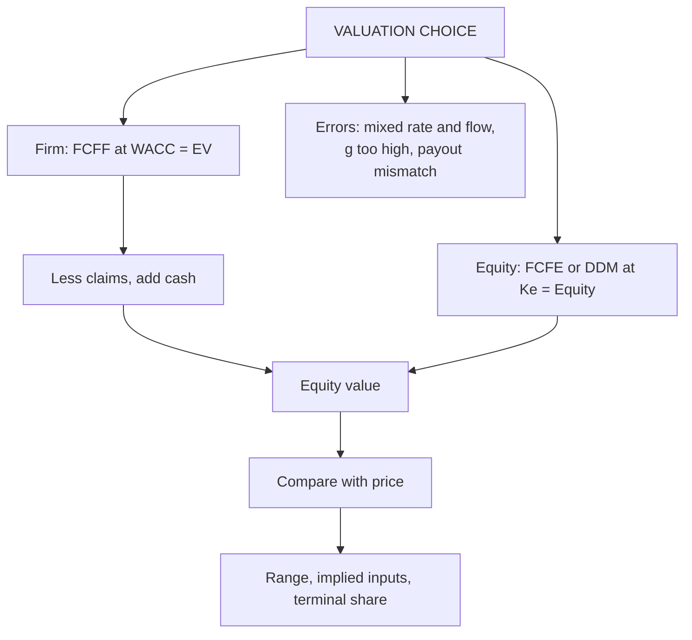

# EQ-4: Equity Valuation versus Firm Valuation, Interpretation and Common Errors

Covers: how FCFF and FCFE valuations reconcile, why they give different answers in practice, how to read an equity valuation result, and the common assumptions and errors the syllabus lists. **(syllabus + textbook)**

## Where this fits in the ESE

"Distinguish equity valuation from firm valuation" is a standard 5-mark or 10-mark theory question; a reconciliation numeric makes it a full answer. "Common errors" is easy marks if you list with consequences.

## Equity valuation versus firm valuation

| | Firm (enterprise) valuation | Equity valuation |
|---|---|---|
| Cash flow | FCFF (before debt service) | FCFE or dividends (after debt service) |
| Discount rate | WACC | Ke |
| Output | Enterprise value; subtract claims to get equity (VF-3) | Equity value directly |
| Debt handled in | WACC and the bridge | Net borrowing in the cash flow and in Ke |
| Best for | Stable or changing leverage, comparing firms, M&A | Financial firms, direct investor view, stable leverage |
| Main risk | Wrong bridge items, wrong WACC | Wrong net borrowing, Ke inconsistent with leverage |

**Rule of consistency:** the cash flow, the discount rate and the claim being valued must match: **FCFF with WACC gives EV; FCFE or dividends with Ke give equity.**

## Worked example 1: the two routes reconcile

*Hypothetical.* A firm has next-year FCFF of ₹84 crore, growing 5% for ever. Debt is kept at 25% of firm value. Ke 14%; pre-tax Kd 8%; tax 25%.

**Firm route.**
**Step 1.** WACC = 0.75 × 14% + 0.25 × 8% × 0.75 = 10.5% + 1.5% = **12.0%**.
**Step 2.** EV = 84 ÷ (0.12 − 0.05) = **₹1,200 crore**.
**Step 3.** Debt = 25% × 1,200 = 300; equity = 1,200 − 300 = **900**.

**Equity route.**
**Step 4.** Interest after tax = 300 × 8% × 0.75 = **18**.
**Step 5.** Net borrowing = debt grows 5% (to keep 25% of a growing value) = 300 × 5% = **15**.
**Step 6.** FCFE₁ = 84 − 18 + 15 = **81**.
**Step 7.** Equity = 81 ÷ (0.14 − 0.05) = **₹900 crore**. ✓

| Route | Cash flow | Rate | Value | Less debt | Equity |
|---|---|---|---|---|---|
| Firm | 84 | 12.0% | 1,200 | (300) | **900** |
| Equity | 81 | 14.0% | 900 | n/a | **900** |

**Decision line:** both routes give ₹900 crore only because the same capital structure, growth and costs are used in each. Interpretation: if your two answers differ, one input is inconsistent: usually the debt ratio, the net borrowing or the cost of equity.

## Why the two routes differ in practice

1. **Different leverage assumptions:** FCFF/WACC uses a target ratio; FCFE uses actual debt flows.
2. **Ke inconsistent with the debt ratio** (beta not relevered; AV-1).
3. **Terminal assumptions differ:** reinvestment in terminal FCFE depends on ROE, not ROIC.
4. **Cash treatment:** FCFF excludes cash, FCFE (from net income) includes interest on cash.
5. **Debt repaid in the forecast** changes net borrowing but not WACC weights.

## Error cost: mixing rate and cash flow (same firm)

| Mistake | Calculation | Value | Error |
|---|---|---|---|
| FCFE at WACC | 81 ÷ 0.07 | 1,157.1 | +28.6% on equity 900 |
| FCFF at Ke, then less debt | 84 ÷ 0.09 = 933.3; − 300 | 633.3 | −29.6% on equity 900 |
| Correct | 81 ÷ 0.09 | 900 | 0 |

## Interpreting an equity valuation outcome

1. **Compare value per share with price.** V > P buy; V < P sell; V ≈ P hold. Margin of safety = (V − P) ÷ V.
2. **Report a range** (sensitivity on Ke, g, payout) and what would flip the decision.
3. **Ask what the market price implies:** solve for the growth or Ke that makes value equal price (EQ-2 implied return).
4. **Check the share of value in the terminal stage.** Above 75% means the call rests on assumptions beyond the explicit period.
5. **Cross-check** with a second method (multiples, EV bridge) and explain any gap.
6. **State the horizon and conditions:** a valuation is as of a date, with assumptions that can change.

## Common assumptions and errors (syllabus list)

| Error | Effect | Fix |
|---|---|---|
| Growth rate above the economy or ≥ Ke | Value explodes | Cap g; g < Ke |
| Payout inconsistent with growth (payout 80% and 10% growth at 15% ROE) | Overstates value | g = (1 − payout) × ROE |
| Using D₀ instead of D₁ | Understates by one year of growth | Grow the dividend once |
| FCFE at WACC or FCFF at Ke | ±30% as above | Match cash flow, rate and claim |
| Ignoring net borrowing in FCFE | Wrong cash flow | Add change in debt |
| Book values in the weights or ROE | Wrong cost of capital | Use market-value weights |
| Constant Ke when leverage or risk changes in the forecast | Mis-pricing | Relever beta each stage |
| Adding cash and also using income that includes its interest | Double count | One treatment |
| Ignoring dilution (ESOPs, convertibles) | Overstates per-share value | Use diluted shares |
| Single point estimate | False precision | Show a range |

## What to remember

- Firm valuation: FCFF at WACC gives EV, then subtract claims. Equity valuation: FCFE or dividends at Ke gives equity directly.
- Consistency example: FCFF 84 at 12% = 1,200; less debt 300 = 900; FCFE 81 at 14% = 900.
- FCFE at WACC overstates by 28.6%; FCFF at Ke less debt understates by 29.6%.
- Interpret with price comparison, a range, market-implied inputs and the terminal share.
- Biggest errors: g above the economy, payout not matched to growth, wrong discount rate.

## Concept map

## Flashcards
Q: Which discount rate goes with FCFF, and which with FCFE?
A: FCFF with WACC (gives enterprise value); FCFE with cost of equity (gives equity value).

Q: FCFF 84, growth 5%, WACC 12%. EV and equity with debt 300?
A: EV = 84 ÷ 0.07 = 1,200; equity 900.

Q: FCFE for the same firm, and its equity value?
A: FCFE = 84 − 18 + 15 = 81; equity = 81 ÷ 0.09 = 900.

Q: What if FCFE is discounted at WACC?
A: 81 ÷ 0.07 = 1,157.1, 28.6% too high.

Q: What if FCFF is discounted at Ke and debt is then subtracted?
A: 84 ÷ 0.09 − 300 = 633.3, 29.6% too low.

Q: Why might FCFF and FCFE routes give different equity values?
A: Inconsistent leverage, Ke not relevered, different terminal reinvestment, or cash treatment.

Q: Give three common errors in equity valuation.
A: Growth above the economy or ≥ Ke; payout not matched to growth; mixing cash flow and discount rate.

Q: How do you interpret an equity valuation result?
A: Compare with price, give a range, find the market-implied growth or Ke, check terminal share, cross-check with another method.

## Sources
- BBA304F-6 syllabus, Unit 3 (equity valuation vs firm valuation; interpretation; common assumptions and errors)
- Damodaran, *Investment Valuation*, chapters on FCFE and firm valuation; consistency; Koller et al., *Valuation*
- Previous: [[Corporate Valuation Unit 3 - EQ-3 Multistage DDM and Transition Years]] · Next: [[Corporate Valuation Unit 3 - EQ-5 Unit 3 Exam Answers]]
- [[Corporate Valuation Unit 3 - Equity DCF MOC (Node Map)]]
