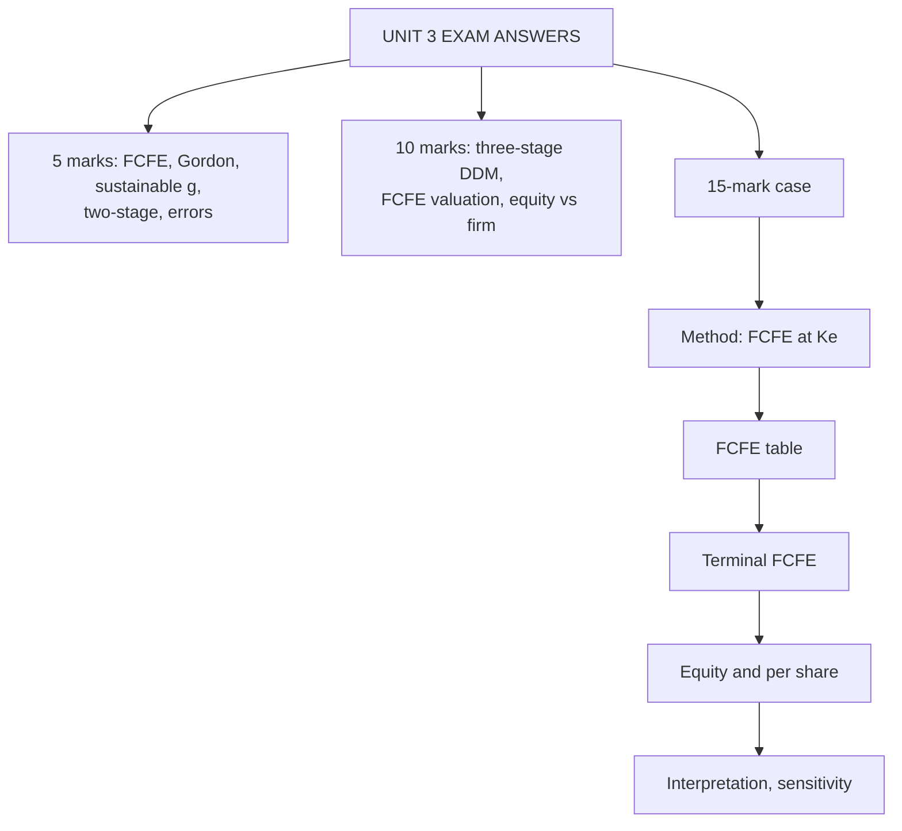

# EQ-5: Unit 3 Exam Answers

Covers: what the ESE will ask from Unit 3, 5-mark and 10-mark skeletons, and a 15-mark equity DCF case with a model answer. Numbers come from EQ-1 to EQ-4.

## What the test will ask

Unit 3 is a high-numerical unit: FCFE, Gordon and multistage DDM. Section A likely has one 5-mark FCFE or Gordon sum; Section B a two-stage or three-stage DDM or a FCFE valuation; the case may be an equity DCF with a recommendation. Confirm the Section B mark split with the faculty (syllabus text is inconsistent).

## Five-mark answer skeletons

**1. FCFE computation (EQ-1).** Formula, net borrowing, numbers: NI 180, D&A 60, capex 110, ΔWC 20, net borrowing 21 gives ₹131 crore.

**2. Zero and constant-growth DDM (EQ-2).** Both formulas; D₀ ₹8, g 6%, Ke 13% gives ₹121.14; note D₁.

**3. Sustainable growth and implied return (EQ-2).** g = b × ROE; Ke = D₁ ÷ P₀ + g (14.48%).

**4. Two-stage DDM (EQ-3).** Layout: dividends, PVs, TV, sum. D₀ ₹4, 20% for 3 years then 7% at Ke 13% gives ₹99.02.

**5. Equity valuation versus firm valuation (EQ-4).** Table of cash flow, rate and output; consistency rule; the 900 reconciliation.

**6. Common errors in equity valuation (EQ-4).** Five errors with effects: FCFE at WACC overstates by 28.6%.

## Ten-mark answer skeletons

**A. "Value a share with a three-stage DDM" (EQ-3).**
1. Fix stages and the stable payout = 1 − g ÷ ROE (2).
2. Growth and payout paths through the transition (2).
3. Table: EPS, DPS, DF, PV (3).
4. TV, P₀ and interpretation (3).

**B. "Explain FCFE and value a firm using it" (EQ-1).**
1. Definition and both formulas (3). 2. Numerical FCFE with net borrowing (3). 3. Terminal FCFE = NI(1 − g/ROE) and equity value (2). 4. When FCFE beats DDM (2).

**C. "Compare equity and firm valuation and discuss errors" (EQ-4).**
1. Table of differences (3). 2. Reconciliation numerical (4). 3. Errors and fixes (3).

## Fifteen-mark case layout

1. **Method (2 marks):** FCFE at Ke gives equity directly; why not FCFF (no bridge needed, leverage stable).
2. **FCFE table (4 marks):** each year's components and net borrowing; PV at Ke.
3. **Terminal value (3 marks):** NI × (1 − g ÷ ROE), TV, PV.
4. **Equity value and per share (2 marks).**
5. **Interpretation (4 marks):** price comparison, margin of safety, sensitivity on Ke, terminal share, DDM or other cross-check.

### Model case

*Hypothetical.* Coastal Pharma Ltd (fictional). Forecast in ₹ crore:

| | Year 1 | Year 2 | Year 3 |
|---|---|---|---|
| Net income | 200 | 230 | 260 |
| D&A | 50 | 55 | 60 |
| Capex | 90 | 100 | 110 |
| Increase in working capital | 15 | 18 | 20 |
| Net borrowing | 25 | 28 | 30 |

After year 3, net income grows 6% for ever; ROE is 16%. Ke is 14% (discount factors 0.877, 0.769, 0.675). 25 crore shares; market price ₹66. Dividends paid are only about 30% of net income. **Value the equity, comment on the dividend policy and advise.**

**Model answer**

**1. Method.** FCFE at Ke. The firm's debt moves with its investment (positive net borrowing each year) and dividends are far below FCFE, so FCFE is a better cash flow than dividends.

**2. FCFE table.**

| Year | NI | + D&A | − Capex | − ΔWC | + Net borrowing | FCFE | DF | PV |
|---|---|---|---|---|---|---|---|---|
| 1 | 200 | 50 | 90 | 15 | 25 | 170 | 0.877 | 149.1 |
| 2 | 230 | 55 | 100 | 18 | 28 | 195 | 0.769 | 150.0 |
| 3 | 260 | 60 | 110 | 20 | 30 | 220 | 0.675 | 148.5 |
| | | | | | | | **Sum** | **447.6** |

(Year 1: 200 + 50 − 90 − 15 + 25 = 170; year 2: 230 + 55 − 100 − 18 + 28 = 195; year 3: 260 + 60 − 110 − 20 + 30 = 220.)

**3. Terminal value.**
- NI₄ = 260 × 1.06 = 275.6.
- Equity reinvestment rate = g ÷ ROE = 6% ÷ 16% = 37.5%; FCFE₄ = 275.6 × 0.625 = **172.25**.
- TV₃ = 172.25 ÷ (0.14 − 0.06) = **₹2,153.1 crore**; PV = 2,153.1 × 0.675 = **1,453.3**.

**4. Equity value and per share.** 447.6 + 1,453.3 = **₹1,900.9 crore**; per share = 1,900.9 ÷ 25 = **₹76.04**.

**5. Interpretation.**
- ₹76.04 vs ₹66: upside 15.2%; margin of safety (76.04 − 66) ÷ 76.04 = **13.2%**. **Recommend buy.**
- Terminal value is 1,453.3 ÷ 1,900.9 = **76.5%** of value, so the call rests on 6% growth and 16% ROE after year 3.
- Sensitivity (exact discount factors): at Ke 15% the value is ₹67.93, still just above ₹66; at 16% it is ₹61.44, below. The break-even Ke is about 15.3%. Recommend buying only if Ke is believed to be under 15.3%.
- Dividend policy: dividends at about 30% of NI (roughly ₹60 crore in year 1) are far below FCFE of ₹170 crore. A DDM on actual dividends would understate value unless the retained cash earns Ke; the firm should explain whether the surplus is for expansion or will be returned (buy-back or higher dividends).

**Interpretation line to write:** "Equity worth ₹1,900.9 crore, ₹76.04 per share against ₹66, a 13% margin of safety; but 77% of value is terminal and the buy flips if Ke exceeds about 15.3%."

## Self-test

- Compute FCFE for year 2 from components without looking.
- Why is terminal FCFE NI × (1 − g/ROE) and not NI plus net borrowing minus reinvestment?
- Where would a mistaken WACC-for-Ke swap show up in this case?

## What to remember

- Case layout: method, FCFE table, terminal FCFE, equity and per share, interpretation with sensitivity.
- Coastal Pharma: FCFE 170, 195, 220; PV sum 447.6; TV 2,153.1; PV of TV 1,453.3; equity 1,900.9; ₹76.04.
- Margin of safety 13.2%; terminal share 76.5%; break-even Ke about 15.3%.
- For multistage DDM, show growth and payout paths in the transition.
- Name the consistency rule (rate matches cash flow) and avoid the ±30% error.

## Concept map

## Flashcards
Q: Coastal Pharma FCFE for years 1, 2, 3?
A: 170, 195 and 220 (₹ crore).

Q: Coastal terminal FCFE and TV?
A: FCFE₄ = 275.6 × 0.625 = 172.25; TV₃ = 172.25 ÷ 0.08 = ₹2,153.1 crore.

Q: Coastal equity value and value per share?
A: 447.6 + 1,453.3 = ₹1,900.9 crore; ₹76.04 on 25 crore shares.

Q: Decision at price ₹66?
A: Buy: upside 15.2%, margin of safety 13.2%, subject to Ke below about 15.3%.

Q: Why use FCFE instead of dividends for Coastal?
A: Dividends are only about 30% of net income, far below FCFE, so a DDM would understate value.

Q: How is terminal reinvestment set in an equity DCF?
A: Equity reinvestment rate = g ÷ ROE, so FCFE = NI × (1 − g ÷ ROE).

Q: How much of Coastal's value is terminal?
A: 76.5%; the call depends on 6% growth and 16% ROE after year 3.

Q: What is the first mark-earning line of a Unit 3 case?
A: State the method (FCFE at Ke or DDM) and why it fits the firm's leverage and payout.

## Sources
- BBA304F-6 syllabus (ESE pattern, Unit 3)
- Nodes EQ-1 to EQ-4 in this unit
- Previous: [[Corporate Valuation Unit 3 - EQ-4 Equity versus Firm Valuation and Common Errors]]
- [[Corporate Valuation Unit 3 - Equity DCF MOC (Node Map)]]
