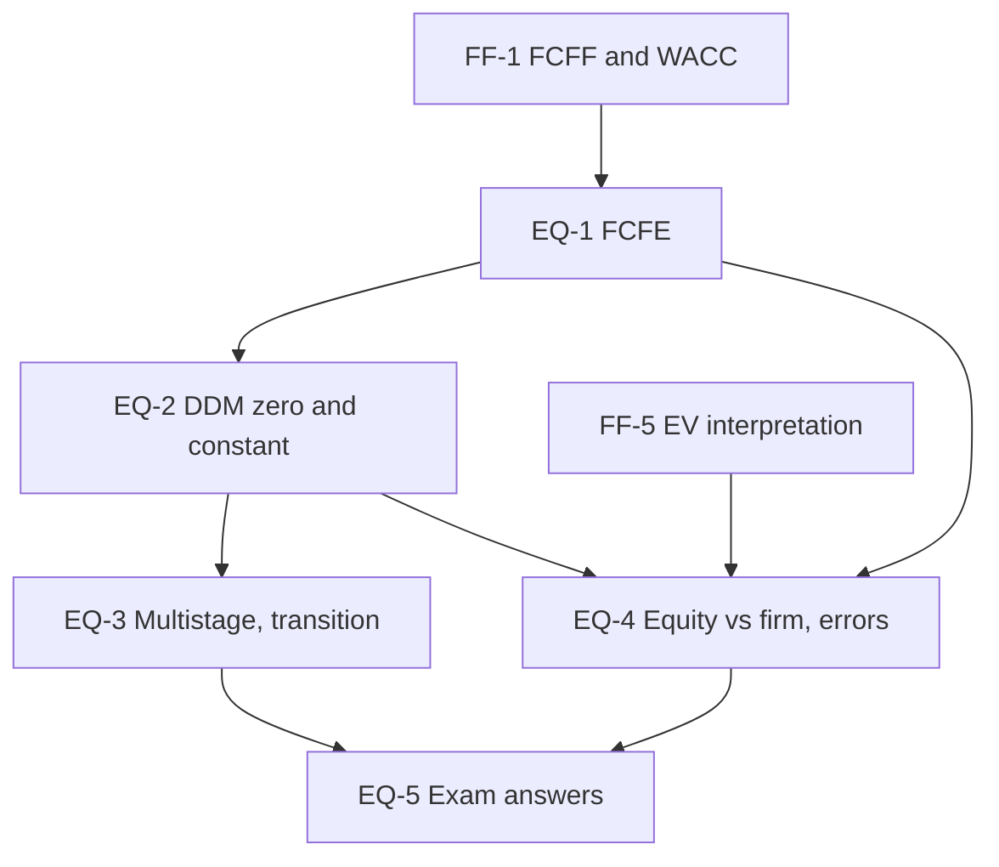

# Corporate Valuation Unit 3: Equity DCF Models, node map

ESE: 50 marks; Section A 3 × 5, Section B 2 × 10 (assumed), Section C one 15-mark case. Unit 3 is CO2 (apply DCF) with a heavy numerical load: FCFE, Gordon and multistage DDM with a transition period. All examples are **hypothetical numbers** (Coastal Pharma is fictional). No faculty slides yet, so content is labelled (syllabus) or (textbook).

## Nodes

| Node | Topic | Deps | Minutes | Exam focus |
|---|---|---|---|---|
| EQ-1 | Free Cash Flow to Equity | FF-1 | 30 | yes |
| EQ-2 | DDM: Zero and Constant Growth | EQ-1 | 30 | yes |
| EQ-3 | Multistage DDM and Transition Years | EQ-2 | 45 | yes |
| EQ-4 | Equity vs Firm Valuation and Common Errors | EQ-1, EQ-2, FF-5 | 30 | yes |
| EQ-5 | Unit 3 Exam Answers | EQ-1 to EQ-4 | 35 | yes |

Total reading time: about 170 minutes.

## Dependency graph

## Headline numbers to know

- FCFE 180 + 60 − 110 − 20 + 21 = ₹131 crore; equity ₹1,528.3 crore at Ke 14%, g 5%. FCFE from FCFF: 295. Terminal FCFE 133.3, TV 1,481.5.
- Gordon: D₀ ₹8, g 6%, Ke 13% gives ₹121.14; implied Ke 14.48% at ₹100; PVGO ₹12.42. Zero growth ₹9 at 12% = ₹75.
- Two-stage: ₹99.02. Three-stage: PV of dividends 33.36, TV 239.86, PV of TV 101.94, P₀ ₹135.30. Errors: ₹84.30 (flat payout), ₹118.96 (no transition). H-model ₹88.57.
- Reconciliation: EV 1,200, equity 900 by both routes; FCFE at WACC 1,157.1 (+28.6%); FCFF at Ke 633.3 (−29.6%).
- Coastal case: equity ₹1,900.9 crore, ₹76.04 vs ₹66, margin of safety 13.2%, break-even Ke about 15.3%.

## Links
- [[Corporate Valuation MOC]]
