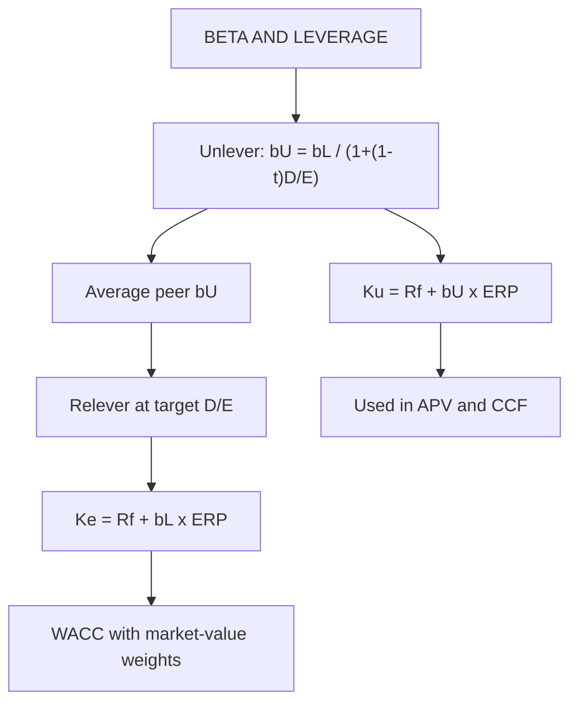

# AV-1: Unlevering and Relevering Beta, Cost of Capital under Changing Leverage

Covers: why beta depends on leverage, the unlevering and relevering formulas (with tax and with a debt beta), the bottom-up beta from peers, and how the cost of equity and WACC move with debt. This is the base for APV and the capital cash flow method. **(syllabus-supporting, textbook)**

## Where this fits in the ESE

Unlevering a peer beta and relevering it for the target's debt ratio is a likely 5-mark numerical. It is also step 1 of any APV answer (AV-2): the unlevered cost of equity comes from the unlevered beta.

## Why beta changes with debt

Business risk is set by the assets. Debt adds **financial risk** to equity holders, so the observed (levered) equity beta is higher than the asset (unlevered) beta. The unlevered beta measures **business risk only**; it is the beta the firm would have with no debt.

## The formulas

**Hamada (debt beta ≈ 0, permanent debt, tax shield as safe as the debt):**
**βL = βU × [1 + (1 − t) × D/E]**, so **βU = βL ÷ [1 + (1 − t) × D/E]**

**Tax shield as risky as the assets (debt kept at a constant ratio to value; Harris-Pringle), with debt beta βD:**
**βL = βU + (βU − βD) × D/E**
With βD = 0 this is **βL = βU × (1 + D/E)**.

Use the Hamada form when the question names it or mentions tax. Use the second when the question says the tax shield has the same risk as the assets (the capital cash flow world, AV-3). If the question does not say, use Hamada and write the formula.

D and E are **market values**. Cost of equity: **Ke = Rf + βL × ERP.** The **unlevered cost of equity Ku = Rf + βU × ERP.**

## Worked example 1: unlever, relever, price the equity

*Hypothetical.* A listed firm has βL = 1.30, D/E = 0.40, t = 25%. Rf 7%, ERP 6%, pre-tax Kd 8%. Target D/E after a recapitalisation: 1.0.

**Step 1.** Unlever: βU = 1.30 ÷ [1 + 0.75 × 0.40] = 1.30 ÷ 1.30 = **1.00**.
**Step 2.** Ku = 7% + 1.00 × 6% = **13.0%**.
**Step 3.** Relever at D/E = 1.0: βL = 1.00 × [1 + 0.75 × 1.0] = **1.75**.
**Step 4.** Ke = 7% + 1.75 × 6% = **17.5%**.

| Leverage D/E | βL (Hamada) | Ke | βL (βD = 0, no tax) |
|---|---|---|---|
| 0.20 | 1.15 | 13.9% | 1.20 |
| 0.40 (today) | 1.30 | 14.8% | 1.40 |
| 1.00 | 1.75 | 17.5% | 2.00 |

**Decision line:** at D/E 1.0 equity holders demand 17.5% against 14.8% today. Interpretation: cheap debt does not make capital cheaper automatically; equity's required return rises to compensate, and the net gain is only the interest tax shield.

**WACC effect (holding pre-tax Kd at 8%, an assumption that fails at high leverage).**

| D/E | E ÷ V | D ÷ V | Ke | WACC = E×Ke + D×8%×0.75 |
|---|---|---|---|---|
| 0.20 | 0.8333 | 0.1667 | 13.9% | 12.58% |
| 0.40 | 0.7143 | 0.2857 | 14.8% | 12.29% |
| 1.00 | 0.5000 | 0.5000 | 17.5% | 11.75% |

WACC falls as debt rises because of the tax shield (Ku = 13.0%; WACC = 13.0% − tax shield effect). In practice Kd also rises with leverage and distress costs appear, which is why the fall stops.

## Worked example 2: bottom-up beta from peers

*Hypothetical.* Three listed peers; t = 25%.

| Peer | βL | D/E | βU = βL ÷ [1 + 0.75 × D/E] |
|---|---|---|---|
| A | 1.20 | 0.40 | 1.20 ÷ 1.30 = 0.923 |
| B | 0.90 | 0.20 | 0.90 ÷ 1.15 = 0.783 |
| C | 1.50 | 0.80 | 1.50 ÷ 1.60 = 0.938 |
| **Average** | | | **0.881** |

**Step 1.** Average βU = (0.923 + 0.783 + 0.938) ÷ 3 = **0.881**.
**Step 2.** The target firm will run D/E = 0.25. βL = 0.881 × [1 + 0.75 × 0.25] = 0.881 × 1.1875 = **1.046**.
**Step 3.** Ke = 7% + 1.046 × 6% = **13.28%**.

**Why average unlevered, not levered?** Peers have different leverage, so only the unlevered betas are comparable. Use the **median** if outliers exist.

## Refinements

- **Cash-adjusted beta.** A firm holding cash has a lower beta than its operations. βU(operations) = βU(firm) ÷ (1 − cash ÷ firm value). *Example:* βU 0.90 with cash 10% of value gives 0.90 ÷ 0.90 = **1.00** for the operating business.
- **Debt beta.** If debt is risky (βD = 0.2): βL = 1.00 + (1.00 − 0.2) × 1.0 = **1.80** at D/E 1.0.
- **Market value weights.** Book D/E understates leverage for firms with high market value of equity; use market values.
- **Private firms.** Use the industry unlevered beta and relever at the firm's target D/E (AD-1).

## Traps

1. **Averaging levered betas** across peers.
2. **Forgetting the tax factor (1 − t)** in the Hamada form.
3. **Using book D/E.**
4. **Applying the current beta to a changed capital structure.** Relever.
5. **Using unlevered beta to compute Ke for a levered firm.** Ku is for the APV discounting of FCFF, not the cost of equity of the levered firm.
6. **Mixing the two formulas** within one answer.

## What to remember

- βL = βU × [1 + (1 − t)D/E] (Hamada); βL = βU + (βU − βD) × D/E (debt beta form).
- Example: βL 1.30 at D/E 0.40 → βU 1.00 → βL 1.75 at D/E 1.0 → Ke 17.5%.
- Peer average βU 0.881 → relevered 1.046 at D/E 0.25 → Ke 13.28%.
- Ku = Rf + βU × ERP is the discount rate for unlevered cash flows in APV.
- Compare peers on unlevered betas only; use market-value D/E; adjust for cash.

## Concept map

## Flashcards
Q: Unlevering formula with tax?
A: βU = βL ÷ [1 + (1 − t) × D/E].

Q: Relevering formula?
A: βL = βU × [1 + (1 − t) × D/E].

Q: βL 1.30, D/E 0.40, t 25%. βU?
A: 1.30 ÷ 1.30 = 1.00.

Q: Relever that firm at D/E 1.0. βL and Ke (Rf 7%, ERP 6%)?
A: βL 1.75; Ke 17.5%.

Q: Why average unlevered betas of peers?
A: Peers have different leverage; only unlevered betas measure business risk on a common basis.

Q: Peer βU average 0.881, target D/E 0.25, t 25%. βL?
A: 0.881 × 1.1875 = 1.046.

Q: Form of the relevering equation with a debt beta?
A: βL = βU + (βU − βD) × D/E.

Q: Cash 10% of firm value, firm βU 0.90. Operating βU?
A: 0.90 ÷ 0.90 = 1.00.

Q: What is Ku?
A: Unlevered cost of equity = Rf + βU × ERP; the rate for discounting unlevered cash flows in APV.

## Sources
- BBA304F-6 syllabus, Unit 4 (supports APV and capital cash flow methods)
- Damodaran, *Investment Valuation*, chapters on risk and return; bottom-up betas, relevering; Hamada (1972); Koller et al., *Valuation*, cost of capital chapters
- Previous unit: [[Corporate Valuation Unit 3 - EQ-4 Equity versus Firm Valuation and Common Errors]] · Next: [[Corporate Valuation Unit 4 - AV-2 Adjusted Present Value Method]]
- [[Corporate Valuation Unit 4 - Alternative DCF and Asset-Based MOC (Node Map)]]
