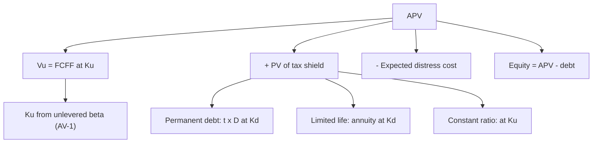

# AV-2: Adjusted Present Value (APV) Method

Covers: the APV formula, the unlevered value, the PV of the interest tax shield under different debt policies, expected distress costs, a full numerical, and when APV beats WACC. **(syllabus + textbook)**

## Where this fits in the ESE

APV is named in the syllabus and is a favourite 10-mark numerical or the second half of a case. The marks are in the layout: unlevered value first, tax shield second, adjustments third, then equity.

## The APV idea

Value the business **as if it had no debt**, then add the value of financing side effects.

**APV = Value of unlevered firm + PV of tax shield on debt − PV of expected distress costs (+ other financing side effects)**

- **Unlevered value Vᵤ** = PV of unlevered FCFF at **Ku** (cost of unlevered equity, from βU in AV-1).
- **Interest tax shield** each year = t × Interest = t × Kd × Debt.
- **Distress cost** = probability of distress × cost if it happens.
- **Equity value = APV − debt − other claims** (VF-3 bridge for the rest).

## The tax shield: choose the discount rate to match the debt policy

| Debt policy | PV of tax shield | Discount rate |
|---|---|---|
| **Fixed debt amount D for ever** | **t × D** | Kd (shield as safe as the debt) |
| **Debt for n years at fixed amount** | Σ t × Kd × D ÷ (1 + Kd)ᵗ (an annuity) | Kd |
| **Debt kept at a constant ratio of firm value** (grows with the firm) | t × Kd × D₀ ÷ (Ku − g) in perpetuity | Ku (shield as risky as assets) |

This is where APV earns its place: it handles **any debt schedule** (fixed amount, repayment profile, LBO paydown) because each year's tax shield is added up separately. The WACC method assumes a constant debt ratio.

## Worked example 1: APV with permanent debt

*Hypothetical.* A firm has FCFF₁ of ₹120 crore, growing 5% for ever. βU = 0.80, Rf 8%, ERP 5%, so **Ku = 8% + 0.80 × 5% = 12.0%**. It will carry **₹600 crore of permanent debt** at pre-tax Kd 9%. Tax 25%. Probability of distress 4% with a cost of 20% of unlevered value.

**Step 1.** Unlevered value = 120 ÷ (0.12 − 0.05) = **₹1,714.29 crore**.
**Step 2.** PV of tax shield = t × D = 0.25 × 600 = **₹150.00 crore** (annual shield 0.25 × 0.09 × 600 = 13.5, a perpetuity at 9%: 13.5 ÷ 0.09 = 150).
**Step 3.** APV before distress = 1,714.29 + 150 = **₹1,864.29 crore**.
**Step 4.** Expected distress cost = 0.04 × 0.20 × 1,714.29 = **₹13.71 crore**.
**Step 5.** APV = 1,864.29 − 13.71 = **₹1,850.57 crore**.
**Step 6.** Equity = 1,850.57 − 600 = **₹1,250.57 crore**.

| Component | ₹ crore |
|---|---|
| Unlevered value (FCFF at Ku 12%) | 1,714.29 |
| + PV of tax shield (t × D) | 150.00 |
| − Expected distress cost | (13.71) |
| **APV (enterprise value)** | **1,850.57** |
| − Debt | (600.00) |
| **Equity value** | **1,250.57** |

**Decision line:** debt adds ₹136.29 crore net (150 − 13.71) to enterprise value, about 8% of unlevered value. Interpretation: financing creates value only through the tax shield; the distress cost shows why the shield does not justify unlimited debt. If the question gives no distress data, write "distress costs ignored; APV = ₹1,864.29 crore".

## Worked example 2: tax shield from debt with a limited life

*Hypothetical.* A buy-out is financed with ₹500 crore of debt outstanding for 4 years at 9%, then repaid. Tax 25%.

**Step 1.** Annual interest = 500 × 0.09 = 45; tax shield = 45 × 0.25 = **11.25**.
**Step 2.** Annuity factor, 4 years at 9% = (1 − 1.09⁻⁴) ÷ 0.09 = **3.240**.
**Step 3.** PV of tax shield = 11.25 × 3.240 = **₹36.45 crore** (36.447 with the exact factor).

If the debt were permanent, the shield would be 0.25 × 500 = 125. Limited life cuts it to 36.45: always count the years of debt.

## Fixed-amount debt and growth: a warning

In example 1 the firm grows 5% but debt is fixed at ₹600 crore, so the debt ratio falls over time. APV handles this. A WACC computed from today's D/E would assume the ratio is maintained, which is a different policy and gives a different value (see AV-3). That is the textbook reason to use APV when the debt schedule is given in rupees.

## When to use APV

- Capital structure changes over the forecast (LBOs, projects with specified loans, turnarounds).
- Debt is a fixed rupee amount or has a repayment schedule.
- Financing side effects matter: subsidised loans, tax holidays, issue costs, distress costs.
- Valuing a project with project-specific financing.

**Limitations:** the tax shield rate (Kd or Ku) and distress cost estimates are judgemental; Ku needs an unlevered beta; and if taxable income is too low to use the shield, the shield is worth less (AD-2 NOL point).

## Traps

1. **Using WACC to discount FCFF in APV.** APV discounts unlevered FCFF at **Ku**.
2. **Using levered Ke instead of Ku** for the unlevered value.
3. **Forgetting to subtract debt** from APV for equity value.
4. **PV of tax shield = t × D for temporary debt.** Only for permanent debt.
5. **Tax shield larger than actual taxable income.** Cap it.
6. **Double counting the tax shield** by also using after-tax Kd in a WACC discount rate.

## What to remember

- APV = Vᵤ (FCFF at Ku) + PV(tax shield) − PV(distress costs); equity = APV − debt.
- PV of tax shield: t × D for permanent debt at Kd; t × Kd × D ÷ (Ku − g) for constant-ratio debt.
- Example: 1,714.29 + 150.00 − 13.71 = ₹1,850.57 crore; equity ₹1,250.57 crore.
- Limited-life debt: 11.25 × 3.240 = 36.45, not 125.
- Use APV when debt policy is a rupee schedule, leverage changes, or financing side effects matter.

## Concept map

## Flashcards
Q: APV formula?
A: Unlevered firm value + PV of interest tax shield − PV of expected distress costs; equity = APV − debt.

Q: Discount rate for the unlevered cash flows in APV?
A: Ku, the unlevered cost of equity from the unlevered beta.

Q: PV of the tax shield on permanent debt D at Kd?
A: t × D.

Q: Debt ₹600 crore permanent, t 25%. PV of tax shield?
A: ₹150 crore.

Q: Unlevered value for FCFF₁ 120, g 5%, Ku 12%?
A: 120 ÷ 0.07 = ₹1,714.29 crore.

Q: Distress probability 4%, cost 20% of Vᵤ 1,714.29. Expected cost and APV?
A: ₹13.71 crore; APV = 1,714.29 + 150 − 13.71 = ₹1,850.57 crore.

Q: Debt ₹500 crore, 9%, 4 years, t 25%. PV of tax shield?
A: 11.25 × 3.240 = ₹36.45 crore.

Q: Give two situations where APV is preferred to WACC.
A: Leverage changing over time (LBOs) and debt given as a fixed rupee schedule; also project-specific financing and side effects.

Q: Why is "tax shield = t × D" dangerous?
A: It holds only for permanent debt discounted at Kd; limited-life or growing debt needs a different PV.

## Sources
- BBA304F-6 syllabus, Unit 4 (adjusted present value method)
- Damodaran, *Investment Valuation*, chapters on APV; Myers (1974); Koller et al., *Valuation*, APV chapter
- Previous: [[Corporate Valuation Unit 4 - AV-1 Unlevering and Relevering Beta]] · Next: [[Corporate Valuation Unit 4 - AV-3 Capital Cash Flow Approach and Reconciliation]]
- [[Corporate Valuation Unit 4 - Alternative DCF and Asset-Based MOC (Node Map)]]
