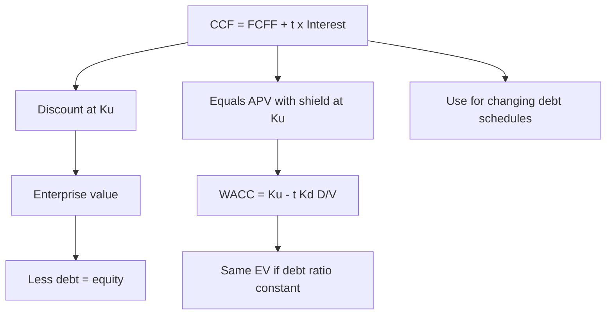

# AV-3: Capital Cash Flow (CCF) Approach and Reconciliation with APV and WACC

Covers: the CCF definition, how it differs from FCFF, why it discounts at Ku, a numerical that reconciles CCF, APV and WACC to the same value, and how to choose between them. **(syllabus + textbook)**

## Where this fits in the ESE

The syllabus names "capital cash flow" beside APV. Expect it as a 5-mark definition with a short numeric, or as a reconciliation inside a 10-mark APV question. The reconciliation is what shows understanding.

## Definition

**Capital cash flow (CCF) = FCFF + Interest tax shield = FCFF + t × Interest.**

It is the cash flow available to **all providers of capital** (debt and equity), including the tax shield. Because the shield is now **inside the cash flow**, the discount rate is the **pre-tax, unlevered rate Ku** (the rate for the risk of the assets), not WACC.

**Value of the enterprise = Σ CCFₜ ÷ (1 + Ku)ᵗ** (and a terminal value on CCF).

**Equity value = CCF-based EV − debt** (and the other bridge items, VF-3).

### CCF versus FCFF versus FCFE

| | FCFF | CCF | FCFE |
|---|---|---|---|
| Includes tax shield? | No (shield is in WACC) | **Yes (in the cash flow)** | Yes (through after-tax interest) |
| Discount rate | WACC | **Ku (pre-tax WACC)** | Ke |
| Gives | EV | EV | Equity |

**Key link:** CCF discounted at Ku is the same as **APV with the tax shield discounted at Ku**. The two methods differ only in whether the tax shield is added to the cash flow (CCF) or valued separately (APV).

## Worked example 1: all three methods agree

*Hypothetical.* Same firm as AV-2: FCFF₁ = ₹120 crore, growth 5%, Ku 12%, pre-tax Kd 9%, tax 25%. This time the firm keeps **debt at 30% of firm value** at all times, so debt grows with value (the tax shield is as risky as the assets).

**Step 1 (unlevered value).** Vᵤ = 120 ÷ 0.07 = **1,714.29**.

**Step 2 (circular tax shield).** Debt D₀ = 0.30 × V_L. First-year tax shield = 0.25 × 0.09 × D₀, growing 5%. PV of shield at Ku = 0.25 × 0.09 × D₀ ÷ (0.12 − 0.05).
V_L = Vᵤ + 0.25 × 0.09 × 0.30 × V_L ÷ 0.07 = Vᵤ + 0.096429 × V_L.
**V_L = 1,714.29 ÷ (1 − 0.096429) = ₹1,897.23 crore.** This is the **APV** answer for this policy.

**Step 3 (CCF).** D₀ = 0.30 × 1,897.23 = **569.17**. Interest₁ = 569.17 × 0.09 = 51.23. Tax shield₁ = 0.25 × 51.23 = **12.81** (12.806).
CCF₁ = 120 + 12.806 = **132.806**; growth 5%.
**EV = 132.806 ÷ (0.12 − 0.05) = ₹1,897.23 crore.** ✓

**Step 4 (WACC).**
- Ke from Harris-Pringle: Ke = Ku + (Ku − Kd) × D/E = 12% + (12% − 9%) × (30 ÷ 70) = **13.286%**.
- WACC = 0.70 × 13.286% + 0.30 × 9% × 0.75 = 9.30% + 2.025% = **11.325%**.
- Check: WACC = Ku − t × Kd × D/V = 12% − 0.25 × 9% × 0.30 = 11.325%. ✓
- EV = 120 ÷ (0.11325 − 0.05) = **₹1,897.23 crore.** ✓

| Method | Cash flow | Rate | EV (₹ crore) |
|---|---|---|---|
| APV (tax shield at Ku) | FCFF 120, shield 12.806 separately | Ku 12% | 1,714.29 + 182.95 = 1,897.24 (rounding), **1,897.23** unrounded |
| CCF | 120 + 12.806 = 132.806 | Ku 12% | **1,897.23** |
| WACC | FCFF 120 | 11.325% | **1,897.23** |

Equity = 1,897.23 − 569.17 = **₹1,328.06 crore**.

**Decision line:** all three agree to the paisa because they assume the same thing: debt at a constant 30% of value and a tax shield with asset-level risk. Interpretation for the exam: if three methods give different answers, the **assumptions differ** (debt policy, shield risk), not the arithmetic. Compare this ₹1,897.23 crore with the ₹1,864.29 crore of AV-2: different debt policy (₹600 crore fixed vs 30% of value) gives a different value.

## Worked example 2: CCF with changing debt

*Hypothetical.* A three-year project with FCFF of ₹100, ₹110 and ₹120 crore. Debt outstanding at the start of each year: ₹400, ₹300 and ₹200 crore (repaid down). Kd 9%, tax 25%, Ku 12% (factors 0.893, 0.797, 0.712). No terminal value.

**Step 1.** Tax shield = Debt × 9% × 25%: 400 → **9.00**; 300 → **6.75**; 200 → **4.50**.
**Step 2.** CCF = FCFF + shield: **109.00**, **116.75**, **124.50**.
**Step 3.** PV at Ku: 109.00 × 0.893 = 97.34; 116.75 × 0.797 = 93.05; 124.50 × 0.712 = 88.64. Sum = **₹279.03 crore**.

| Year | FCFF | Shield | CCF | DF at 12% | PV |
|---|---|---|---|---|---|
| 1 | 100.00 | 9.00 | 109.00 | 0.893 | 97.34 |
| 2 | 110.00 | 6.75 | 116.75 | 0.797 | 93.05 |
| 3 | 120.00 | 4.50 | 124.50 | 0.712 | 88.64 |
| | | | | **EV** | **279.03** |

**Cross-check with APV:** unlevered PV = 89.30 + 87.67 + 85.44 = 262.41; PV of shield at Ku = 8.04 + 5.38 + 3.20 = 16.62; total **279.03** ✓. If the shield were discounted at Kd 9% instead, its PV would be 17.41 and APV 279.82, higher by 0.79: the choice of shield rate matters little for short-lived debt.

**Decision line:** with declining debt the shield shrinks each year, and a single WACC would not capture that; CCF and APV do, which is why they are preferred for repayment-schedule financing.

## Choosing between WACC, APV and CCF

| Situation | Best |
|---|---|
| Stable debt ratio, simple firm | WACC |
| Debt policy given as rupee amounts or repayments | APV or CCF |
| LBO or turnaround with changing leverage | APV or CCF |
| Tax shield and distress costs need separate treatment | APV |
| You want one discount rate that does not change with leverage | CCF (Ku) |
| Exam asks for the "textbook" method and gives no policy | WACC, and state the constant-ratio assumption |

## Traps

1. **Discounting CCF at WACC.** The shield is already in the cash flow; use Ku.
2. **Using FCFF with Ku, or CCF with WACC.** Pair cash flow and rate correctly.
3. **Computing WACC from today's D/E when debt is a fixed rupee amount.** Use APV.
4. **Ignoring circularity.** Debt as a ratio of value needs the algebraic solution or iteration.
5. **Taking Ke from Hamada while valuing with a constant ratio.** Use the matching relevering formula (AV-1).
6. **Expecting equal answers from inconsistent policies.**

## What to remember

- CCF = FCFF + t × Interest, discounted at Ku; equity = EV − debt.
- CCF at Ku equals APV with the shield discounted at Ku.
- Constant 30% debt: APV, CCF and WACC all give ₹1,897.23 crore; WACC = 12% − 0.25 × 9% × 0.30 = 11.325%.
- Changing debt: CCF 109.00, 116.75, 124.50 gives ₹279.03 crore, the same as APV.
- Different answers mean different assumptions about debt policy or shield risk.

## Concept map

## Flashcards
Q: Define capital cash flow.
A: FCFF plus the interest tax shield (t × interest): the cash flow to all capital providers including the shield.

Q: Discount rate for CCF, and why?
A: Ku (pre-tax, unlevered), because the tax shield is already in the cash flow.

Q: Relationship between CCF and APV?
A: CCF at Ku equals APV with the tax shield discounted at Ku; they differ only in presentation.

Q: Debt 30% of value, Ku 12%, Kd 9%, t 25%. WACC?
A: 12% − 0.25 × 9% × 0.30 = 11.325%.

Q: FCFF₁ 120, g 5%, same policy. EV three ways?
A: APV, CCF and WACC all give ₹1,897.23 crore.

Q: Ke under constant-ratio debt (Harris-Pringle) for D/E 3/7?
A: Ku + (Ku − Kd) × D/E = 12% + 3% × 3/7 = 13.286%.

Q: Debt 400, 300, 200 at 9%, t 25%. Tax shields?
A: 9.00, 6.75 and 4.50.

Q: Three-year project, FCFF 100, 110, 120, those shields, Ku 12%. EV?
A: ₹279.03 crore.

Q: Why might CCF, APV and WACC give different values?
A: Different assumptions on debt policy (fixed amount versus constant ratio) or the risk of the tax shield, not different arithmetic.

## Sources
- BBA304F-6 syllabus, Unit 4 (capital cash flow approach)
- Ruback (2002) "Capital Cash Flows"; Damodaran, *Investment Valuation*, relevant chapters; Koller et al., *Valuation*
- Previous: [[Corporate Valuation Unit 4 - AV-2 Adjusted Present Value Method]] · Next: [[Corporate Valuation Unit 4 - AV-4 Asset-Based Valuation Approaches]]
- [[Corporate Valuation Unit 4 - Alternative DCF and Asset-Based MOC (Node Map)]]
