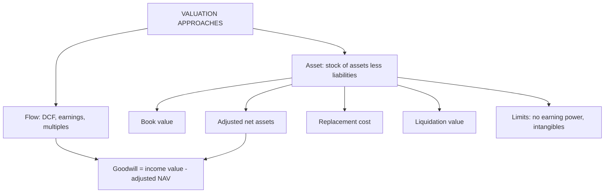

# AV-4: Asset-Based Valuation Approaches

Covers: the flow approach versus the asset (stock) approach, the book value, adjusted net asset, liquidation value and replacement cost methods, when each applies, and the limitations of non-income-based valuation. **(syllabus + textbook)**

## Where this fits in the ESE

A 5-mark "explain asset-based valuation methods" or a 10-mark "compare asset-based and income-based approaches" is likely. A small balance sheet numerical (book vs adjusted vs liquidation) is easy to set, so practise the layout below.

## Flow approach versus asset approach

The syllabus pairs "flow approach" with asset-based methods. In the usual reading **(textbook interpretation; confirm with the faculty)**:

- **Flow (income) approach:** value comes from the **cash flows or earnings** the business generates (DCF, capitalised earnings, multiples). Units 2 to 4.
- **Asset (stock) approach:** value comes from **what the business owns, less what it owes**, measured at book, fair, replacement or liquidation value.

The two answer different questions. A going concern with strong earnings is worth more than its asset value (the excess is **goodwill**); a weak business can be worth less alive than dead.

## The four asset-based measures

| Method | What it measures | Formula |
|---|---|---|
| **Book value** | Accounting net worth at historical cost | Net worth = assets − liabilities, as per the balance sheet |
| **Adjusted net asset value** | Assets and liabilities restated to fair value (going concern) | Σ fair value of assets − Σ liabilities (including contingent) |
| **Replacement cost** | Cost to rebuild the same assets today, new-for-old, less obsolescence | Σ replacement cost − liabilities |
| **Liquidation value** | Net cash if assets are sold off, after costs, then liabilities paid | Σ (asset × recovery %) − selling costs − liabilities |

Per-share values divide by shares outstanding. **Liquidation** can be **orderly** (time to find buyers, higher recovery) or **forced** (quick sale, steep discounts). Priority of claims on liquidation puts secured lenders and statutory dues ahead of equity; under the Insolvency and Bankruptcy Code equity is last **[VERIFY]** the order of the waterfall before quoting it.

## Worked example: one firm, four asset values

*Hypothetical.* Meridian Metals Ltd (fictional). 20 crore shares. Balance sheet items in ₹ crore:

| Asset | Book | Adjusted (fair) | Replacement cost | Forced-sale recovery | Liquidation proceeds |
|---|---|---|---|---|---|
| Land | 50 | 140 | 140 | 90% of adjusted | 126.0 |
| Plant and machinery | 100 | 80 | 160 | 50% of adjusted | 40.0 |
| Inventory | 60 | 54 | 56 | 60% of adjusted | 32.4 |
| Receivables | 80 | 72 | 72 | 80% of adjusted | 57.6 |
| Investments | 30 | 45 | 45 | 90% of adjusted | 40.5 |
| Cash | 20 | 20 | 20 | 100% | 20.0 |
| **Total assets** | **340** | **411** | **493** | | **316.5** |

Liabilities: book 150; for the adjusted and liquidation columns add a contingent liability of 10, so **160**. Forced-sale costs (legal, severance) are 8% of proceeds.

**Step 1 (book).** 340 − 150 = **190**; per share **₹9.50**.
**Step 2 (adjusted).** 411 − 160 = **251**; per share **₹12.55**.
**Step 3 (replacement).** 493 − 160 = **333**; per share **₹16.65**.
**Step 4 (forced liquidation).** Proceeds 316.5; costs 8% × 316.5 = 25.3; net 291.2; less liabilities 160 = **131.2**; per share **₹6.56**.

| Measure | Equity value (₹ crore) | Per share |
|---|---|---|
| Liquidation (forced) | 131.2 | ₹6.56 |
| Book | 190.0 | ₹9.50 |
| Adjusted net assets | 251.0 | ₹12.55 |
| Replacement cost | 333.0 | ₹16.65 |

**Link with the income view.** Suppose capitalised earnings (income approach) give equity value ₹300 crore (₹15.00 a share). Then:
- **Goodwill = income value − adjusted net asset value = 300 − 251 = ₹49 crore.** The business earns above its asset base.
- Going-concern value (300) exceeds liquidation value (131.2): keep operating.
- **Tobin's q (equity form) = market capitalisation ÷ replacement-cost equity.** At a market price of ₹16 (market cap 320), q = 320 ÷ 333 = **0.96**. Below 1 means it is cheaper to buy the firm than to build it: either the market is pessimistic or the assets earn too little.

**Decision line:** the range for an acquirer is ₹6.56 (floor, forced sale) to ₹16.65 (ceiling, rebuild); the income value ₹15.00 sits inside it and above adjusted assets, so a buyer should pay ₹12.55 to ₹15.00 and treat ₹16.65 as the cap (no one pays more than the cost of building new). If the DCF value fell below ₹6.56 the firm would be worth more broken up, and liquidation would be the better decision. Quote all four measures and state which one fits the purpose.

## Applicability: when asset-based works

| Situation | Method |
|---|---|
| Holding or investment company (value is in the investments) | Adjusted net assets at market value |
| Real estate, natural resource, asset-heavy firms | Adjusted or replacement value |
| Firm in distress, closure, winding up | Liquidation value |
| Floor value in M&A and negotiation | Liquidation or adjusted net assets |
| Insurance claims and regulatory capital | Replacement cost |
| Early-stage or new business with assets but no earnings | Cross-check only |

## Limitations of non-income-based approaches

1. **Ignores earning power:** two firms with the same assets but different returns get the same value.
2. **Ignores intangibles:** brands, technology, customer relationships, human capital are mostly off the balance sheet.
3. **Book value is historical,** so it is stale and distorted by depreciation policy and inflation.
4. **Fair and replacement values are estimates** needing valuers; subjective and costly.
5. **Liquidation value assumes the end of the firm,** which understates a going concern.
6. **Ignores future growth and risk.** No discount rate, no forecast.
7. **Contingent liabilities and off-balance items** may be missed.
8. **Not comparable across firms** with different accounting policies.

## Traps

1. **Quoting book value as "the" value.** It is one of several asset measures.
2. **Forgetting to deduct liabilities (including contingent ones).**
3. **Replacement cost for plant without adjusting for age** (new-for-old overstates value of used assets).
4. **Treating liquidation value as a going-concern price.**
5. **Forgetting selling costs and claim priority in liquidation.**
6. **Using asset-based value for a high-ROIC services firm.**

## What to remember

- Flow approach values cash and earnings; asset approach values what the firm owns less what it owes.
- Four measures: book, adjusted net assets, replacement cost, liquidation; in the example ₹6.56, ₹9.50, ₹12.55, ₹16.65.
- Goodwill = income value − adjusted net assets (300 − 251 = 49).
- q = market cap ÷ replacement-cost equity (0.96).
- Use asset-based for holding, asset-heavy and distressed firms, and as a floor; its limitation is that it ignores earning power and intangibles.

## Concept map

## Flashcards
Q: Flow approach versus asset approach?
A: Flow values the cash flows or earnings the business generates; asset approach values assets owned less liabilities owed.

Q: Name four asset-based measures.
A: Book value, adjusted (fair value) net assets, replacement cost, liquidation value.

Q: Meridian total assets: book 340, liabilities 150. Book value per share on 20 crore shares?
A: Net worth 190; ₹9.50.

Q: Meridian adjusted net asset value?
A: Assets 411 less liabilities 160 (with contingent 10) = ₹251 crore, ₹12.55 per share.

Q: Meridian forced liquidation equity value?
A: Proceeds 316.5, costs 25.3, liabilities 160: ₹131.2 crore, ₹6.56 per share.

Q: Goodwill when income value is 300 and adjusted NAV 251?
A: 300 − 251 = ₹49 crore.

Q: What does Tobin's q below 1 mean?
A: Market value is below replacement cost, so buying the firm is cheaper than building it (market pessimism or low returns).

Q: When is liquidation value the relevant benchmark?
A: For distressed or winding-up firms and as a floor; if going-concern value is below it, break up the firm.

Q: Name three limitations of asset-based valuation.
A: Ignores earning power, ignores intangibles, and book values are historical; also subjective fair values and no growth or risk.

## Sources
- BBA304F-6 syllabus, Unit 4 (asset-based valuation approaches; applicability; limitations of non-income-based approaches)
- Damodaran, *Investment Valuation*, chapters on asset-based valuation, liquidation; Pratt and Grabowski, *Cost of Capital*
- Insolvency and Bankruptcy Code priority of claims **[VERIFY]**
- Previous: [[Corporate Valuation Unit 4 - AV-3 Capital Cash Flow Approach and Reconciliation]] · Next: [[Corporate Valuation Unit 4 - AV-5 Unit 4 Exam Answers]]
- [[Corporate Valuation Unit 4 - Alternative DCF and Asset-Based MOC (Node Map)]]
