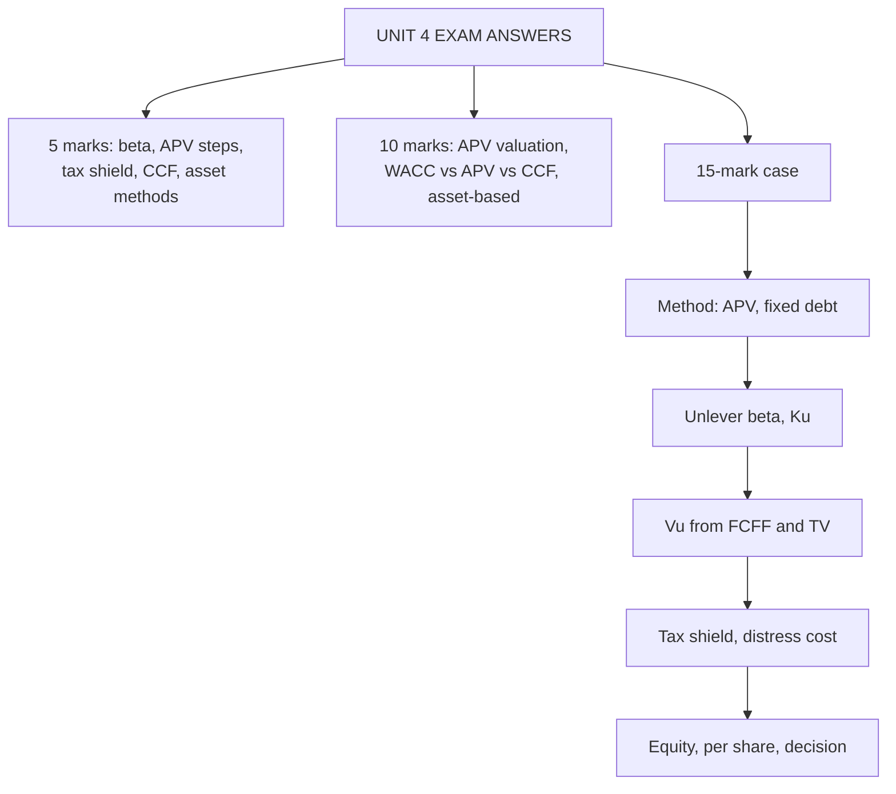

# AV-5: Unit 4 Exam Answers

Covers: what the ESE will ask from Unit 4, 5-mark and 10-mark skeletons, and a 15-mark APV case with a model answer. Numbers come from AV-1 to AV-4.

## What the test will ask

Unit 4 is the shortest unit (8 hours) but the most technical. Section A may ask for an unlevering or tax-shield sum; Section B for an APV valuation or the asset-based methods; the case may combine unlevering, APV and a recommendation. Confirm the Section B mark split with the faculty (the syllabus text is inconsistent).

## Five-mark answer skeletons

**1. Unlever and relever beta (AV-1).** Formula, steps, numbers: βL 1.30, D/E 0.40, t 25% gives βU 1.00; relevered at D/E 1.0 gives 1.75; Ke 17.5% at Rf 7%, ERP 6%.

**2. Bottom-up beta from peers (AV-1).** Table of three peers, average βU 0.881, relevered 1.046 at D/E 0.25, Ke 13.28%.

**3. APV formula and steps (AV-2).** Vᵤ at Ku, plus PV of tax shield, less distress cost; numbers 1,714.29 + 150 − 13.71 = 1,850.57.

**4. Tax shield under different debt policies (AV-2).** Permanent debt t × D; limited-life annuity (₹36.45 crore for 500 over 4 years); constant ratio at Ku.

**5. Capital cash flow approach (AV-3).** Definition, Ku as rate, equals APV with shield at Ku, WACC = Ku − t Kd D/V.

**6. Asset-based methods (AV-4).** Four measures with formula; applicability; one limitation line.

## Ten-mark answer skeletons

**A. "Explain APV and value a firm using it" (AV-2).**
1. Idea and formula (2). 2. Ku from the unlevered beta (2). 3. Table: Vᵤ, tax shield, distress cost, APV, equity (4). 4. When APV beats WACC (2).

**B. "Compare WACC, APV and CCF with a reconciliation" (AV-3).**
1. Definitions and rates (3). 2. Reconciliation: constant 30% debt gives ₹1,897.23 crore three ways (4). 3. Selection guide (3).

**C. "Discuss asset-based valuation: methods, applicability and limitations" (AV-4).**
1. Flow versus asset approach (2). 2. Four methods with the Meridian numerical (4). 3. Applicability and limitations (4).

## Fifteen-mark case layout

1. **Method and why (2 marks):** APV because debt is a fixed rupee amount; WACC would assume a constant ratio.
2. **Beta and Ku (2 marks):** unlever the comparable's beta, then Ku.
3. **Unlevered value (4 marks):** FCFF table, TV, sum.
4. **Financing side effects (3 marks):** tax shield, distress cost, APV.
5. **Equity and per share, decision (4 marks):** bridge, price comparison, interpretation, sensitivity.

### Model case

*Hypothetical.* Deccan Auto Components Ltd (fictional) is being valued for a leveraged recapitalisation. Unlevered FCFF is ₹90 crore, ₹100 crore and ₹110 crore in years 1 to 3, then grows 4% for ever. A comparable listed firm has βL = 1.04 at D/E = 0.40. Rf 7%, ERP 6%, tax 25%. The firm will hold **₹400 crore of debt for ever** at pre-tax 9%. Probability of distress 3%, cost 15% of unlevered value. 25 crore shares; market price ₹36. Discount factors at Ku to 3 decimals. **Value the equity by APV and advise.**

**Model answer**

**1. Method.** APV, because the debt is a fixed ₹400 crore. A WACC based on today's D/E would assume the debt ratio stays constant as the firm grows, which is not the stated policy.

**2. Beta and Ku.**
- βU = 1.04 ÷ [1 + 0.75 × 0.40] = 1.04 ÷ 1.30 = **0.80**.
- Ku = 7% + 0.80 × 6% = **11.8%**. Discount factors: 1 ÷ 1.118 = 0.894; ÷ 1.118² = 0.800; ÷ 1.118³ = 0.716.

**3. Unlevered value (₹ crore).**

| Year | FCFF | DF at 11.8% | PV |
|---|---|---|---|
| 1 | 90.0 | 0.894 | 80.5 |
| 2 | 100.0 | 0.800 | 80.0 |
| 3 | 110.0 | 0.716 | 78.8 |
| Sum of PV | | | 239.3 |
| TV₃ = 110 × 1.04 ÷ (0.118 − 0.04) = 114.4 ÷ 0.078 | 1,466.7 | 0.716 | 1,050.2 |
| **Unlevered value Vᵤ** | | | **1,289.5** |

**4. Financing side effects.**
- Tax shield each year = 0.25 × 0.09 × 400 = 9.0; permanent debt, so PV = t × D = 0.25 × 400 = **100.0**.
- Expected distress cost = 0.03 × 0.15 × 1,289.5 = **5.8**.
- **APV = 1,289.5 + 100.0 − 5.8 = ₹1,383.7 crore.**

**5. Equity and decision.**
- Equity = 1,383.7 − 400 = **₹983.7 crore**; per share = 983.7 ÷ 25 = **₹39.35**.
- Versus ₹36: upside 9.3%; margin of safety (39.35 − 36) ÷ 39.35 = **8.5%**. **Recommend a modest buy.**
- Financing adds 94.2 (100.0 − 5.8), about 7.3% of Vᵤ. Terminal value is 1,050.2 ÷ 1,289.5 = 81.4% of Vᵤ.
- Sensitivity: if Ku is one point higher (12.8%, exact discount factors), APV falls to about ₹1,235.7 crore and the value to ₹33.43 a share, below ₹36, so the buy reverses; the 8.5% margin of safety is thin. If the probability of distress were 6% (cost 15%), the distress cost would be 11.6 and APV 1,377.9, a small change; the call is far more sensitive to Ku than to distress cost. (At 11.8% the exact-factor value is ₹39.32; the table's 3-decimal factors give ₹39.35.)

**Interpretation line to write:** "APV ₹1,383.7 crore gives ₹39.35 a share against ₹36, an 8.5% margin of safety; financing contributes about ₹94 crore, but 81% of unlevered value is terminal, so the buy depends on Ku and growth, not on the debt."

## Self-test

- Recompute βU for the comparable and Ku without looking.
- Why is the tax shield t × D here and not 0.25 × 9% × 400 for only three years?
- Which assumption would make WACC give the same answer as this APV?

## What to remember

- Case layout: method, beta and Ku, unlevered value, tax shield and distress cost, equity and decision.
- Deccan: βU 0.80, Ku 11.8%, Vᵤ 1,289.5, tax shield 100.0, distress 5.8, APV 1,383.7, equity 983.7, ₹39.35.
- Margin of safety 8.5%; terminal share of Vᵤ 81.4%.
- APV is chosen because debt is a fixed rupee amount.
- Sums to practise: unlevering, relevering, tax shield (permanent and limited), reconciliation, asset values.

## Concept map

## Flashcards
Q: Deccan unlevered beta and Ku?
A: βU = 1.04 ÷ 1.30 = 0.80; Ku = 7% + 0.80 × 6% = 11.8%.

Q: Deccan unlevered value?
A: PV of FCFF 239.3 + PV of TV 1,050.2 = ₹1,289.5 crore.

Q: Deccan terminal value at year 3?
A: 110 × 1.04 ÷ (0.118 − 0.04) = ₹1,466.7 crore.

Q: Deccan tax shield and distress cost?
A: PV of tax shield 0.25 × 400 = ₹100 crore; expected distress cost 0.03 × 0.15 × 1,289.5 = ₹5.8 crore.

Q: Deccan APV, equity and per share?
A: APV ₹1,383.7 crore; equity ₹983.7 crore; ₹39.35 on 25 crore shares.

Q: Decision at ₹36?
A: Modest buy: upside 9.3%, margin of safety 8.5%, sensitive to Ku.

Q: Why APV rather than WACC for Deccan?
A: Debt is a fixed ₹400 crore, so the debt ratio changes; WACC assumes a constant ratio.

Q: First line of an APV case answer?
A: State why APV fits (fixed or changing debt, financing side effects), then unlever the comparable beta to get Ku.

## Sources
- BBA304F-6 syllabus (ESE pattern, Unit 4)
- Nodes AV-1 to AV-4 in this unit
- Previous: [[Corporate Valuation Unit 4 - AV-4 Asset-Based Valuation Approaches]]
- [[Corporate Valuation Unit 4 - Alternative DCF and Asset-Based MOC (Node Map)]]
