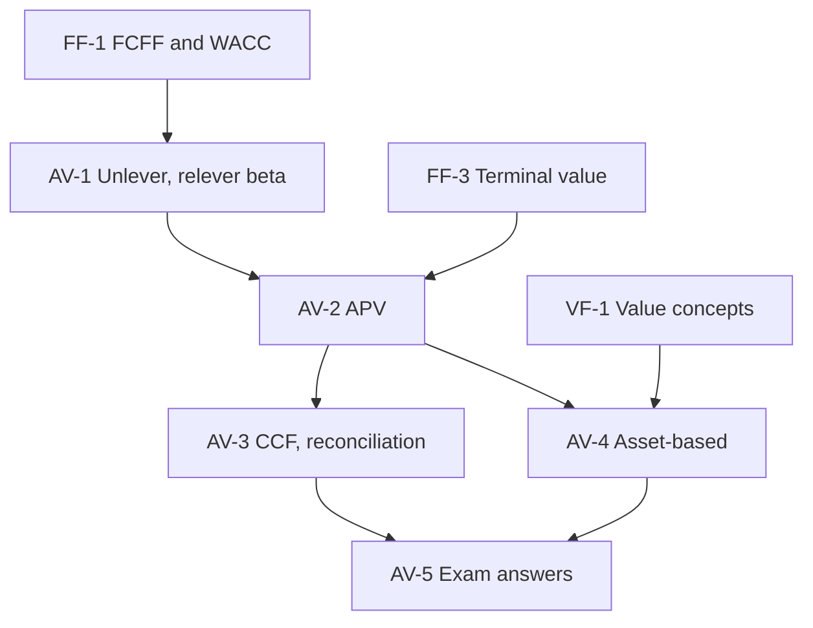

# Corporate Valuation Unit 4: Alternative DCF and Asset-Based Approaches, node map

ESE: 50 marks; Section A 3 × 5, Section B 2 × 10 (assumed), Section C one 15-mark case. Unit 4 is CO2 and CO3 (apply and analyse): APV, capital cash flow, and the asset-based methods. All examples are **hypothetical numbers** (Meridian Metals and Deccan Auto Components are fictional). No faculty slides yet, so content is labelled (syllabus) or (textbook).

## Nodes

| Node | Topic | Deps | Minutes | Exam focus |
|---|---|---|---|---|
| AV-1 | Unlevering and Relevering Beta | FF-1 | 35 | yes |
| AV-2 | Adjusted Present Value Method | AV-1, FF-3 | 45 | yes |
| AV-3 | Capital Cash Flow and Reconciliation | AV-2 | 35 | yes |
| AV-4 | Asset-Based Valuation Approaches | VF-1, AV-2 | 35 | yes |
| AV-5 | Unit 4 Exam Answers | AV-1 to AV-4 | 35 | yes |

Total reading time: about 185 minutes.

## Dependency graph

## Headline numbers to know

- βL 1.30 at D/E 0.40, t 25% gives βU 1.00; relever at D/E 1.0: 1.75; Ke 17.5%. Peers: βU 0.881, relevered 1.046, Ke 13.28%.
- APV: Vᵤ 1,714.29 + tax shield 150 − distress 13.71 = ₹1,850.57 crore; equity 1,250.57. Limited-life shield 36.45.
- Constant 30% debt: APV = CCF = WACC = ₹1,897.23 crore; WACC 11.325%. Changing debt CCF project: ₹279.03 crore.
- Meridian assets: liquidation ₹6.56, book ₹9.50, adjusted ₹12.55, replacement ₹16.65 per share; goodwill 49; q 0.96.
- Deccan case: βU 0.80, Ku 11.8%, Vᵤ 1,289.5, APV 1,383.7, equity 983.7, ₹39.35 vs ₹36; at Ku 12.8% ₹33.43.

## Links
- [[Corporate Valuation MOC]]
