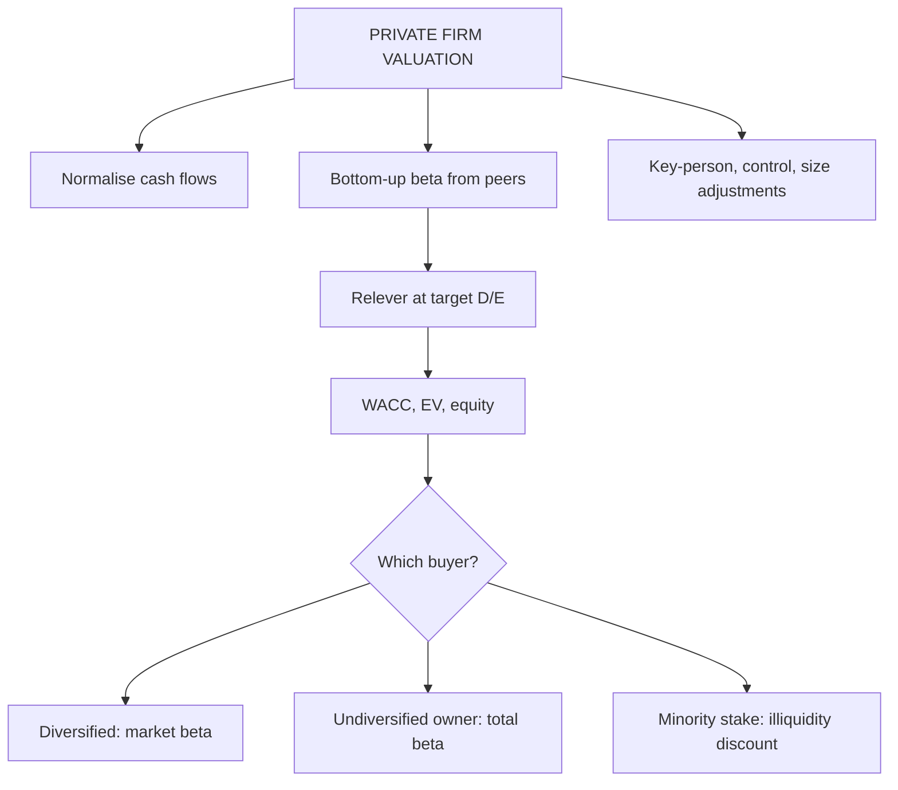

# AD-1: Valuing Private Companies

Covers: what is different about a private firm, normalising its numbers, estimating beta and cost of capital without a market price, the total beta for an undiversified owner, the illiquidity (DLOM) and other discounts, and which answer to give to which buyer. **(syllabus + textbook)**

## Where this fits in the ESE

Private company valuation is a likely 10-mark question and part of the Unit 5 case. The marks are in recognising that **the answer depends on who the buyer is**, and in not double counting the illiquidity penalty.

## What is different about a private firm

| Issue | Listed firm | Private firm |
|---|---|---|
| Market price | Observed daily | None; value must be estimated |
| Beta | Regression on market returns | Not observable: use bottom-up beta from listed peers |
| Debt ratio | Market D/E | No market equity value: use the industry or target D/E |
| Financials | Audited, standard disclosure, scrutinised | Owner-managed, related-party dealings, tax-driven choices |
| Owner diversification | Investors diversified | Owner may hold most wealth in one firm |
| Liquidity | Sell in minutes | Hard to sell; transaction cost and time |
| Key people | Replaceable management | Founder dependence |
| Control | Minority shares | Often whole-firm control transactions |

## Step 1: normalise the cash flows

- **Owner pay** to market level. *Example:* reported EBIT ₹60 crore after the owner draws ₹2 crore; a professional manager costs ₹6 crore, so **normalised EBIT = 60 − 4 = ₹56 crore**. At 10x EBIT that is 560, not 600: 6.7% lower.
- Remove **related-party** transactions priced off-market.
- Remove **personal expenses** run through the firm.
- Align **accounting policies** (depreciation, revenue recognition) with peers.
- Treat **leases** consistently (VF-3).

## Step 2: the discount rate without a market beta

1. **Bottom-up beta:** take unlevered betas of listed peers (AV-1), average them, **relever at the private firm's target D/E**.
2. **Cost of debt** from the firm's actual borrowing or a rating-equivalent rate.
3. **Weights** from the industry or target capital structure, not book.

### Total beta for an undiversified owner

A listed investor holds a diversified portfolio, so only market risk matters. An owner with all wealth in one private firm bears **total risk**. Total beta scales market beta up by dividing by the correlation of the firm with the market:

**Total beta = Market beta ÷ Correlation with the market (ρ)**

Use total beta only when the **buyer or the valuation purpose is an undiversified owner** (a founder, a family, a sole investor). A diversified buyer (a listed company, a fund) prices only market risk.

## Worked example: three answers for one firm

*Hypothetical.* Pavan Foods Pvt Ltd (fictional). Next-year FCFF ₹50 crore, growing 5% for ever. Debt ₹140 crore outstanding. Industry unlevered beta 0.90. Target D/E 0.25 (so D/V = 20%). Tax 25%. Rf 7%, ERP 6%, pre-tax Kd 9%. Correlation of the industry with the market 0.5. Illiquidity discount 20%.

**Step 1.** Relever: βL = 0.90 × [1 + 0.75 × 0.25] = 0.90 × 1.1875 = **1.069** (1.06875).
**Step 2.** Ke (market beta) = 7% + 1.06875 × 6% = **13.41%**.
**Step 3.** After-tax Kd = 9% × 0.75 = 6.75%. WACC = 0.80 × 13.4125% + 0.20 × 6.75% = 10.73% + 1.35% = **12.08%**.
**Step 4.** EV = 50 ÷ (0.1208 − 0.05) = **₹706.2 crore**. Equity = 706.2 − 140 = **₹566.2 crore**.

**Answer A: diversified buyer (listed company or fund), marketable-equivalent value: ₹566.2 crore.**

**Step 5 (illiquidity).** A minority stake that cannot be sold easily: 566.2 × (1 − 0.20) = **₹453.0 crore**. **Answer B.**

**Step 6 (total beta).** Total beta = 1.06875 ÷ 0.5 = **2.1375**.
- Ke = 7% + 2.1375 × 6% = **19.83%**.
- WACC = 0.80 × 19.825% + 0.20 × 6.75% = 15.86% + 1.35% = **17.21%**.
- EV = 50 ÷ (0.1721 − 0.05) = **₹409.5 crore**; equity = 409.5 − 140 = **₹269.5 crore**. **Answer C.**

| Answer | Beta used | Buyer | Equity value (₹ crore) |
|---|---|---|---|
| A | Market beta 1.069 | Diversified, control or marketable | 566.2 |
| B | Market beta, minus 20% illiquidity | Minority investor in the private firm | 453.0 |
| C | Total beta 2.138 | Undiversified owner | 269.5 |

**Decision line:** the three numbers answer three different questions; none is "wrong". For a sale to a listed acquirer quote A; for a minority stake sale B; for the founder judging whether to keep the business as his only asset C. **Do not apply the illiquidity discount on top of total beta:** total beta already prices the owner's lack of diversification, and many practitioners treat the two as overlapping. Say which you use and why.

## Discounts and premiums in private valuation

| Adjustment | When | Typical size |
|---|---|---|
| **Illiquidity (DLOM)** | Minority or non-marketable stake | Judgement; 10% to 30% in practice, wider in studies **[VERIFY]** |
| **Minority discount (lack of control)** | Stake that cannot change policy | Reverse of the control premium |
| **Control premium** | Whole-firm or controlling stake | Value of better management (AD-3) |
| **Key-person discount** | Value depends on the founder | Judgement; reduce cash flow or add risk |
| **Size or specific-risk premium** | Small firms | Added to Ke; peer evidence **[VERIFY]** |

Rule: **a control buyer who can sell, list or restructure faces a lower illiquidity discount; a minority holder with no exit faces a higher one.** The discount must be defensible with evidence (restricted stock studies, pre-IPO prices), so write "judgement supported by market evidence" and show sensitivity at 15%, 20%, 25%.

## Relative valuation for private firms

Apply the multiple of listed peers (EV/EBITDA, P/E) to normalised earnings, then adjust for size, growth, liquidity and control. A discount to listed peers is usual; mention the basis.

## Traps

1. **Using the owner's reported profit** without normalising.
2. **Using total beta for a listed acquirer.**
3. **Applying total beta and a full DLOM together.**
4. **Using the private firm's book D/E in the relevering.** Use the target or industry ratio.
5. **Using the levered peer beta without unlevering.**
6. **Applying a DLOM to a controlling sale** where the buyer can list or sell the whole firm, without evidence.

## What to remember

- Private firm: no price, no beta, weak disclosure, owner concentration, key-person risk.
- Normalise owner pay and related-party items before forecasting.
- Bottom-up beta from peers relevered at the target D/E; total beta = market beta ÷ correlation.
- Pavan Foods: ₹566.2 crore (market beta), ₹453.0 crore (20% illiquidity), ₹269.5 crore (total beta).
- The right answer depends on the buyer; never stack total beta and a full illiquidity discount.

## Concept map

## Flashcards
Q: Why can't you regress a private firm's beta?
A: It has no traded price; use unlevered peer betas relevered at the firm's target D/E (bottom-up beta).

Q: Formula for total beta?
A: Market beta ÷ correlation of the firm with the market.

Q: When is total beta appropriate?
A: When the buyer or owner is undiversified (a founder or family with most wealth in the firm); not for a diversified acquirer.

Q: Market beta 1.06875, correlation 0.5. Total beta and Ke at Rf 7%, ERP 6%?
A: Total beta 2.1375; Ke = 7% + 2.1375 × 6% = 19.83%.

Q: Pavan Foods equity values under market beta, 20% DLOM and total beta?
A: ₹566.2 crore, ₹453.0 crore and ₹269.5 crore.

Q: Why not apply total beta and a full illiquidity discount together?
A: Total beta already prices the owner's lack of diversification; stacking both double counts.

Q: Reported EBIT 60, owner paid 2, professional manager costs 6. Normalised EBIT?
A: 60 − (6 − 2) = ₹56 crore.

Q: Name three adjustments applied to private firm values.
A: Illiquidity (marketability) discount, minority or control adjustment, and key-person discount; also a size premium.

Q: Which debt ratio is used in relevering for a private firm?
A: The target or industry D/E, not book or the owner's actual ratio.

## Sources
- BBA304F-6 syllabus, Unit 5 (valuation of private companies)
- Damodaran, *Investment Valuation*, chapters on private company valuation and on estimating risk parameters; Pratt and Grabowski, *Cost of Capital*
- Previous: [[Corporate Valuation Unit 4 - AV-5 Unit 4 Exam Answers]] · Next: [[Corporate Valuation Unit 5 - AD-2 Valuing High-Growth and Loss-Making Firms]]
- [[Corporate Valuation Unit 5 - Advanced Valuation MOC (Node Map)]]
