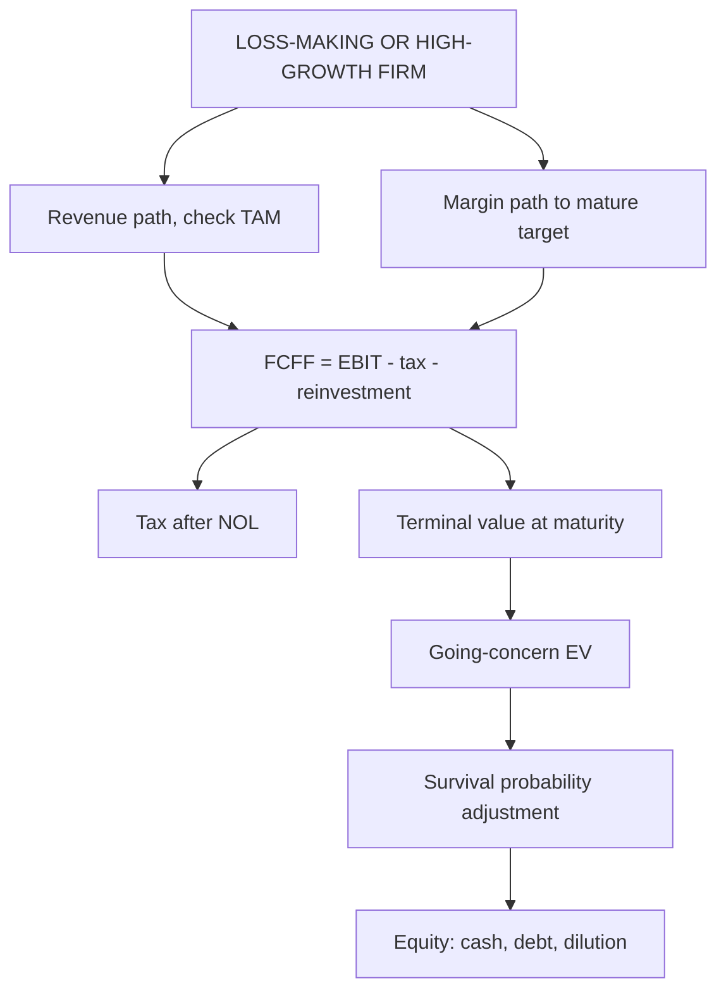

# AD-2: Valuing High-Growth and Loss-Making Firms

Covers: why standard multiples and last year's earnings fail, the revenue-and-margin-path method, tax with net operating losses (NOL), reinvestment, terminal value, the survival adjustment, dilution and cash runway, with a full numerical. **(syllabus + textbook)**

## Where this fits in the ESE

High-growth and loss-making firms (new-age technology, quick commerce, early-stage consumer brands) are the modern case study. The expected layout is a revenue and margin path, a negative-then-positive FCFF table, a terminal value at a mature margin, and a survival or probability adjustment.

## Why the usual tools fail

- **P/E is meaningless:** earnings are negative.
- **Growth from the past** (such as 50% revenue growth) cannot continue; the firm will hit market size limits.
- **Gordon's constant growth fails** because growth is far above the economy for years.
- **Beta from history** is unstable; use bottom-up beta (AV-1, AD-1).
- **Survival is not certain:** many of these firms fail, and a plain DCF ignores that.

## The method: value the firm from its future steady state backwards

1. **Revenue path.** Start with current revenue; apply declining growth rates; check that year-5 revenue is a plausible share of the **total addressable market** (TAM).
2. **Margin path.** Move the operating margin from negative to a **target margin** taken from mature peers, over the same years.
3. **Taxes with NOL.** Losses carry forward and shelter later profits: tax is zero until the NOL pool is used. Carry-forward rules and limits are statutory **[VERIFY]**; the example assumes losses carry forward in full.
4. **Reinvestment** from a **sales-to-capital** ratio: Reinvestment = ΔRevenue ÷ (Sales/Capital). Early years have large negative FCFF.
5. **Cost of capital** starts high for a risky start-up and falls to the mature firm's rate. (The example holds 13% to keep the arithmetic short; say that it is simplified.)
6. **Terminal value** at maturity: g ≤ risk-free rate, ROIC consistent with g (FF-3).
7. **Probability of failure:** value = P(survive) × going-concern value + P(fail) × distress value.
8. **Convert to equity per share:** add cash, subtract debt, and use **fully diluted shares** after expected future funding rounds.

## Worked example: a loss-making growth firm

*Hypothetical.* Tarang Quick Commerce Pvt Ltd (fictional). Revenue today ₹100 crore. Forecast revenue (₹ crore): 150, 210, 270, 320, 360 in years 1 to 5. Operating margin path: −10%, 0%, 6%, 10%, 14% (14% is the mature peer margin). Opening NOL ₹20 crore. Tax 25%. Sales-to-capital 2.0. Cost of capital 13% (factors 0.885, 0.783, 0.693, 0.613, 0.543). Terminal growth 5% with ROIC 16%. Probability of survival 90%; if the firm fails, enterprise value is ₹30 crore (asset sale). Cash on hand ₹30 crore, no debt. **Market check:** year-5 revenue of ₹360 crore is 10% of an assumed ₹3,600 crore addressable market, which is plausible for a leader.

**Step 1.** EBIT: −15.0; 0.0; 16.2; 32.0; 50.4.
**Step 2.** NOL pool: opening 20 + year 1 loss 15 = 35 at the end of year 1; year 2 EBIT is 0 so 35 carries; year 3 uses 16.2 (pool 18.8 left); year 4 uses the remaining 18.8, taxable income 32.0 − 18.8 = 13.2.
**Step 3.** Tax: years 1 to 3 zero; year 4 = 13.2 × 25% = **3.3**; year 5 = 50.4 × 25% = **12.6**.
**Step 4.** Reinvestment = ΔRevenue ÷ 2: 25.0; 30.0; 30.0; 25.0; 20.0.
**Step 5.** FCFF = EBIT − tax − reinvestment.

| Year | Revenue | EBIT | Tax | Reinvestment | FCFF | DF at 13% | PV |
|---|---|---|---|---|---|---|---|
| 1 | 150 | −15.0 | 0.0 | 25.0 | −40.0 | 0.885 | −35.4 |
| 2 | 210 | 0.0 | 0.0 | 30.0 | −30.0 | 0.783 | −23.5 |
| 3 | 270 | 16.2 | 0.0 | 30.0 | −13.8 | 0.693 | −9.6 |
| 4 | 320 | 32.0 | 3.3 | 25.0 | 3.7 | 0.613 | 2.3 |
| 5 | 360 | 50.4 | 12.6 | 20.0 | 17.8 | 0.543 | 9.7 |
| | | | | | | **Sum of PV** | **−56.5** |

**Step 6 (terminal).** Revenue₆ = 360 × 1.05 = 378; EBIT₆ = 378 × 14% = 52.92; NOPAT₆ = 52.92 × 0.75 = **39.69**. Reinvestment rate = 5% ÷ 16% = 31.25%; FCFF₆ = 39.69 × 0.6875 = **27.29**. TV₅ = 27.29 ÷ (0.13 − 0.05) = **341.1**; PV = 341.1 × 0.543 = **185.2**.
**Step 7 (going-concern EV).** −56.5 + 185.2 = **₹128.7 crore**.
**Step 8 (survival).** 0.90 × 128.7 + 0.10 × 30 = 115.83 + 3.0 = **₹118.8 crore**.
**Step 9 (equity).** 118.8 + cash 30 − debt 0 = **₹148.8 crore** (before dilution from future funding).

| Probability of survival | Value of operations (₹ crore) |
|---|---|
| 90% | 118.8 |
| 80% | 109.0 |
| 70% | 99.1 |

**Decision line:** value is all in the terminal value (PV of TV 185.2 against −56.5 for the first five years), so the valuation is a bet on reaching a 14% margin on ₹360 crore of revenue. State the value of operations as **₹99.1 crore to ₹128.7 crore** (survival odds of 70% to 100%), not a point. The first three years burn ₹83.8 crore (40.0 + 30.0 + 13.8; present value −68.5), while cash is only ₹30 crore, less than one year of burn. Interpretation: more funding, and so more dilution, is certain, and the value per share to today's shareholders is below ₹148.8 crore divided by today's share count.

**Value of the NOL.** Tax saved because of the NOL = 35 × 25% = **₹8.75 crore** (year 3 saves 16.2 × 25% = 4.05; year 4 saves 8.0 − 3.3 = 4.70), present value 4.05 × 0.693 + 4.70 × 0.613 = **₹5.69 crore**. The NOL is real but small beside the terminal value.

## Cross-checks for firms with no earnings

- **EV/Sales:** 128.7 ÷ 100 = 1.29x current sales, 0.36x year-5 sales. Compare with listed peers' multiples after allowing for growth.
- **Implied market share and margin:** what must be true for today's price to be right?
- **Venture capital method (VF-2)** for the exit-based view.

## Traps

1. **Using trailing earnings or P/E** when earnings are negative.
2. **Letting growth run above the economy's rate into the terminal value.**
3. **Ignoring reinvestment** (growth with no capital).
4. **Applying a mature margin from year 1** or never reaching it.
5. **Forgetting taxes after the NOL is used.**
6. **No survival or failure adjustment.**
7. **Ignoring dilution from future rounds.**
8. **Valuing at the high start-up discount rate for ever** instead of fading it to a mature rate.

## What to remember

- Loss-making firms: build a revenue path and a margin path to a mature target, not a multiple of current earnings.
- FCFF is negative early; tax is zero until the NOL is used (NOL value here 35 × 25% = ₹8.75 crore, PV ₹5.69 crore).
- Tarang: PV of years 1 to 5 −56.5, PV of TV 185.2, going-concern EV ₹128.7 crore; with 90% survival ₹118.8 crore.
- Terminal value uses g ≤ risk-free and consistent ROIC; check TAM and market share.
- Adjust for failure probability and dilution; report a range.

## Concept map

## Flashcards
Q: Why does P/E fail for a loss-making firm?
A: Earnings are negative or tiny, so the ratio is meaningless; value must come from future revenue and margins.

Q: Two paths you forecast for a young firm?
A: A declining revenue growth path and an operating margin path converging to a mature peer margin.

Q: How is tax computed with an NOL?
A: Tax is zero until accumulated losses are used up; then tax is charged on EBIT in excess of the remaining NOL.

Q: Tarang NOL pool and value?
A: Opening 20 + loss 15 = 35; tax saved 35 × 25% = ₹8.75 crore, PV ₹5.69 crore.

Q: Tarang year 1 FCFF?
A: EBIT −15.0 − tax 0 − reinvestment 25.0 = −₹40.0 crore.

Q: Tarang terminal value and its PV?
A: FCFF₆ 27.29; TV₅ = 27.29 ÷ 0.08 = 341.1; PV = 185.2.

Q: Going-concern EV and value with 90% survival (failure value 30)?
A: ₹128.7 crore; 0.9 × 128.7 + 0.1 × 30 = ₹118.8 crore.

Q: Why is the survival adjustment needed?
A: Many young firms fail; a DCF of the success case overstates expected value.

Q: What must you check about year-5 revenue?
A: That it is a plausible share of the total addressable market.

## Sources
- BBA304F-6 syllabus, Unit 5 (valuation of high-growth and loss-making firms)
- Damodaran, *Investment Valuation*, chapter on valuing young and start-up firms; Koller et al., *Valuation*, high-growth and start-up valuation
- Carry-forward of business losses under the Income-tax Act **[VERIFY]**
- Previous: [[Corporate Valuation Unit 5 - AD-1 Valuing Private Companies]] · Next: [[Corporate Valuation Unit 5 - AD-3 Mergers and Acquisitions and Synergy Valuation]]
- [[Corporate Valuation Unit 5 - Advanced Valuation MOC (Node Map)]]
