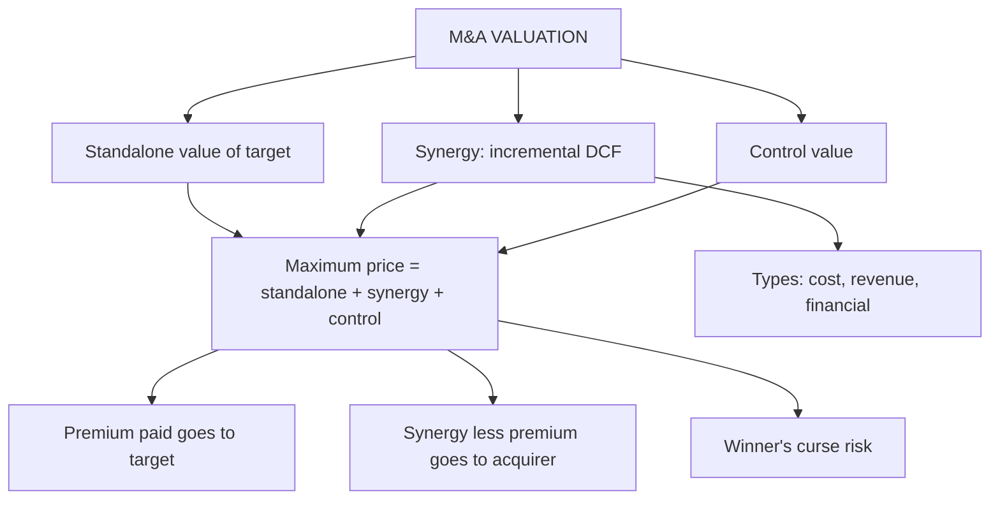

# AD-3: Valuation in Mergers and Acquisitions, and Synergy Valuation

Covers: the M&A valuation framework (standalone value, synergy, control, maximum bid), types of synergy, valuing synergy by discounted incremental cash flows (the "non-EVA" route in the syllabus), how value splits between buyer and seller, and the traps. **(syllabus + textbook)**

## Where this fits in the ESE

"Explain synergy and show how it is valued" is a likely 10-mark question; the incremental-cash-flow numerical and the maximum bid logic also feed the 15-mark case in AD-5.

## The M&A valuation framework

**Value to the acquirer of the target = Standalone value of the target + Value of synergy + Value of control (if poorly managed).**

- **Standalone value:** DCF or multiples of the target as it is run today (Units 2 to 4).
- **Synergy:** extra value created by combining the two firms.
- **Control:** extra value from running the target better (restructuring), separate from synergy.
- **Maximum price** the acquirer can pay without losing value = standalone + synergy (+ control value).
- **Minimum price** the target will accept = its standalone value (or its market value if higher).

**Gain split:**
- Value created for the target's shareholders = **price paid − standalone value** (the premium).
- Value created for the acquirer = **synergy (and control value) − premium paid**.

## Types of synergy

| Type | Source | How it is modelled |
|---|---|---|
| **Operating: cost** | Economies of scale, removing duplicate functions, procurement | Lower costs, higher operating margin |
| **Operating: revenue** | Cross-selling, wider distribution, pricing power | Higher revenue growth |
| **Operating: reinvestment** | Shared plant, lower working capital | Lower capex or working capital |
| **Financial** | Tax benefits (use of losses, depreciation step-up), greater debt capacity, lower cost of capital | Higher after-tax cash flow or lower WACC |
| **Diversification** | Lower earnings volatility | Usually **no value** for diversified shareholders; they can diversify themselves |

**Synergy valuation here is conceptual and non-EVA based:** build the **incremental after-tax cash flows** from the combination and discount them at a rate matching their risk. (An economic value added route exists but is not required by this syllabus.)

## Worked example: valuing synergy and the bid

*Hypothetical.* Acquirer A Ltd (fictional) is considering buying T Ltd (fictional), a listed firm whose unaffected market capitalisation and standalone DCF value are both **₹1,000 crore**. Tax 25%; discount rate for synergies 10% (the target's risk; discount factors 0.909 for year 1). The planned synergies:

- **Cost savings:** pre-tax run-rate ₹40 crore a year, 50% achieved in year 1 and 100% from year 2 onwards, flat for ever.
- **Integration cost:** ₹60 crore pre-tax in year 1, tax-deductible.

**Step 1 (year 1 after tax).** Savings 20 − integration 60 = −40 pre-tax; × 0.75 = **−30**.
**Step 2 (year 2 onwards).** 40 × 0.75 = **30** a year for ever.
**Step 3 (PV).**
- Year 1: −30 × 0.909 = **−27.3**.
- Years 2 onwards: value at the end of year 1 = 30 ÷ 0.10 = 300; PV = 300 × 0.909 = **272.7**.
**Step 4.** **Synergy value = −27.3 + 272.7 = ₹245.4 crore.**
**Step 5 (maximum bid).** 1,000 + 245.4 = **₹1,245.4 crore**, a 24.5% premium to market.
**Step 6 (offer).** Suppose A offers a 15% premium: 1,000 × 1.15 = **₹1,150 crore**.

| Item | ₹ crore |
|---|---|
| Standalone value of T | 1,000.0 |
| + Value of synergy | 245.4 |
| **Maximum price (walk-away)** | **1,245.4** |
| Offer at 15% premium | 1,150.0 |
| Gain to T's shareholders (1,150 − 1,000) | 150.0 |
| Gain to A's shareholders (245.4 − 150.0) | 95.4 |
| T's share of the synergy | 61.1% |

**Decision line:** at ₹1,150 crore the deal adds ₹95.4 crore to A's shareholders and passes. The walk-away price is ₹1,245.4 crore; above it A transfers value to T. Interpretation: the offer is sensitive to synergy realisation. If only 60% of the planned savings are achieved (12 in year 1, 24 from year 2, integration cost unchanged), year 1 is (12 − 60) × 0.75 = −36 (PV −32.7) and later years are 24 × 0.75 = 18 (PV 18 ÷ 0.10 × 0.909 = 163.6), so synergy falls to **₹130.9 crore**, the maximum bid to ₹1,130.9 crore, and a ₹1,150 crore offer then destroys ₹19.1 crore of value. Price below the realistic, not the hoped-for, synergy.

## Value of control

If the target's management is poor, a buyer who can restructure gains the difference between the **optimally run value** and the **status quo value**. *Example:* status quo ₹1,000 crore; restructured ₹1,120 crore; value of control = **₹120 crore**. Do not double count: control value and synergy are separate lines, and market prices of listed firms already include some expectation of a takeover.

## Other valuation points in deals

- **Consideration:** cash, shares, or a mix. A share offer shares the synergy risk; the exchange ratio = offer price per target share ÷ acquirer's share price.
- **Contingent payment:** earn-outs tie part of the price to performance (AD-4).
- **Method of valuing the combined firm:** value both firms standalone, value the merged firm with the new assumptions; the difference is the synergy.
- **Regulatory and process points** (takeover code pricing, competition review, valuation by registered valuers) change over time **[VERIFY]**.
- **Winner's curse:** in an auction the winner tends to be the bidder with the most optimistic synergy estimate, so winners often overpay. Some large cross-border takeovers by Indian groups are often discussed in this light; check the facts **[VERIFY]** before citing any specific deal.

## Traps

1. **Paying away all the synergy** in the premium: no gain to the acquirer.
2. **Counting synergy that shareholders could achieve themselves** (pure diversification).
3. **Ignoring integration costs and the time to realise savings.**
4. **Using the acquirer's cost of capital for the target's synergies.** Use a rate that reflects the risk of the synergy cash flows.
5. **Double counting synergy:** the standalone market price may already embed a takeover premium.
6. **Treating control value and synergy as the same.**
7. **Overstating revenue synergies,** which are harder to achieve than cost savings.

## What to remember

- Maximum bid = standalone value + synergy (+ control value); target's minimum = standalone value.
- Premium paid goes to the target; synergy minus premium goes to the acquirer.
- Value synergy by discounting incremental after-tax cash flows: the example gives ₹245.4 crore, maximum price ₹1,245.4 crore.
- At a 15% premium (₹1,150 crore) the acquirer gains ₹95.4 crore; the target keeps 61.1% of the synergy.
- Cost synergies are credible; revenue synergies and pure diversification are weak; account for integration cost and the winner's curse.

## Concept map

## Flashcards
Q: Maximum price an acquirer should pay?
A: Standalone value of the target plus synergy (plus control value if the target is poorly run).

Q: Who gets what in a deal?
A: Target's shareholders gain the premium over standalone value; the acquirer gains synergy minus the premium.

Q: Name the types of synergy.
A: Operating (cost, revenue, reinvestment), financial (tax, debt capacity), and diversification (usually no value).

Q: How is synergy valued without EVA?
A: Discount the incremental after-tax cash flows from the combination at a rate matching their risk, net of integration costs.

Q: Savings ₹40 crore pre-tax run-rate (50% in year 1), integration cost ₹60 crore, tax 25%, rate 10%. Synergy?
A: Year 1 −30 (PV −27.3), then 30 a year for ever (PV 272.7); synergy ₹245.4 crore.

Q: Target standalone ₹1,000 crore, synergy ₹245.4 crore. Maximum price and premium?
A: ₹1,245.4 crore; premium 24.5%.

Q: Offer ₹1,150 crore. Gain to acquirer and to target?
A: Acquirer ₹95.4 crore; target ₹150 crore (61.1% of the synergy).

Q: What is the winner's curse?
A: The winning bidder tends to have the most optimistic estimate of value, so winners overpay on average.

Q: Why is diversification not a valid synergy for a listed target?
A: Its shareholders can diversify on their own at low cost, so the combination adds no value for them.

## Sources
- BBA304F-6 syllabus, Unit 5 (valuation in mergers and acquisitions; synergy valuation, conceptual and non-EVA based)
- Damodaran, *Investment Valuation*, chapter on acquisitions and takeovers; Koller et al., *Valuation*, mergers and acquisitions
- Previous: [[Corporate Valuation Unit 5 - AD-2 Valuing High-Growth and Loss-Making Firms]] · Next: [[Corporate Valuation Unit 5 - AD-4 Uncertainty Information Asymmetry and Ethics]]
- [[Corporate Valuation Unit 5 - Advanced Valuation MOC (Node Map)]]
