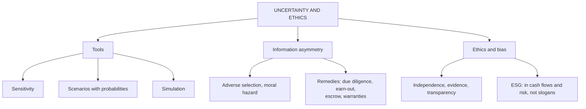

# AD-4: Valuation under Uncertainty, Information Asymmetry and Ethics

Covers: scenario analysis, sensitivity and simulation, expected-value valuation, information asymmetry in deals and how contracts handle it, and the ethical issues, bias and professional standards that govern valuers. **(syllabus + textbook)**

## Where this fits in the ESE

This is a theory-heavy Unit 5 topic, so expect a 5-mark or 10-mark discussion question. The scenario numerical is short. Ethics answers score best with a concrete example of pressure on inputs and the defence.

## Valuation under uncertainty

Uncertainty comes from estimation, from the firm, and from the economy (VF-4). Three tools respond to it:

| Tool | What it does | Strength | Weakness |
|---|---|---|---|
| **Sensitivity analysis** | Changes one input at a time (WACC, g) and shows the value | Simple; shows which input matters | Ignores that inputs move together and gives no probabilities |
| **Scenario analysis** | Builds 3 to 5 coherent stories (bull, base, bear) with linked inputs, assigns probabilities | Captures linked changes; gives expected value | Probabilities are judgement |
| **Simulation (Monte Carlo)** | Draws inputs from distributions many times and builds a distribution of values | Full range and percentiles | Needs distributions; can feel more precise than it is |

(Decision trees and real options handle staged decisions and flexibility; mention only.)

### Worked example 1: scenario-weighted value

*Hypothetical.* A firm's enterprise value under three scenarios (₹ crore):

| Scenario | Story | Probability | Value |
|---|---|---|---|
| Bull | Fast growth, margin expansion | 25% | 1,400 |
| Base | Plan achieved | 50% | 1,000 |
| Bear | Competition, margin squeeze | 25% | 500 |

**Step 1.** Expected value = 0.25 × 1,400 + 0.50 × 1,000 + 0.25 × 500 = 350 + 500 + 125 = **₹975 crore**.
**Step 2.** Range = 500 to 1,400; base case is 1,000.

**Decision line:** the probability-weighted value (975) is below the base case (1,000) because the downside is wider than the upside. A bid based on the base case pays for the plan being achieved; the expected value says pay about 975, and show the 500 to 1,400 range. Interpretation: the decision should rest on expected value and the loss in the bear case, not on the base case alone.

## Information asymmetry

**Information asymmetry:** one party (the seller, management or promoter) knows more than the other (the buyer or outside investor).

- **Adverse selection (the lemons problem):** sellers of weak firms are keen to sell, so a buyer who cannot tell good from bad pays a price that averages them, and good sellers withdraw.
- **Moral hazard:** after the deal, managers with less at stake may act in ways that reduce value.
- **Signalling:** a promoter keeping a large stake, or a buy-back, signals confidence.
- **Effect on valuation:** buyers add a risk premium or discount, or insist on protection.

**Remedies in deals**
1. **Due diligence:** financial, legal, tax, commercial, ESG.
2. **Earn-outs and deferred consideration:** pay part only if targets are met.
3. **Escrow and holdbacks:** part of the price held back against claims.
4. **Warranties and indemnities:** seller compensates for undisclosed liabilities.
5. **Staged investment and milestones** (venture capital, convertible instruments).
6. **Promoter rollover:** seller keeps a stake.

### Worked example 2: earn-out

*Hypothetical.* A buyer offers ₹1,000 crore upfront plus an earn-out of ₹200 crore, payable in 2 years only if EBITDA targets are met. The buyer judges the chance of meeting the target at 40%. Discount rate 10%.

**Step 1.** Expected earn-out = 0.40 × 200 = **₹80 crore**.
**Step 2.** PV = 80 ÷ 1.10² = 80 ÷ 1.21 = **₹66.1 crore**.
**Step 3.** Expected value of the offer = 1,000 + 66.1 = **₹1,066.1 crore**.

**Decision line:** the headline offer is ₹1,200 crore but the expected cost is ₹1,066.1 crore. The earn-out lets the buyer bid a higher headline while paying more only if the seller's own optimism proves right: it is a way of testing the seller's information. The seller should compare ₹1,066.1 crore with other bids, not the headline.

## Bias and ethics in valuation

**Sources of bias** (VF-4): the client's wishes, the valuer's incentive (fee, relationship, contingent fee), anchoring on a target price, confirmation bias, selective comparables, over-optimism in growth and underestimation of risk.

### Worked example 3: how little it takes to move a value

*Hypothetical.* FCFF₁ ₹100 crore, WACC 11%. Base growth 5%: value = 100 ÷ 0.06 = **₹1,666.7 crore**. The client asks for 6% "to match the bid": value = 100 ÷ 0.05 = **₹2,000.0 crore**, up **20.0%** for one point of growth. A request like this is **not a small judgement call**: it must be justified by evidence (ROIC, reinvestment, market growth), otherwise the valuer should refuse and document the disagreement.

**Ethical principles for a valuer**
1. **Independence and objectivity:** no fee linked to the value reached; disclose conflicts of interest.
2. **Competence and due care:** use methods suited to the purpose; document sources.
3. **Transparency:** state assumptions, limits, the date of valuation and the purpose (a valuation for one purpose may not suit another).
4. **Confidentiality** of client information.
5. **No misleading presentation:** show ranges, do not hide adverse scenarios.
6. **Refuse pressure** to alter inputs without evidence.

**Regulatory and professional frame in India (verify before quoting section numbers)**
- Companies Act 2013 provisions on **registered valuers** and the rules made under them, with the Insolvency and Bankruptcy Board of India as the regulator of valuers **[VERIFY]**.
- **ICAI Valuation Standards** and international valuation standards **[VERIFY]**.
- SEBI rules on pricing and disclosure in public issues, preferential allotments and takeovers **[VERIFY]**.
- RBI and FEMA valuation norms for foreign investment **[VERIFY]**.

**Sustainability link (cross-cutting issue in the syllabus).** ESG matters enter value through **cash flows** (carbon costs, compliance spending, product demand), **risk and discount rates** (climate and governance risk), and **terminal value** (assets that may be stranded). Ethical practice means including material ESG risk with evidence, not applying a vague "ESG premium" or discount, and not using sustainability claims to inflate value (greenwashing).

## Traps

1. **Quoting the base case as the expected value.**
2. **Treating scenario probabilities as facts.**
3. **Believing simulation removes uncertainty.**
4. **Quoting the headline price of an earn-out deal** instead of the expected value.
5. **Listing ethics as slogans** without a concrete example and a defence.
6. **Quoting section numbers from memory.**

## What to remember

- Uncertainty tools: sensitivity (one input), scenarios (linked inputs with probabilities), simulation (distributions). Report a range.
- Scenario example: expected value ₹975 crore against a ₹1,000 crore base case.
- Information asymmetry causes adverse selection and moral hazard; remedies are due diligence, earn-outs, escrow, warranties, staging.
- Earn-out example: ₹1,000 crore upfront plus 40% × ₹200 crore discounted two years is ₹1,066.1 crore, not ₹1,200 crore.
- Ethics: independence, transparency, evidence for inputs, refusing pressure; one point of growth moved value 20% in the example.

## Concept map

## Flashcards
Q: Difference between sensitivity and scenario analysis?
A: Sensitivity changes one input at a time; scenarios change linked inputs together and assign probabilities.

Q: Scenarios bull 25% at 1,400, base 50% at 1,000, bear 25% at 500. Expected value?
A: 350 + 500 + 125 = ₹975 crore, below the base case because the downside is wider.

Q: What is adverse selection in deals?
A: Weak firms are keen to sell, so buyers who cannot judge quality price in an average and good sellers withdraw.

Q: Name four remedies for information asymmetry.
A: Due diligence, earn-outs, escrow or holdbacks, and warranties and indemnities; also staged investment and promoter rollover.

Q: ₹1,000 crore upfront plus ₹200 crore earn-out in 2 years at 40% probability, 10%. Expected offer value?
A: 80 ÷ 1.21 = 66.1; total ₹1,066.1 crore.

Q: FCFF₁ 100, WACC 11%. Value change when g goes from 5% to 6%?
A: 1,666.7 to 2,000.0: up 20.0%, so a client's request to raise g needs evidence.

Q: Name three principles of valuer ethics.
A: Independence and objectivity, transparency of assumptions and purpose, and refusing pressure to alter inputs without evidence.

Q: How does ESG enter a valuation?
A: Through cash flows, discount rates (risk) and terminal value; not as an unexplained premium or discount.

Q: Why should regulatory references carry a [VERIFY] tag?
A: Rules, thresholds and section numbers change; state only what you can confirm.

## Sources
- BBA304F-6 syllabus, Unit 5 (valuation under uncertainty and information asymmetry; ethical issues and bias)
- Damodaran, *Investment Valuation*, chapters on estimation uncertainty and on managing uncertainty (scenario, simulation); Koller et al., *Valuation*, scenario analysis
- Regulatory points marked **[VERIFY]** need checking against the current Companies Act, rules, ICAI standards and SEBI regulations
- Previous: [[Corporate Valuation Unit 5 - AD-3 Mergers and Acquisitions and Synergy Valuation]] · Next: [[Corporate Valuation Unit 5 - AD-5 Unit 5 Exam Answers]]
- [[Corporate Valuation Unit 5 - Advanced Valuation MOC (Node Map)]]
