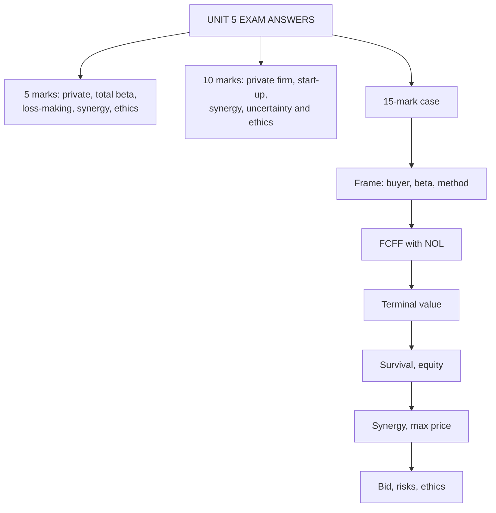

# AD-5: Unit 5 Exam Answers

Covers: what the ESE will ask from Unit 5, 5-mark and 10-mark skeletons, and a full model 15-mark case that combines a private, loss-making, high-growth target with synergy and a bid recommendation. Numbers come from AD-1 to AD-4.

## What the test will ask

Unit 5 is CO3 and CO4 (analyse and evaluate) and CO5 (case studies), so it is the most likely source of the 15-mark case: a private or loss-making target in an acquisition, asking for a value, a bid and a defence. Section A and B questions come from the five topics: private firms, high-growth and loss-making firms, M&A and synergy, uncertainty and information asymmetry, ethics and bias. Confirm the Section B mark split with the faculty (the syllabus text is inconsistent).

## Five-mark answer skeletons

**1. Why is valuing a private company different? (AD-1).** Table: no price, no beta, weak disclosure, owner concentration, illiquidity, key-person; then bottom-up beta and normalisation in one line each.

**2. Total beta and when to use it (AD-1).** Formula market beta ÷ correlation; undiversified owner only; example 1.069 ÷ 0.5 = 2.138, Ke 19.83%; warn against stacking with a full illiquidity discount.

**3. Illiquidity discount and other adjustments (AD-1).** DLOM, minority and control, key-person, size; sensitivity 15% to 25%; Pavan example 566.2 to 453.0.

**4. Valuing a loss-making high-growth firm (AD-2).** Revenue path, margin path, NOL tax, reinvestment, terminal value at maturity, survival adjustment; headline Tarang EV 128.7, 118.8 with survival.

**5. Types of synergy and how to value it (AD-3).** Operating, financial, diversification; incremental after-tax cash flows; example 245.4; maximum price = standalone + synergy.

**6. Bias and ethics in valuation (AD-4).** Sources of bias, principles (independence, transparency, evidence), one concrete example (growth 5% to 6% raises value 20%), ESG in cash flows and risk.

**7. Information asymmetry in deals (AD-4).** Adverse selection, moral hazard, remedies (due diligence, earn-out, escrow, warranties); earn-out example 1,066.1.

## Ten-mark answer skeletons

**A. "Explain how you would value a private company for acquisition by a listed firm" (AD-1).**
1. Differences from a listed firm (2). 2. Normalising cash flows (2). 3. Bottom-up beta and WACC (3). 4. Discounts, and which buyer needs which (3).

**B. "Value a loss-making start-up and explain the adjustments" (AD-2).**
1. Revenue and margin paths with a TAM check (3). 2. FCFF table with NOL tax (3). 3. Terminal value and survival adjustment (2). 4. Cash runway and dilution (2).

**C. "Explain synergy valuation and the maximum bid, with an example" (AD-3).**
1. Types (2). 2. Incremental cash flow method and numerical (4). 3. Maximum price, split of gains, winner's curse (4).

**D. "Discuss uncertainty, information asymmetry and ethics in valuation" (AD-4).**
1. Tools: sensitivity, scenario, simulation with the 975 example (3). 2. Asymmetry and remedies (3). 3. Ethics, bias, ESG, regulators flagged [VERIFY] (4).

## Fifteen-mark case layout (private, loss-making, M&A)

1. **Framing (3 marks):** who is the buyer, what question, which method and why (DCF with margin path; market beta because the buyer is diversified; control purchase).
2. **FCFF table (4 marks):** revenue, EBIT, tax after NOL, reinvestment, FCFF, PV.
3. **Terminal value (2 marks):** g ÷ ROIC reinvestment; TV and PV.
4. **EV to equity with risk adjustments (2 marks):** survival adjustment, debt and cash; private-firm treatment stated.
5. **Synergy and bid (2 marks):** incremental cash flows, maximum price, opening bid.
6. **Recommendation and risks (2 marks):** value range, what flips the decision, ethical or process note.

### Model case

*Hypothetical.* Sahyadri Beverages Ltd (fictional, listed) is considering buying 100% of Tarang Foods Pvt Ltd (fictional), a private firm in the packaged beverage business, founded by a family. Tarang is loss-making and growing fast. Data in ₹ crore:

| | Year 1 | Year 2 | Year 3 | Year 4 |
|---|---|---|---|---|
| Revenue (today: 200) | 260 | 320 | 380 | 420 |
| EBIT margin | −5% | 3% | 9% | 12% |

- Opening tax-loss carry-forward (NOL) ₹20 crore; tax 25%; losses carry forward in full **[VERIFY]**.
- Reinvestment = ΔRevenue ÷ 2 (sales-to-capital 2.0).
- After year 4: growth 5% for ever, ROIC 15%, EBIT margin stays 12%.
- Cost of capital 13% (bottom-up market beta; Sahyadri is diversified). Discount factors 0.885, 0.783, 0.693, 0.613.
- Probability that Tarang survives to maturity: 80%. If it fails, enterprise value ₹30 crore.
- Debt ₹25 crore, cash ₹10 crore.
- Synergy if Sahyadri buys: integration cost ₹16 crore pre-tax in year 1; cost savings ₹8 crore pre-tax in year 2 and ₹12 crore pre-tax from year 3 onwards for ever. Synergies are discounted at 13%.

**Value Tarang, estimate the value of synergy and advise on the bid, with the private-firm and ethical points a valuer should state.**

**Model answer**

**1. Framing.** The buyer is a listed, diversified company taking control, so use **market beta (no total beta)** and **no marketability discount** on a 100% purchase. The target is loss-making, so value it from a revenue and margin path with tax after NOL, a terminal value at maturity, and a survival adjustment. P/E cannot be used. Normalise owner pay and related-party items in the family's accounts before forecasting (not quantified in the data).

**2. FCFF table (₹ crore).**
- EBIT: 260 × −5% = −13.0; 320 × 3% = 9.6; 380 × 9% = 34.2; 420 × 12% = 50.4.
- NOL pool: 20 + 13.0 = 33.0 after year 1; year 2 uses 9.6, leaving 23.4; year 3 uses 23.4, leaving 0, so taxable income = 34.2 − 23.4 = 10.8.
- Tax: 0; 0; 10.8 × 25% = 2.7; 50.4 × 25% = 12.6.
- Reinvestment: 60 ÷ 2 = 30.0; 60 ÷ 2 = 30.0; 60 ÷ 2 = 30.0; 40 ÷ 2 = 20.0.

| Year | Revenue | EBIT | Tax | Reinvestment | FCFF | DF at 13% | PV |
|---|---|---|---|---|---|---|---|
| 1 | 260 | −13.0 | 0.0 | 30.0 | −43.0 | 0.885 | −38.1 |
| 2 | 320 | 9.6 | 0.0 | 30.0 | −20.4 | 0.783 | −16.0 |
| 3 | 380 | 34.2 | 2.7 | 30.0 | 1.5 | 0.693 | 1.0 |
| 4 | 420 | 50.4 | 12.6 | 20.0 | 17.8 | 0.613 | 10.9 |
| | | | | | | **Sum of PV** | **−42.2** |

**3. Terminal value.**
- Revenue₅ = 420 × 1.05 = 441; EBIT₅ = 441 × 12% = 52.92; NOPAT₅ = 52.92 × 0.75 = **39.69**.
- Reinvestment rate = g ÷ ROIC = 5% ÷ 15% = 33.3%; FCFF₅ = 39.69 × 2/3 = **26.46**.
- TV₄ = 26.46 ÷ (0.13 − 0.05) = **330.75**; PV = 330.75 × 0.613 = **202.7**.
- **Going-concern EV = −42.2 + 202.7 = ₹160.5 crore.**

**4. EV to equity.**
- Survival-adjusted value = 0.80 × 160.5 + 0.20 × 30 = 128.4 + 6.0 = **₹134.4 crore**.
- Equity = 134.4 − debt 25 + cash 10 = **₹119.4 crore** (standalone value to a diversified controlling buyer).
- Other buyers: a minority financial investor with no exit would apply an illiquidity discount (15% gives 119.4 × 0.85 = **₹101.5 crore**); the founding family, if undiversified, would use total beta and obtain a lower value (not computed here).

**5. Synergy.** After tax: year 1 = −16 × 0.75 = **−12.0**; year 2 = 8 × 0.75 = **6.0**; year 3 onwards = 12 × 0.75 = **9.0** a year for ever.
- PV year 1 = −12.0 × 0.885 = −10.6.
- PV year 2 = 6.0 × 0.783 = 4.7.
- PV of year 3 onwards: value at the end of year 2 = 9.0 ÷ 0.13 = 69.2; PV = 69.2 × 0.783 = 54.2.
- **Synergy = −10.6 + 4.7 + 54.2 = ₹48.3 crore.**
- **Maximum price = 119.4 + 48.3 = ₹167.7 crore** (40.5% above standalone).
- Giving the founders 30% to 50% of the synergy: 119.4 + 0.30 × 48.3 = 133.9 to 119.4 + 0.50 × 48.3 = about 143.6, so an **opening bid of about ₹134 crore and a ceiling near ₹144 crore**.

| Item | ₹ crore |
|---|---|
| Going-concern EV | 160.5 |
| Survival-adjusted EV | 134.4 |
| Standalone equity | 119.4 |
| + Synergy | 48.3 |
| **Maximum price** | **167.7** |
| Recommended range | about 134 to 144 |

**6. Recommendation and risks.**
- **Bid ₹134 crore to ₹144 crore; never above ₹167.7 crore.** At ₹144 crore Sahyadri keeps about ₹23.7 crore of the synergy (167.7 − 144).
- **The terminal value PV (202.7) is larger than the EV (160.5)** because the first four years burn cash. The value is a bet on a 12% margin at ₹441 crore revenue; verify it with peers and market size.
- **Survival:** each 10 points of survival probability moves EV by (160.5 − 30) × 0.10 = **₹13.05 crore**. At 60% survival, EV is 0.6 × 160.5 + 0.4 × 30 = ₹108.3 crore.
- **Synergy risk:** cost savings are more credible than revenue synergies; test a 60% realisation case (AD-3).
- **Information asymmetry:** use due diligence on the family's books and related-party items, and propose an **earn-out** (part of the price paid only if year 3 EBIT meets plan) plus promoter rollover to cover key-person risk.
- **Ethics:** the valuer should be independent of the success fee, document every assumption, and refuse to raise growth or margin to justify a bid already agreed.

**Interpretation line to write:** "Tarang is worth about ₹119 crore as a standalone business (₹160.5 crore EV before a 20% failure risk), with ₹48 crore of synergy for Sahyadri; bid ₹134 to ₹144 crore, walk away above ₹167.7 crore, and protect against the key risks with an earn-out."

## Self-test

- Rebuild the Tarang NOL schedule: which years have zero tax and why?
- Which beta would you use if the buyer were the founding family, and what would happen to value?
- Say in one sentence why the survival adjustment lowers value even though the terminal value looks large.

## What to remember

- Case layout: framing, FCFF with NOL, terminal value, equity with survival adjustment, synergy, recommendation with risks.
- Tarang: PV of years 1 to 4 −42.2, PV of TV 202.7, EV 160.5, survival-adjusted 134.4, equity 119.4.
- Synergy ₹48.3 crore; maximum price ₹167.7 crore; recommended bid ₹134 to ₹144 crore.
- Buyer decides beta and discounts: diversified controlling buyer means market beta and no DLOM; minority holder means DLOM; undiversified owner means total beta.
- Close with risks, an earn-out for information asymmetry and the valuer's independence.

## Concept map

## Flashcards
Q: Tarang year 1 to 4 FCFF?
A: −43.0, −20.4, 1.5 and 17.8 (₹ crore).

Q: Tarang NOL treatment?
A: 20 + 13 = 33 pool; year 2 uses 9.6, year 3 uses 23.4; tax is zero in years 1 and 2, 2.7 in year 3, 12.6 in year 4.

Q: Tarang terminal value and PV?
A: FCFF₅ 26.46; TV₄ = 26.46 ÷ 0.08 = 330.75; PV 202.7.

Q: Tarang going-concern EV and survival-adjusted value?
A: ₹160.5 crore; 0.8 × 160.5 + 0.2 × 30 = ₹134.4 crore.

Q: Tarang standalone equity value?
A: 134.4 − 25 + 10 = ₹119.4 crore.

Q: Tarang synergy and maximum price?
A: Synergy ₹48.3 crore (−10.6 + 4.7 + 54.2); maximum price ₹167.7 crore.

Q: Recommended bid range and walk-away?
A: About ₹134 crore to ₹144 crore; walk away above ₹167.7 crore.

Q: Why use market beta, not total beta, for Sahyadri?
A: The buyer is a diversified listed company, so only market risk is priced; total beta is for an undiversified owner.

Q: How much does 10 points of survival probability move Tarang's EV?
A: (160.5 − 30) × 10% = ₹13.05 crore.

Q: How do you protect against information asymmetry in the deal?
A: Due diligence, an earn-out tied to year 3 EBIT, escrow or warranties, and promoter rollover.

## Sources
- BBA304F-6 syllabus (ESE pattern, Unit 5)
- Nodes AD-1 to AD-4 in this unit
- Previous: [[Corporate Valuation Unit 5 - AD-4 Uncertainty Information Asymmetry and Ethics]]
- [[Corporate Valuation Unit 5 - Advanced Valuation MOC (Node Map)]]
