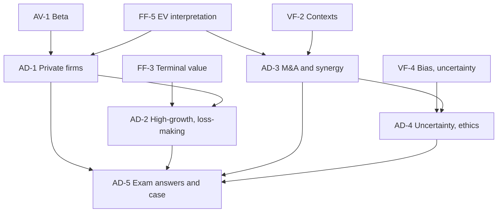

# Corporate Valuation Unit 5: Advanced Valuation Issues and Applications, node map

ESE: 50 marks; Section A 3 × 5, Section B 2 × 10 (assumed), Section C one 15-mark case. Unit 5 is CO3, CO4 and CO5 (analyse, evaluate, case studies) and the likeliest source of the case. All examples are **hypothetical numbers** (Pavan Foods, Tarang Quick Commerce, Tarang Foods, A Ltd, T Ltd and Sahyadri Beverages are fictional). No faculty slides yet, so content is labelled (syllabus) or (textbook). Regulatory points carry [VERIFY].

## Nodes

| Node | Topic | Deps | Minutes | Exam focus |
|---|---|---|---|---|
| AD-1 | Valuing Private Companies | AV-1, FF-5 | 40 | yes |
| AD-2 | Valuing High-Growth and Loss-Making Firms | FF-3, AD-1 | 40 | yes |
| AD-3 | Mergers and Acquisitions and Synergy Valuation | FF-5, VF-2 | 40 | yes |
| AD-4 | Uncertainty, Information Asymmetry and Ethics | VF-4, AD-3 | 30 | yes |
| AD-5 | Unit 5 Exam Answers (with model 15-mark case) | AD-1 to AD-4 | 45 | yes |

Total reading time: about 195 minutes.

## Dependency graph

## Headline numbers to know

- Pavan Foods: βL 1.069, Ke 13.41%, WACC 12.08%, equity ₹566.2 crore; with 20% illiquidity ₹453.0 crore; total beta 2.138, Ke 19.83%, equity ₹269.5 crore.
- Tarang Quick Commerce: PV of years 1 to 5 −56.5, PV of TV 185.2, EV ₹128.7 crore; 90% survival ₹118.8 crore; NOL value ₹8.75 crore (PV 5.69).
- Synergy: ₹245.4 crore, maximum price ₹1,245.4 crore, offer ₹1,150 crore gives acquirer ₹95.4 crore and target ₹150 crore.
- Scenario expected value ₹975 crore; earn-out offer worth ₹1,066.1 crore; one point of growth moves value 20.0%.
- Tarang Foods case: EV 160.5, survival-adjusted 134.4, equity 119.4, synergy 48.3, maximum price 167.7, bid 134 to 144.

## Links
- [[Corporate Valuation MOC]]
