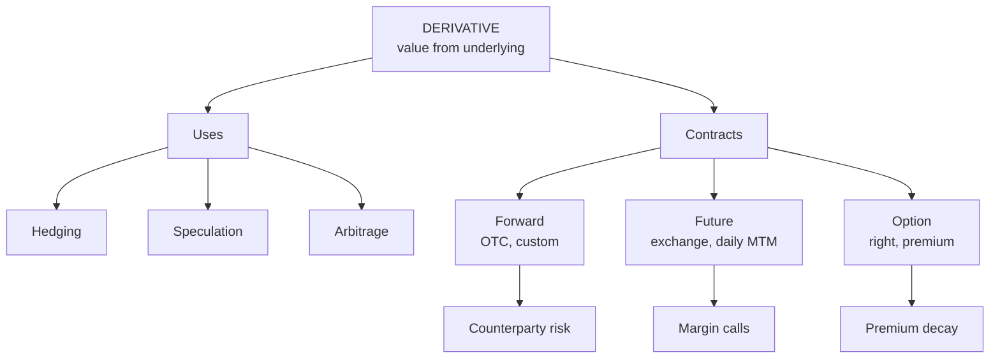

# DI-1: Derivatives, Forwards, Futures and Options

Covers: what a derivative is, the three uses (hedging, speculation, arbitrage), the meaning, purpose, advantages and disadvantages of forwards, futures and options, with one hedging sum. **(syllabus)** for scope, **(textbook)** for definitions.

## Where this fits in the ESE

Unit 1 carries 6 of 45 teaching hours. Expect a 5-mark definition-and-compare question ("forward vs futures vs options") in Section A. The hedging sum below is good practice for the Unit 2 and Unit 4 numericals. No faculty slides yet: if class notes define things differently, write the class version in the exam.

## What a derivative is **(textbook)**

A **derivative** is a financial instrument whose value depends on (is derived from) the price of an **underlying asset**. The underlying can be a share, a stock index (Nifty), a currency pair (USD/INR), a commodity (gold, crude), an interest rate or a bond.

Three uses, and every question about "why derivatives" is an answer built from these:

| Use | Who | What they do |
|---|---|---|
| **Hedging** | Importer, exporter, fund manager, farmer | Take a derivative position opposite to an existing exposure to cut risk |
| **Speculation** | Trader | Take a view on price direction and use leverage |
| **Arbitrage** | Arbitrageur | Lock a riskless profit from a mispricing between spot and derivative |

## The three basic contracts

| Feature | Forward | Future | Option |
|---|---|---|---|
| Meaning | Agreement to buy or sell an asset at a fixed price on a future date | Standardised forward traded on an exchange | Right, not obligation, to buy (call) or sell (put) at a fixed price |
| Where traded | OTC (over the counter) | Exchange | Exchange or OTC |
| Terms | Customised | Standardised (lot, expiry) | Standardised on exchange |
| Upfront cost | None | Margin (a deposit, not a price) | **Premium** paid by the buyer |
| Settlement | At maturity | Daily (marking to market) | At or before expiry, if exercised |
| Counterparty risk | High (bilateral) | Almost none (clearing corporation) | Buyer faces seller risk only OTC |
| Obligation | Both sides | Both sides | Buyer: right. Seller: obligation |
| Loss | Either side, unlimited | Either side, unlimited | Buyer: premium only. Seller: can be large |

**Purpose.** Forwards and futures **lock a price**. Options **insure a price**: you keep the upside and pay a premium for it.

**Advantages (all three).** Risk transfer, price discovery, leverage (small outlay controls a large exposure), lower transaction cost than trading the underlying, access to short positions.

**Disadvantages.** Leverage cuts both ways, so losses can exceed the deposit; forwards carry counterparty (default) risk and are illiquid; futures leave basis risk and margin calls; options decay in value as expiry nears; complexity invites misuse.

Derivatives are a **zero-sum game** before costs: one side's gain is the other's loss.

## Worked example: importer hedges with a forward, and compares an option

**Data (hypothetical):** an importer must pay USD 1,00,000 in 3 months. Spot ₹84.00. 3-month forward ₹84.60. A 3-month call option on USD, strike ₹84.60, costs ₹0.80 per USD (premium ₹80,000).

1. **Unhedged cost** depends on spot at maturity.
2. **Forward cost** = 84.60 × 1,00,000 = **₹84,60,000** whatever the spot.
3. **Option cost** = exercise only if spot is above ₹84.60. Effective rate = min(spot, 84.60) + 0.80.

| Spot in 3 months | Unhedged (₹) | Forward (₹) | Option incl. premium (₹) |
|---|---|---|---|
| 86.50 | 86,50,000 | 84,60,000 | 85,40,000 |
| 83.00 | 83,00,000 | 84,60,000 | 83,80,000 |

4. **Decision line.** If the rupee weakens to 86.50, the forward saves ₹1,90,000 against no hedge and the option saves ₹1,10,000. If the rupee strengthens to 83.00, the forward costs ₹1,60,000 more than waiting while the option costs only ₹80,000 more (its premium).
5. **Interpretation.** The forward removes risk and the upside. The option caps the cost at ₹85.40 per USD but you pay ₹80,000 for the insurance. Choose a forward when certainty matters; choose an option when you want to benefit if the rupee strengthens.

## Traps

- **Margin is not a premium.** The futures buyer posts a refundable deposit; the option buyer pays a non-refundable premium.
- **"Option" does not mean optional for the seller.** The writer must perform if the buyer exercises.
- **Hedging does not make money.** It removes variability. A hedged position can look worse than an unhedged one in hindsight.

## What to remember

- Derivative = value derived from an underlying; uses are hedging, speculation and arbitrage.
- Forward: OTC, customised, settled at maturity. Future: exchange, standardised, settled daily.
- Option: buyer has the right, pays a premium; seller has the obligation.
- Forward fixes the importer's cost at ₹84,60,000; the option caps it at ₹85,40,000 per the example.
- Counterparty risk is the key forward weakness; the clearing corporation removes it for futures.

## Concept map

## Flashcards
Q: Define a derivative.
A: A financial instrument whose value is derived from the price of an underlying asset such as a share, index, currency, commodity or interest rate.

Q: Name the three uses of derivatives.
A: Hedging, speculation and arbitrage.

Q: One-line difference between a forward and a future?
A: A forward is a customised OTC contract settled at maturity; a future is a standardised exchange-traded contract settled daily.

Q: What does an option buyer pay and what does the seller get?
A: The buyer pays a premium; the seller (writer) receives it and takes on the obligation to perform if exercised.

Q: Which contract insures a price and which locks it?
A: Options insure (keep the upside, pay a premium); forwards and futures lock a price.

Q: Why is a derivative market a zero-sum game?
A: Every gain on one side is a loss on the other, before transaction costs.

Q: Importer pays USD 1,00,000 via a forward at ₹84.60. Cost?
A: ₹84,60,000, whatever the spot rate at maturity.

Q: Same importer, call option strike 84.60, premium ₹0.80. Maximum effective rate?
A: ₹85.40 per USD (₹85,40,000).

Q: Name two disadvantages of derivatives.
A: Leverage can create losses beyond the deposit; forwards carry counterparty risk; options lose time value.

## Sources
- BBA301F-6 syllabus, Unit 1 (U1-T1)
- Hull, *Options, Futures and Other Derivatives* (6th ed.), ch. 1
- Next: [[Derivatives Unit 1 - DI-2 Swaps]]
- [[Derivatives Unit 1 - Introduction to Derivatives MOC (Node Map)]]
