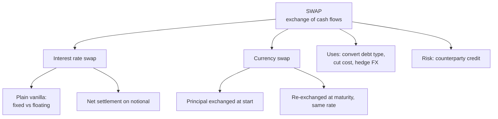

# DI-2: Swaps

Covers: features and uses of swaps, the plain vanilla interest rate swap with a settlement sum, the currency swap with principal exchange, and a worked effective-cost calculation. **(syllabus)** scope, **(textbook)** method.

## Where this fits in the ESE

Swaps are named in the syllabus ("features and uses of swaps, interest rate swaps, currency swaps"). A 5-mark question is likely: define, give features, show a numerical settlement. They are also the cleanest 15-mark Unit 1 case material.

## Swap: definition and features **(textbook)**

A **swap** is an OTC agreement between two parties to exchange **cash flows** on future dates, calculated on a **notional principal**, according to agreed formulas. Think of it as a portfolio of forward contracts.

Features:
- OTC and customised; no exchange. Counterparty (credit) risk is real.
- **Notional principal** is not exchanged in an interest rate swap; it only fixes the size of the payments.
- Only the **net** difference is paid on each date.
- Fixed tenor (1 to 10+ years) and fixed payment dates.
- Can be unwound by a reverse swap or a termination payment.

Uses: convert floating-rate debt to fixed (or the reverse), reduce borrowing cost using comparative advantage, hedge currency exposure on foreign loans, manage the interest rate sensitivity of a bank balance sheet.

## Plain vanilla interest rate swap

One party pays a **fixed rate** and receives a **floating rate** (MIBOR/MIFOR-type benchmark; in India an overnight index swap on MIBOR is the usual one) on the same notional. The other party does the reverse.

**Net payment by the fixed payer on a date = Notional × (Fixed − Floating) × period fraction.** Positive means the fixed payer pays; negative means it receives.

## Currency swap

Two parties exchange **principal and interest in different currencies**:
1. At start: exchange principals at the spot rate.
2. During the life: each pays interest on the currency it received.
3. At maturity: re-exchange principals at the **same original rate**.

Unlike an interest rate swap, principal is exchanged, so the currency swap carries real exposure to the principal.

## Worked example: converting a floating loan to fixed

**Data (hypothetical):** Surya Textiles (fictional) has a ₹50 crore loan at MIBOR + 1.5%, floating, paid half-yearly. It enters a 5-year swap: it **pays 7.2% fixed and receives MIBOR** on ₹50 crore. On one payment date MIBOR is 6.4%.

1. **Loan interest** = MIBOR + 1.5% = 6.4% + 1.5% = 7.9% for the year.
2. **Swap settlement (half-year)** = 50,00,00,000 × 0.5 × (7.2% − 6.4%) = **₹20,00,000 paid by Surya**.
3. **Effective cost** = loan margin + swap fixed rate. MIBOR received on the swap cancels MIBOR paid on the loan, leaving 1.5% + 7.2% = **8.7% fixed**.

| Item | Rate |
|---|---|
| Pays on loan | MIBOR + 1.5% |
| Receives from swap | MIBOR |
| Pays on swap | 7.2% fixed |
| **Net** | **8.7% fixed** |

4. **Decision line.** If the firm expects MIBOR to rise above about 7.2% on average, the swap saves interest. If MIBOR stays low (6.4%), it pays ₹20,00,000 a half-year more than an unhedged loan would cost on the swap leg. The swap buys certainty, not savings.

## Comparative advantage, in two lines

If Firm A borrows fixed cheaply and Firm B borrows floating cheaply, each borrows where it has the edge and they swap. The total saving is the gap between the two quality spreads, and the swap shares it. Hull notes this logic is debated, since the floating-rate spread can reflect re-pricing risk.

## Traps

- **Netting.** The swap pays only the difference, not the full fixed and floating legs.
- **Notional is not at risk** in an interest rate swap. Credit exposure is the net amount owed, not the principal.
- **Currency swap re-exchanges principal at the original spot rate**, not the maturity rate.

## What to remember

- Swap = exchange of cash flows on a notional; a strip of forwards.
- Plain vanilla: fixed vs floating, net settled.
- Net = Notional × (fixed − floating) × period; ₹50 crore, 0.5 year, 0.8% gap = ₹20,00,000.
- Floating loan plus pay-fixed swap gives a fixed cost: 1.5% + 7.2% = 8.7%.
- Currency swap exchanges principal at start and end at the same rate.

## Concept map

## Flashcards
Q: Define a swap.
A: An OTC agreement to exchange cash flows on future dates, based on a notional principal and agreed formulas.

Q: In a plain vanilla interest rate swap, what is exchanged?
A: A fixed rate payment for a floating rate payment on the same notional, settled net.

Q: Is notional principal exchanged in an interest rate swap?
A: No, it only sizes the payments. Only the net interest difference is paid.

Q: Notional ₹50 crore, fixed 7.2%, floating 6.4%, half-yearly. Net paid by the fixed payer?
A: 50,00,00,000 × 0.5 × 0.008 = ₹20,00,000.

Q: Floating loan at MIBOR + 1.5%, pay-fixed 7.2% swap against MIBOR. Effective cost?
A: 8.7% fixed.

Q: How does a currency swap differ from an interest rate swap?
A: A currency swap exchanges principal in two currencies at start and end (same rate), plus interest in each.

Q: Name two uses of swaps.
A: Convert floating-rate debt to fixed (or reverse); reduce borrowing cost via comparative advantage; hedge foreign-currency debt.

Q: Main risk in a swap?
A: Counterparty credit risk, because it is OTC.

## Sources
- BBA301F-6 syllabus, Unit 1 (swaps)
- Hull, *Options, Futures and Other Derivatives* (6th ed.), ch. 7
- Previous: [[Derivatives Unit 1 - DI-1 Derivatives Forwards Futures and Options]] · Next: [[Derivatives Unit 1 - DI-3 Swaption FRA Caps and Floors]]
- [[Derivatives Unit 1 - Introduction to Derivatives MOC (Node Map)]]
