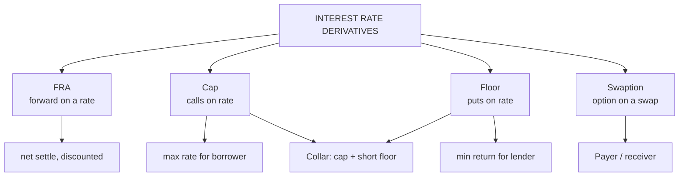

# DI-3: Swaption, FRA, Caps and Floors

Covers: the four interest rate derivatives the syllabus lists as "concept only": what each is, who uses it, and a settlement figure for each. **(syllabus)** scope, **(textbook)** method.

## Where this fits in the ESE

The syllabus says "only concept". Expect a short-note question ("write a note on caps and floors") rather than a calculation. Learn one line of definition, one use and one settlement number per instrument.

## FRA: forward rate agreement

An **FRA** is an OTC contract fixing the interest rate on a **future loan or deposit** for a future period. Quoted "6x9": starts in 6 months, runs 3 months. Only the **difference** between the agreed and the actual rate is paid, on the notional, at the start of the period (discounted).

**Settlement = Notional × (Reference rate − FRA rate) × τ ÷ (1 + Reference rate × τ)**, received by the buyer (borrower) if the reference rate is higher.

*Example (hypothetical):* ₹10 crore, 6x9 FRA bought at 7.0%; the 3-month reference rate at the start of the period is 7.6%; τ = 0.25.
- Undiscounted = 10,00,00,000 × 0.006 × 0.25 = ₹1,50,000.
- Discounted: ÷ (1 + 0.076 × 0.25) = ÷ 1.019 = **₹1,47,203**.
The buyer receives this, offsetting the higher cost of borrowing.

## Cap

An **interest rate cap** is a series of call options on a rate (**caplets**). It pays the buyer when the floating rate exceeds the **cap rate**; the buyer pays an upfront premium. Used by floating-rate borrowers to set a maximum rate while keeping the benefit of falling rates.

**Caplet payoff = Notional × max(Rate − Cap rate, 0) × τ.**

*Example:* ₹10 crore, cap 7.0%, half-yearly, rate fixes at 7.6%: 10,00,00,000 × 0.006 × 0.5 = **₹3,00,000**.

## Floor

An **interest rate floor** is a series of put options on a rate (**floorlets**). It pays the buyer when the floating rate falls below the **floor rate**. Used by lenders and investors to guarantee a minimum return.

**Floorlet payoff = Notional × max(Floor rate − Rate, 0) × τ.**

*Example:* floor 7.0%, rate fixes at 6.4%: 10,00,00,000 × 0.006 × 0.5 = **₹3,00,000**.

A **collar** = long cap + short floor: the borrower is protected above the cap, and the floor premium received cuts the cost, at the price of giving up gains below the floor.

## Swaption

A **swaption** is an **option to enter a swap** at a fixed rate on a future date. A **payer swaption** gives the right to pay fixed (useful if you fear rates will rise); a **receiver swaption** gives the right to receive fixed. The buyer pays a premium. Used by a firm bidding for a project: it locks the right to a fixed funding rate without the obligation if the bid fails.

## Summary table

| Instrument | Type | Pays the buyer when | Typical user |
|---|---|---|---|
| FRA | Forward on a rate | Rate ends above FRA rate (for the FRA buyer) | Borrower fixing a future rate |
| Cap | Strip of calls on a rate | Rate above cap rate | Floating-rate borrower |
| Floor | Strip of puts on a rate | Rate below floor rate | Lender or investor |
| Swaption | Option on a swap | Swap rate moves in the holder's favour | Firm with uncertain borrowing |

## Traps

- **FRA settles the difference at the start of the period**, so discount it; caps and floors are usually settled at the end.
- **Caps are calls on rates, floors are puts on rates.** The buyer of a cap is the borrower.
- **A FRA has no premium and is two-sided; a cap has a premium and is one-sided.**

## What to remember

- FRA: OTC forward on a rate, net settled; 6x9 means start in 6 months, run 3 months.
- FRA sum: ₹10 crore, 7.6% vs 7.0%, 3 months gives ₹1,47,203 (discounted) from ₹1,50,000.
- Cap = calls on a rate (borrower); floor = puts on a rate (lender).
- Caplet and floorlet examples each pay ₹3,00,000 on ₹10 crore for a 0.6% gap over half a year.
- Swaption = option to enter a swap; payer pays fixed, receiver receives fixed.

## Concept map

## Flashcards
Q: What does a "6x9" FRA mean?
A: A forward rate agreement that starts in 6 months and covers a 3-month period (ends in 9 months).

Q: FRA settlement formula?
A: Notional × (reference rate − FRA rate) × τ ÷ (1 + reference rate × τ), paid at the start of the period.

Q: ₹10 crore, 6x9 FRA at 7.0%, reference 7.6%. Buyer receives?
A: ₹1,47,203 (₹1,50,000 discounted by 1.019).

Q: What is an interest rate cap?
A: A strip of call options on a rate (caplets) that pays when the floating rate exceeds the cap rate; used by floating-rate borrowers.

Q: What is an interest rate floor?
A: A strip of put options on a rate (floorlets) that pays when the rate falls below the floor; used by lenders and investors.

Q: What is a collar?
A: A long cap plus a short floor: the borrower caps its cost and funds part of the premium by selling the floor.

Q: Define a swaption.
A: An option to enter a swap at a set fixed rate on a future date; payer swaption pays fixed, receiver swaption receives fixed.

Q: Cap 7.0%, rate fixes at 7.6%, ₹10 crore, half-year. Caplet payoff?
A: 10,00,00,000 × 0.006 × 0.5 = ₹3,00,000.

## Sources
- BBA301F-6 syllabus, Unit 1 (swaption, FRA, caps, floors: concept only)
- Hull, *Options, Futures and Other Derivatives* (6th ed.), interest rate chapters (FRA, caps, floors)
- Previous: [[Derivatives Unit 1 - DI-2 Swaps]] · Next: [[Derivatives Unit 1 - DI-4 Exchange vs OTC Participants and Indian Market]]
- [[Derivatives Unit 1 - Introduction to Derivatives MOC (Node Map)]]
