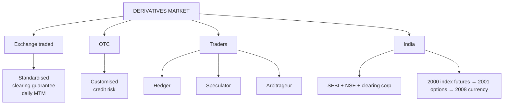

# DI-4: Exchange vs OTC, Participants and the Indian Market

Covers: exchange-traded versus OTC derivatives, the three types of trader, the structure and history of the Indian derivatives market, and what changed recently. The Indian part is "self learning" in the syllabus, so it is the part students skip and examiners can still ask. **(syllabus)** scope, **(textbook)** for the general parts.

## Where this fits in the ESE

A compare-and-contrast 5-marker ("exchange traded vs OTC") is very likely. The Indian market piece suits a short note. All Indian dates and rules below carry **[VERIFY]** because SEBI and NSE revise them often; check the NSE website the week before the exam.

## Exchange-traded vs OTC **(textbook)**

| Basis | Exchange traded | OTC |
|---|---|---|
| Contract terms | Standardised (lot, expiry, strike) | Customised |
| Counterparty | Clearing corporation guarantees | Bilateral, credit risk |
| Regulation | SEBI, exchange rules | Lightly regulated, RBI for currency and rate products |
| Transparency | Prices public | Prices private |
| Liquidity | High, easy to exit | Low, exit needs the counterparty |
| Margin | Initial and daily MTM | Negotiated, often none |
| Examples | Nifty futures, stock options | Forwards, swaps, FRAs |
| Settlement | Daily, via clearing house | At maturity or per contract |

Hull's point: the OTC market is larger than the exchange market by notional value, but exchange trading has more contracts and daily visibility.

## Who trades: three types **(textbook)**

| Trader | Aim | Example |
|---|---|---|
| **Hedger** | Reduce an existing price risk | Exporter sells USD forward; fund manager shorts index futures |
| **Speculator** | Bet on price direction using leverage | Trader buys Nifty futures expecting a rise |
| **Arbitrageur** | Lock riskless profit from mispricing between markets | Buys the cheap spot, sells the dear future |

Speculators provide liquidity; arbitrageurs keep futures prices aligned with spot (the cost of carry link in Unit 3).

## The Indian market **[VERIFY]**

**Legal base.** The Securities Contracts (Regulation) Act 1956 was amended in 1999 to allow derivatives (earlier banned for equities). The **L C Gupta Committee (1998)** recommended starting equity derivatives and the **J R Varma Committee** set risk-containment norms (margins).

**Timeline (NSE/BSE):**
- Index futures: June 2000.
- Index options: June 2001.
- Stock options: July 2001.
- Stock futures: November 2001.
- Currency futures (USD/INR): NSE, August 2008. Interest rate futures revived: 2009 and 2014 (10-year G-Sec).
- Stock derivatives later moved to **physical settlement** (from 2018 phased); index derivatives stay **cash settled**.

**Players.** SEBI (regulator); NSE (the dominant derivatives exchange by volume), BSE; clearing corporations (NSCCL, ICCL); clearing members and trading members; foreign portfolio investors, mutual funds, proprietary desks and retail traders.

**Why India matters in the global ranking.** NSE has been among the world's largest derivatives exchanges by number of contracts, driven largely by index options.

**Recent regulatory direction (SEBI, 2024 onwards) [VERIFY]:** larger minimum contract value, upfront collection of option premium, limits on weekly expiries, higher margins near expiry, tighter intraday position monitoring. The purpose is to cut retail losses in short-dated index options.

**Sizing rule:** the contract value of one lot = price × lot size. Lot sizes for Nifty, Bank Nifty and stocks are revised by NSE from time to time, so use the figure given in the question. **[VERIFY]** the current lot size before the exam.

## Worked example: exchange vs OTC for a hedge

**Question style:** "A firm wants to hedge a USD 5 lakh receivable due in 3 months. Choose between an exchange futures contract and an OTC forward."

1. **Exchange route.** NSE USD/INR futures have a lot of USD 1,000 **[VERIFY]**. Exact cover needs 500 lots; maturity must be an expiry date; margin and daily settlement apply.
2. **OTC route.** A bank forward for exactly USD 5,00,000 on the exact date; no margin but the bank's credit line is used.
3. **Decision line.** If the receivable date matches an expiry and the firm can fund margin calls, futures give transparency and no credit risk. If the amount or date is irregular, the OTC forward gives a perfect match at the cost of counterparty exposure. Both fix the rate; the choice is liquidity and matching.

## Traps

- **OTC does not mean unregulated.** Currency and rate OTC products are overseen by the RBI.
- **Standardisation is the price of liquidity.** Customisation cannot be had on an exchange.
- **Index derivatives are cash settled; stock derivatives are physically settled in India (since the 2018 phase-in)** **[VERIFY]**.

## What to remember

- Exchange = standardised, guaranteed, daily MTM; OTC = custom, bilateral credit risk.
- Three traders: hedger, speculator, arbitrageur.
- India: index futures 2000, index options 2001, stock options 2001, stock futures 2001, currency 2008 **[VERIFY]**.
- Index derivatives cash settled; stock derivatives physical **[VERIFY]**.
- Contract value = price × lot size; lot sizes change, so use the question's figure.

## Concept map

## Flashcards
Q: Two big differences between exchange-traded and OTC derivatives?
A: Exchange contracts are standardised with a clearing-house guarantee; OTC contracts are customised and carry counterparty risk.

Q: Who are the three types of derivative traders?
A: Hedgers, speculators and arbitrageurs.

Q: What does an arbitrageur do?
A: Locks in a riskless profit from a price gap between the spot and derivative markets.

Q: Which committee recommended starting equity derivatives in India?
A: The L C Gupta Committee (1998) [VERIFY].

Q: In what year did index futures start in India?
A: June 2000 [VERIFY].

Q: Are Nifty derivatives cash or physically settled?
A: Cash settled (index derivatives); stock derivatives moved to physical settlement [VERIFY].

Q: How do you find the contract value of one lot?
A: Futures price × lot size.

Q: Why prefer an OTC forward over exchange futures for an irregular cash flow?
A: It can be matched exactly in amount and date, at the cost of counterparty risk.

## Sources
- BBA301F-6 syllabus, Unit 1 (exchange vs OTC, traders, Indian derivatives market)
- Hull, *Options, Futures and Other Derivatives* (6th ed.), ch. 1; NSE and SEBI websites for Indian rules **[VERIFY]**
- Previous: [[Derivatives Unit 1 - DI-3 Swaption FRA Caps and Floors]] · Next: [[Derivatives Unit 1 - DI-5 Unit 1 Exam Answers]]
- [[Derivatives Unit 1 - Introduction to Derivatives MOC (Node Map)]]
