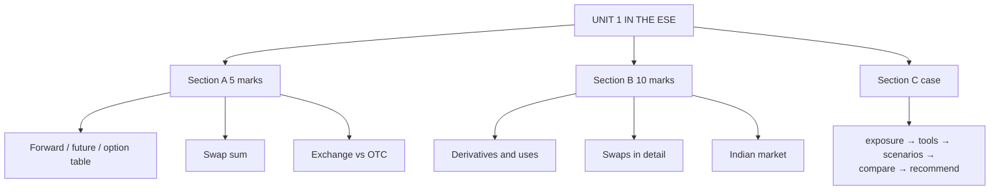

# DI-5: Unit 1 Exam Answers

Covers: what the ESE will ask from Unit 1, 5-mark and 10-mark skeletons, and a 15-mark case layout with a model answer on swap versus cap. Numbers come from DI-1 to DI-3.

## What the test will ask

ESE is 50 marks: Section A three 5-mark questions with internal choice, Section B two 10-mark questions with internal choice, Section C one 15-mark case. Unit 1 is the lightest numerical unit (6 of 45 hours), so expect it in Section A or as the conceptual 10-marker. The 15-mark case is more likely from Units 3 to 5, but a risk-management case on swaps or caps is possible. This is a judgement from the syllabus, not a confirmed pattern.

## Five-mark answer skeletons

**1. Forward vs futures vs options (DI-1).** Table of meaning, venue, terms, margin or premium, settlement, counterparty risk; one line on each use.

**2. Swaps: features and uses (DI-2).** Definition; four features (OTC, notional, net settled, fixed tenor); two uses; interest rate swap net settlement sum (₹20,00,000).

**3. Currency swap vs interest rate swap (DI-2).** Principal exchanged at start and end at the same rate versus never exchanged; interest paid in two currencies.

**4. FRA, cap, floor, swaption (DI-3).** One-line definition each; the FRA settlement formula; who uses which.

**5. Exchange traded vs OTC (DI-4).** Eight-row table; three traders; one Indian fact.

## Ten-mark answer skeletons

**A. Derivatives: meaning, types and uses.** Definition → underlyings → three uses with examples → forwards, futures, options, swaps with a line each → advantages and disadvantages → importer hedging sum (forward ₹84,60,000 vs option ₹85,40,000) → conclusion on the zero-sum nature.

**B. Swaps in detail.** Definition → features → plain vanilla mechanics with the ₹50 crore sum → effective cost 8.7% → currency swap → comparative advantage → risk (counterparty).

**C. Indian derivatives market.** Legal base (SCRA amendment, committees) → timeline → participants and clearing → product list → settlement style → recent SEBI measures **[VERIFY]** → challenges (retail losses).

## Fifteen-mark case layout (interest rate risk)

1. **Identify the exposure (1).** Floating-rate borrower, rising-rate risk.
2. **List the tools (2).** Do nothing, swap, cap, FRA.
3. **Compute each outcome across scenarios (6).**
4. **Compare certainty, cost and flexibility (3).**
5. **Recommend with a condition (2).**
6. **Note risks (1).** Counterparty risk for the swap, premium cost for the cap.

### Model answer, laid out as the exam answer

**Data (hypothetical):** Surya Textiles (fictional) has a ₹50 crore loan at MIBOR + 1.5%. The board fears rates will rise. Options: (a) leave unhedged; (b) 5-year swap, pay 7.2% fixed and receive MIBOR; (c) 5-year cap at 7.0% on MIBOR, upfront premium 0.45% of notional (₹22,50,000, i.e. ₹4,50,000 a year or 0.09%).

1. **Unhedged cost** = MIBOR + 1.5%.
2. **Swap cost** = 7.2% + 1.5% = **8.7%** fixed.
3. **Cap cost** = min(MIBOR, 7.0%) + 1.5% + 0.09% premium.

| MIBOR | Unhedged | Swap | Cap | Annual interest, unhedged (₹) | Swap (₹) | Cap incl. premium (₹) |
|---|---|---|---|---|---|---|
| 5.5% | 7.0% | 8.7% | 7.09% | 3,50,00,000 | 4,35,00,000 | 3,54,50,000 |
| 6.4% | 7.9% | 8.7% | 7.99% | 3,95,00,000 | 4,35,00,000 | 3,99,50,000 |
| 8.0% | 9.5% | 8.7% | 8.59% | 4,75,00,000 | 4,35,00,000 | 4,29,50,000 |

4. **Break-even for the swap:** it beats the unhedged loan when MIBOR is above 7.2%.
5. **Reading the table.** At MIBOR 8.0% the swap saves ₹40,00,000 a year and the cap saves ₹45,50,000. At 5.5% the swap costs ₹85,00,000 more than staying floating, and the cap only ₹4,50,000 more.
6. **Recommendation.** If the aim is certainty for budgeting, take the **swap** (8.7% fixed). If the board wants protection but still wants to gain if rates fall, take the **cap**, whose worst case is 8.59% all-in and whose cost of protection is the premium. Given a view that rates may rise but could fall, the cap is the better risk-adjusted choice here.
7. **Risks.** The swap exposes the firm to counterparty default and the mark-to-market loss if rates fall; the cap's premium is sunk.

Close with: *figures are illustrative; the cap premium and swap rate would be quoted by a bank.*

## Time rule

If short of time: define the product, write the net-settlement formula, show one number, and state the decision rule. That secures most marks in Unit 1.

## What to remember

- Section A Unit 1 items: comparison table, swap sum, exchange vs OTC.
- Swap gives certainty (8.7% fixed); cap gives a ceiling and keeps the upside (worst case 8.59%).
- Key numbers: ₹20,00,000 swap settlement, ₹1,47,203 FRA, ₹84,60,000 forward cost.
- Always state who bears counterparty risk.

## Concept map

## Flashcards
Q: What steps does a rate-hedging case answer follow?
A: Identify the exposure, list the tools, compute each outcome across rate scenarios, compare certainty, cost and flexibility, then recommend with risks.

Q: Surya Textiles case: swap vs cap at MIBOR 8.0%. Which saves more?
A: The cap saves ₹45,50,000 against ₹40,00,000 for the swap (cap includes premium).

Q: At what MIBOR does the 7.2% pay-fixed swap beat floating?
A: Above 7.2%.

Q: Skeleton for a 5-mark swap answer?
A: Definition, four features, two uses, one net-settlement number.

Q: Skeleton for the 10-mark derivatives answer?
A: Meaning, underlyings, uses, four contract types, pros and cons, hedging sum, conclusion.

Q: What should every swap answer mention as a risk?
A: Counterparty credit risk (OTC).

## Sources
- BBA301F-6 syllabus, Unit 1 and ESE pattern
- [[Derivatives Unit 1 - Introduction to Derivatives MOC (Node Map)]]
