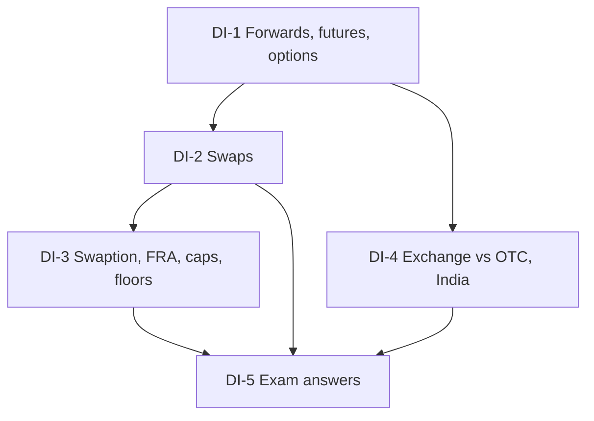

# Derivatives Unit 1: Introduction to Derivatives, node map

ESE: 50 marks, Section A 3 x 5, Section B 2 x 10, Section C one 15-mark case. Unit 1 is CO1 (basic concepts and types) and is mostly conceptual. All examples are **hypothetical, illustrative numbers**. Indian market facts carry **[VERIFY]** tags.

## Nodes

| Node | Topic | Deps | Minutes | Exam focus |
|---|---|---|---|---|
| DI-1 | Derivatives, Forwards, Futures and Options | none | 30 | yes |
| DI-2 | Swaps | DI-1 | 30 | yes |
| DI-3 | Swaption, FRA, Caps and Floors | DI-2 | 25 | no |
| DI-4 | Exchange vs OTC, Participants and Indian Market | DI-1 | 30 | yes |
| DI-5 | Unit 1 Exam Answers | DI-1 to DI-4 | 25 | yes |

Total reading time: about 140 minutes.

## Dependency graph

## Headline numbers to know

- Importer, USD 1,00,000: forward ₹84,60,000; option capped at ₹85,40,000; spot 86.50 saves ₹1,90,000 on the forward.
- Swap: ₹50 crore, 7.2% vs 6.4%, half-year = ₹20,00,000; effective loan cost 8.7%.
- FRA 6x9 at 7.0% vs 7.6% on ₹10 crore: ₹1,50,000 undiscounted, ₹1,47,203 discounted.
- Caplet and floorlet: ₹3,00,000 each on ₹10 crore for a 0.6% gap over half a year.
- Case: at MIBOR 8.0% the cap saves ₹45,50,000 a year, the swap ₹40,00,000.

## Links
- [[Derivatives MOC]]
