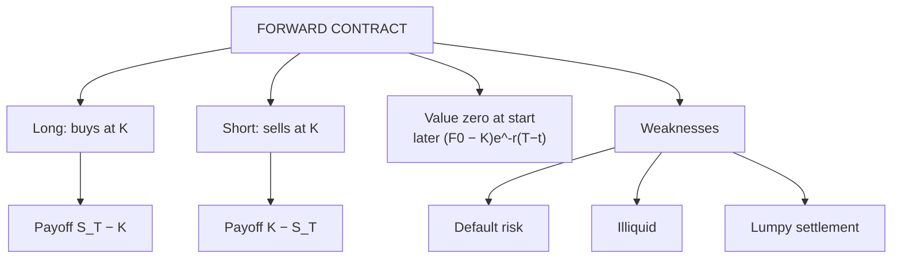

# FC-1: Forward Contracts

Covers: structure of a forward contract, how it trades, long and short payoffs, the value of a forward after inception, and its weaknesses. **(syllabus)** scope, **(textbook)** method.

## Where this fits in the ESE

The payoff table is a standard 5-mark item and is the base for every later payoff diagram (futures, options). The forward value formula appears again in Unit 3 (cost of carry).

## Structure of a forward contract **(textbook)**

A **forward contract** is a bilateral agreement to buy or sell an asset on a **future date (maturity T)** at a price **K** fixed today.

| Term | Meaning |
|---|---|
| Long position | Agrees to **buy** at K |
| Short position | Agrees to **sell** at K |
| Delivery price K | Price fixed in the contract; chosen so the forward is worth **zero at inception** |
| Forward price F₀ | The delivery price that would make a new contract worth zero today. Equals K at inception; later F₀ and K diverge |
| Spot price S_T | Market price of the asset at maturity |
| Settlement | Physical delivery or cash settlement of S_T − K |

No money changes hands at the start. Each side is exposed to the other's default.

## Trading mechanism

- Negotiated directly with a bank or dealer; **no exchange**.
- Dealer quotes a two-way price (bid/ask); the spread is the dealer's income.
- Terms are customised: amount, date, grade, place of delivery.
- In India, INR-forex forwards are bank contracts under FEDAI/RBI rules **[VERIFY]**; commodity and equity forwards are largely restricted, so futures are used instead.
- To exit early, you need the counterparty's agreement (cancellation or reverse contract).

## Payoff

**Long forward payoff = S_T − K. Short forward payoff = K − S_T.** The two always sum to zero.

*Example (hypothetical):* long a 3-month forward on a share at K = ₹500.

| S_T (₹) | Long payoff (₹) | Short payoff (₹) |
|---|---|---|
| 440 | −60 | +60 |
| 470 | −30 | +30 |
| 500 | 0 | 0 |
| 540 | +40 | −40 |
| 580 | +80 | −80 |

Both payoffs are linear and unlimited. The long gains when the price rises, the short when it falls.

## Value of a forward during its life **(textbook)**

At time t with time to maturity (T − t), the value of the long position is

**f = (F₀ − K) × e^(−r(T−t))**

where F₀ is today's forward price for the remaining term.

*Example:* K = ₹500, today's forward price for the remaining 3 months is ₹520, r = 6%.
f = (520 − 500) × e^(−0.06 × 0.25) = 20 × 0.9851 = **₹19.70** to the long (the short has the same loss).

## Worked example: exam layout

**Question:** A firm agrees to buy 10,000 kg of an industrial metal in 3 months at ₹500 per kg through a forward. Calculate the gain or loss on each side if the spot price is ₹540 and ₹470.

1. Position: firm is long, supplier is short, K = ₹500.
2. Payoff per kg = S_T − K.

| Spot at maturity | Per kg (long) | Total for 10,000 kg (long) | Total (short) |
|---|---|---|---|
| ₹540 | +₹40 | +₹4,00,000 | −₹4,00,000 |
| ₹470 | −₹30 | −₹3,00,000 | +₹3,00,000 |

3. **Decision line.** At ₹540 the firm saves ₹4,00,000 against buying at spot; at ₹470 it overpays ₹3,00,000. The forward fixed its cost at ₹50,00,000. A hedger accepts the opportunity loss at ₹470 as the cost of certainty.

## Weaknesses of forwards

1. **Default (counterparty) risk**: the loser may not pay.
2. **Illiquidity**: hard to exit; no secondary market.
3. **No price transparency**; wide dealer spreads for small clients.
4. **Lumpy settlement**: the whole gain or loss arrives at maturity.
5. **Hard to find a match** for amount and date.

Futures (FC-2) were designed to fix these five.

## Traps

- **K is not the forward price after inception.** K stays fixed; F₀ moves.
- **Value of the forward at inception is zero**, not the forward price.
- **Payoff is not profit net of financing** in this simple treatment. Hull ignores the time value of the price when computing payoff at maturity.

## What to remember

- Long payoff S_T − K; short payoff K − S_T; sum zero.
- Value at inception is zero; later f = (F₀ − K)e^(−r(T−t)).
- Example: K = 500, spot 540 gives +₹40 per unit; spot 470 gives −₹30.
- Forwards carry default risk, illiquidity and lumpy settlement.
- Customised OTC; no daily settlement.

## Concept map

## Flashcards
Q: Payoff of a long forward at maturity?
A: S_T − K, where K is the delivery price and S_T the spot price at maturity.

Q: Payoff of a short forward at maturity?
A: K − S_T.

Q: What is the value of a forward contract at inception?
A: Zero; the delivery price is set so neither side pays anything.

Q: Value of a long forward later in its life?
A: f = (F₀ − K) × e^(−r(T−t)), with F₀ the current forward price for the remaining term.

Q: K = ₹500 long forward, spot at maturity ₹470. Payoff?
A: −₹30 per unit for the long; +₹30 for the short.

Q: Name three weaknesses of forwards.
A: Counterparty default risk, illiquidity or difficulty exiting, and lumpy settlement at maturity.

Q: Who sets the price of an OTC forward?
A: Negotiation with a dealer, who quotes a bid-ask spread.

Q: Forward K = ₹500, F₀ for the remaining 3 months is ₹520, r = 6%. Value to the long?
A: 20 × e^(−0.015) = 20 × 0.9851 = ₹19.70.

## Sources
- BBA301F-6 syllabus, Unit 2 (forward contracts)
- Hull, *Options, Futures and Other Derivatives* (6th ed.), ch. 1 and ch. 5
- Next: [[Derivatives Unit 2 - FC-2 Futures Contracts Specifications and Trading]]
- [[Derivatives Unit 2 - Forward and Future Contracts MOC (Node Map)]]
