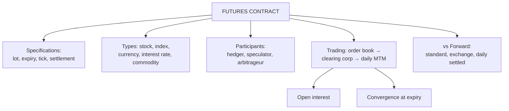

# FC-2: Futures Contracts, Specifications and Trading

Covers: forward vs futures, contract specifications, the five types of futures, market participants, trading and clearing mechanism, open interest, and a lot-and-tick sum. **(syllabus)** scope, **(textbook)** method, NSE details **[VERIFY]**.

## Where this fits in the ESE

"Difference between forward and futures contracts" is on the syllabus line by line and is a near-certain 5-marker. Specifications and trading mechanism make a good 10-mark descriptive answer; the lot-and-tick sum is a quick numeric.

## Meaning and difference from forwards

A **futures contract** is a standardised agreement, traded on an exchange and guaranteed by a clearing corporation, to buy or sell an asset at a set price on a set future date, with profits and losses **settled daily**.

| Basis | Forward | Futures |
|---|---|---|
| Venue | OTC | Exchange |
| Terms | Customised | Standardised |
| Counterparty | Each other (credit risk) | Clearing corporation (novation) |
| Settlement | At maturity | Daily mark to market |
| Margin | Usually none | Initial plus variation |
| Liquidity | Low | High, can reverse any time |
| Delivery | Usually physical | Usually closed out; many cash settled |
| Regulation | Light | SEBI and exchange |
| Price transparency | Private | Public quotes |

## Specifications of a futures contract

| Item | What it fixes | Example |
|---|---|---|
| Underlying | The asset | Stock, index, USD/INR, 10-year G-Sec |
| Contract size (lot) | Units per contract | Stock lot of 500 shares (hypothetical) |
| Expiry | Last trading day | Near month, next month, far month cycle (three months on NSE) **[VERIFY]** |
| Tick size | Smallest price move | ₹0.05 for stock futures; ₹0.0025 for USD/INR **[VERIFY]** |
| Quotation | Price per unit | Rupees per share |
| Settlement | Cash or physical | Index: cash. Stock: physical **[VERIFY]** |
| Margin | SPAN plus exposure | See FC-3 |
| Position limits | Maximum open positions | Exchange set |

**Tick value = tick size × lot size.** Stock future: 0.05 × 500 = ₹25 per tick per lot. USD/INR: 0.0025 × 1,000 = ₹2.50 per tick per lot **[VERIFY]**.

## Types of futures

1. **Stock futures** (single share).
2. **Index futures** (Nifty, Bank Nifty): cash settled; used for portfolio hedging (Unit 3).
3. **Currency futures** (USD/INR, EUR/INR and others on NSE).
4. **Interest rate futures** (10-year G-Sec, T-bill).
5. **Commodity futures** (MCX, NCDEX; gold, crude).

## Market participants

Hedgers, speculators, arbitrageurs (DI-4) plus the institutional roles: **trading members** (execute orders), **clearing members** (settle trades with the clearing corporation), the **clearing corporation** (counterparty to every trade, manages margins), and SEBI as regulator.

## Trading and clearing mechanism

1. Client gives an order to a broker (trading member).
2. Order enters the exchange's electronic order book and is matched by price-time priority.
3. After the match, the trade is sent to the **clearing corporation**, which becomes the buyer to every seller and the seller to every buyer (**novation**). This removes counterparty risk.
4. Margins are collected; positions are marked to market daily.
5. Positions are closed by an **offsetting trade** (long sells, short buys) or run to expiry.

**Convergence.** At expiry the futures price equals the spot price; before expiry the gap is the **basis** (spot − futures).

## Open interest

**Open interest** is the number of contracts outstanding. It changes with each trade:

| Buyer | Seller | Open interest |
|---|---|---|
| New position | New position | +1 |
| Closing | Closing | −1 |
| New | Closing | Unchanged |

*Example:* A buys 5 contracts from B (both new): OI = 5. A sells 3 to C (C new, A closing): OI = 5. C sells 3 to B (both closing): OI = 2.

## Worked example: lot, tick and P&L

**Data (hypothetical):** a stock future with lot size 500 trades at ₹800. A trader buys 2 lots and sells at ₹812.

1. Contract value per lot = 800 × 500 = **₹4,00,000**; two lots = ₹8,00,000.
2. Profit = (812 − 800) × 500 × 2 = **₹12,000**.
3. Tick value = 0.05 × 500 = ₹25 per lot; ₹12 gain = 240 ticks. Check: 240 ticks × ₹25 × 2 lots = ₹12,000. ✓
4. If the price falls to ₹790, loss = 10 × 500 × 2 = ₹10,000.

**Decision line.** The position gains or loses ₹1,000 for every ₹1 move in the share; futures are leveraged, so a 1.5% move in the price (₹12 on ₹800) produces ₹12,000 on ₹8,00,000 of exposure, which is a far larger percentage of the margin posted (FC-3).

## Traps

- **Futures are rarely delivered.** The vast majority of positions are closed out before expiry (Hull); do not describe delivery as the normal exit.
- **Clearing corporation is the counterparty**, not the other trader.
- **Tick value uses the lot size**: always multiply tick size by lot size.

## What to remember

- Futures = standardised, exchange traded, daily settled, guaranteed forwards.
- Specifications: underlying, lot, expiry, tick, settlement, margin.
- Tick value = tick size × lot size (₹0.05 × 500 = ₹25).
- OI rises only when both sides are opening new positions.
- Example: 2 lots at ₹800 → ₹812 = ₹12,000 profit.

## Concept map

## Flashcards
Q: Five differences between a forward and a futures contract?
A: Venue (OTC vs exchange), terms (custom vs standard), counterparty (each other vs clearing corporation), settlement (maturity vs daily), margin (usually none vs initial and variation).

Q: What does the clearing corporation do?
A: Becomes buyer to every seller and seller to every buyer (novation), removing counterparty risk and collecting margins.

Q: Tick value formula?
A: Tick size × lot size.

Q: Stock future, lot 500, tick ₹0.05. Tick value?
A: ₹25 per tick per lot.

Q: Name the five types of futures.
A: Stock, index, currency, interest rate and commodity futures.

Q: What is open interest?
A: The number of futures contracts outstanding that have not been closed or delivered.

Q: Both buyer and seller open new positions. Effect on open interest?
A: It rises by one contract.

Q: What is convergence?
A: At expiry the futures price equals the spot price; the basis goes to zero.

Q: 2 lots (500 each) bought at ₹800 and sold at ₹812. Profit?
A: (812 − 800) × 500 × 2 = ₹12,000.

## Sources
- BBA301F-6 syllabus, Unit 2 (futures)
- Hull, *Options, Futures and Other Derivatives* (6th ed.), ch. 2; NSE contract specifications **[VERIFY]**
- Previous: [[Derivatives Unit 2 - FC-1 Forward Contracts]] · Next: [[Derivatives Unit 2 - FC-3 Margins and Marking to Market]]
- [[Derivatives Unit 2 - Forward and Future Contracts MOC (Node Map)]]
