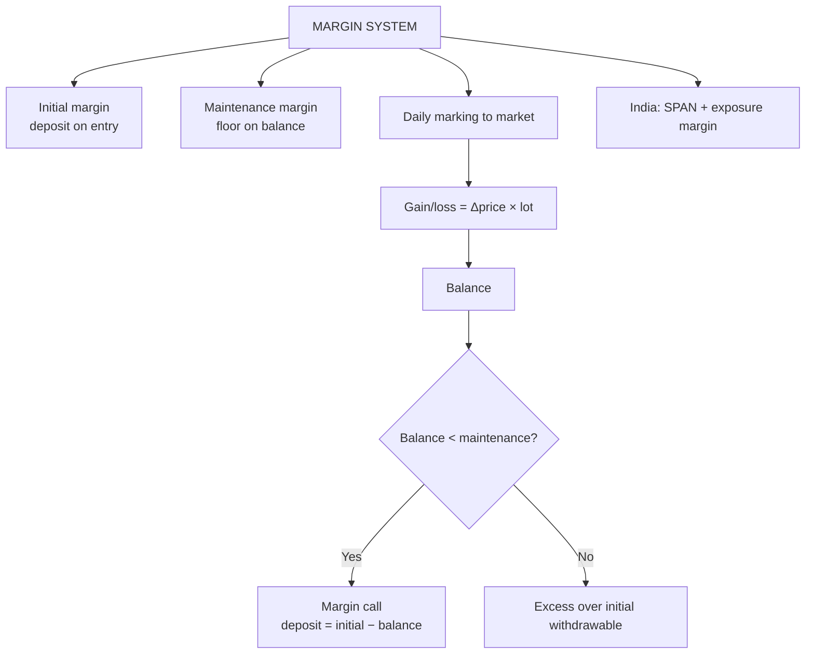

# FC-3: Margins and Marking to Market

Covers: initial, maintenance and variation margin, the daily settlement table, when a margin call is triggered and how much to deposit, the trigger price, leverage, and the Indian SPAN system. This is the syllabus's only "(Problems)" topic in Unit 2, so it is a numerical favourite. **(syllabus)** scope, **(textbook)** method, SPAN details **[VERIFY]**.

## Where this fits in the ESE

Expect one full daily-settlement table in Section A (5 marks) or as part of a 10-mark/15-mark case. Marks go for: the layout, correct daily gain or loss, correct balance, the margin call decision, and the amount deposited. Every table below recomputes.

## Why margin exists

A futures contract has no price paid upfront, so the clearing corporation protects itself with a **deposit** (margin) and settles gains and losses **every day** (**marking to market**, MTM). A loss is collected before it can grow large enough to cause default.

## The four terms **(textbook)**

| Term | Meaning |
|---|---|
| **Initial margin** | Deposit paid when the position is opened |
| **Maintenance margin** | Minimum balance the account must hold (lower than initial) |
| **Margin call** | Demand to top up when the balance falls **below** the maintenance margin |
| **Variation margin** | The top-up amount; it must bring the balance back to the **initial** margin |

Daily gain or loss is credited or debited to the margin account:

**Daily gain (long) = (Settlement price today − Settlement price yesterday) × lot size × contracts.** For the first day, "yesterday" is the **entry price**. For a short position the sign reverses.

Balance after day = previous balance + daily gain + variation margin deposited. Anything above initial margin can be withdrawn.

## Indian practice (SPAN) **[VERIFY]**

India does not use a maintenance margin in the Hull sense. The clearing corporation computes:
- **Initial margin by SPAN** (Standard Portfolio Analysis of Risk): the worst one-day loss over a set of price and volatility scenarios, at about 99% confidence.
- **Exposure margin** on top of SPAN, as a percentage of contract value.
- **MTM settlement** in cash daily, typically the next day (T+1).
- Option buyers pay the premium; **option sellers** pay SPAN plus exposure margin.
- Margins are raised in volatile periods and near expiry.

In the exam, if the question gives **initial and maintenance margin**, use the Hull rules above (class version unless told otherwise).

## Worked example 1: daily settlement table (long position)

**Data (hypothetical):** a trader buys **1 lot of a stock future, lot size 500, at ₹800**. Contract value = 800 × 500 = ₹4,00,000. **Initial margin ₹60,000, maintenance margin ₹45,000.** Daily settlement prices: Day 1 ₹812, Day 2 ₹795, Day 3 ₹780, Day 4 ₹768, Day 5 ₹790, Day 6 ₹805.

**Steps for each day:** (1) change in price from the previous settlement; (2) × 500 for the gain or loss; (3) add to balance; (4) if balance < ₹45,000, margin call = ₹60,000 − balance; (5) record closing balance.

| Day | Prev. price | Settle price | Daily gain/loss (₹) | Balance before call (₹) | Margin call (₹) | Closing balance (₹) |
|---|---|---|---|---|---|---|
| 0 (entry) | | 800 | | 60,000 | | 60,000 |
| 1 | 800 | 812 | +6,000 | 66,000 | 0 | 66,000 |
| 2 | 812 | 795 | −8,500 | 57,500 | 0 | 57,500 |
| 3 | 795 | 780 | −7,500 | 50,000 | 0 | 50,000 |
| 4 | 780 | 768 | −6,000 | 44,000 | **16,000** | 60,000 |
| 5 | 768 | 790 | +11,000 | 71,000 | 0 | 71,000 |
| 6 | 790 | 805 | +7,500 | 78,500 | 0 | 78,500 |

**Check:** total price gain = (805 − 800) × 500 = ₹2,500. Closing balance = initial 60,000 + margin call 16,000 + gain 2,500 = **₹78,500** ✓.

**Decision line and interpretation.**
- The first margin call comes on **Day 4** because ₹44,000 is below ₹45,000. The deposit is ₹60,000 − ₹44,000 = **₹16,000** (not ₹45,000 − ₹44,000 = ₹1,000: the call restores the initial margin).
- Day 3 closes at exactly ₹50,000, which is above ₹45,000, so no call.
- On Day 5 and Day 6 the balance exceeds the initial margin; the excess (₹11,000 on Day 5, then ₹18,500 in total) is **withdrawable**.
- The trader's net result is a gain of ₹2,500, yet the path needed a ₹16,000 cash top-up. A hedger must plan for the **liquidity** needed, even when the final result is positive.

## Worked example 2: trigger price

**Question:** At what price does the first margin call arise?

1. Balance can fall by 60,000 − 45,000 = ₹15,000 before the call.
2. Price fall = 15,000 ÷ 500 = ₹30 per share.
3. Trigger = 800 − 30 = **₹770**. A settlement **below ₹770** (cumulatively from entry) triggers the call; ₹770 exactly does not.

(Short position: the call arises when the settlement exceeds 800 + 30 = ₹830.)

## Worked example 3: the short side of the same trade

Same contract, same prices, but the trader **sells** one lot at ₹800. Gains are the reverse.

| Day | Settle price | Daily gain/loss (₹) | Closing balance (₹) | Call (₹) |
|---|---|---|---|---|
| 1 | 812 | −6,000 | 54,000 | 0 |
| 2 | 795 | +8,500 | 62,500 | 0 |
| 3 | 780 | +7,500 | 70,000 | 0 |
| 4 | 768 | +6,000 | 76,000 | 0 |
| 5 | 790 | −11,000 | 65,000 | 0 |
| 6 | 805 | −7,500 | 57,500 | 0 |

Balance 54,000 after Day 1 is above ₹45,000, so no call arises. Final 57,500 = 60,000 − 2,500. **The long's gain is the short's loss, every day**, and the clearing corporation holds both margins.

## Worked example 4: leverage and return on margin

- Exposure ₹4,00,000 on margin ₹60,000 → leverage = 4,00,000 ÷ 60,000 = **6.67 times**.
- A 2% rise in the price gives 0.02 × 4,00,000 = ₹8,000 gain = 8,000 ÷ 60,000 = **13.3% return on margin**. A 2% fall loses the same 13.3%.

## Worked example 5: first-day MTM with an intraday entry

If the trader had bought at ₹805 during the day and the day's settlement price is ₹812, Day 1 gain = (812 − 805) × 500 = **₹3,500**, not 6,000. Day 2 onwards uses settlement to settlement.

## Futures vs forward cash flows

A forward realises the whole ₹2,500 on delivery. The future above moved cash on six dates: ₹16,000 paid in, then withdrawals later. Same total profit; different timing, different funding need. That is the economic difference the daily settlement creates.

## Exam layout for a margin sum

1. State the position, lot size, entry price and contract value.
2. State initial and maintenance margin.
3. Draw the table: day, settle, change, gain/loss, balance, call, closing balance.
4. Mark the first day balance < maintenance and compute the call as initial − balance.
5. Cross-check: total gain = (last price − entry) × lot size.
6. Conclude with the trigger price or the withdrawable excess.

## Traps

- **Call tops up to INITIAL, not maintenance.** Most common error.
- **Call only when balance is strictly below maintenance.**
- **First day uses the entry price**, not the previous settlement.
- **Short side signs reverse.** A rising price is a loss for the short.
- **The excess over initial margin is the withdrawable amount**; a call is never made for a gain.

## What to remember

- Daily gain = price change × lot size × contracts; sign flips for a short.
- Call when balance < maintenance; deposit = initial − balance.
- Worked table: ₹60,000 initial, ₹45,000 maintenance; call of ₹16,000 on Day 4; closing ₹78,500.
- Trigger price = entry − (initial − maintenance) ÷ lot size = ₹770.
- Leverage 6.67×: a 2% price move = 13.3% on margin.

## Concept map

## Flashcards
Q: What is marking to market?
A: Daily settlement of futures gains and losses in the margin account at the day's settlement price.

Q: When does a margin call arise?
A: When the margin balance falls below the maintenance margin.

Q: How much must be deposited on a margin call?
A: Enough to restore the balance to the initial margin: initial − current balance.

Q: Long 1 lot (500) at ₹800, initial ₹60,000, maintenance ₹45,000. First margin call price?
A: A settlement below ₹770 (800 − 15,000 ÷ 500).

Q: In the worked table, balance is ₹44,000 on Day 4. Call amount?
A: ₹60,000 − ₹44,000 = ₹16,000.

Q: Closing balance after Day 6 in the worked table?
A: ₹78,500 (60,000 + 16,000 + 2,500 total gain).

Q: Entry ₹805 intraday, settlement ₹812, lot 500. Day 1 gain?
A: (812 − 805) × 500 = ₹3,500.

Q: Leverage on ₹4,00,000 exposure with ₹60,000 margin?
A: 6.67 times; a 2% price move is a 13.3% return on margin.

Q: How does Indian margining differ from Hull's initial/maintenance model?
A: India uses SPAN-based initial margin plus exposure margin and daily MTM settlement, without a separate maintenance-margin call [VERIFY].

Q: For a short position, when is the margin call triggered?
A: When the settlement price rises enough to cut the balance below maintenance (above ₹830 in the worked example).

## Sources
- BBA301F-6 syllabus, Unit 2 (margins and marking to market, problems)
- Hull, *Options, Futures and Other Derivatives* (6th ed.), ch. 2; NSE clearing (NSCCL) margin framework **[VERIFY]**
- Previous: [[Derivatives Unit 2 - FC-2 Futures Contracts Specifications and Trading]] · Next: [[Derivatives Unit 2 - FC-4 Unit 2 Exam Answers]]
- [[Derivatives Unit 2 - Forward and Future Contracts MOC (Node Map)]]
