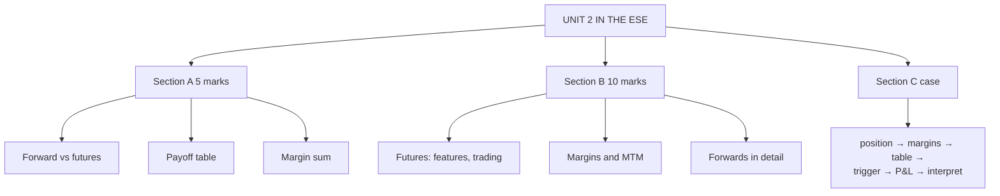

# FC-4: Unit 2 Exam Answers

Covers: what the ESE will ask from Unit 2, 5-mark and 10-mark skeletons, and a 15-mark margin-and-MTM case with a full model answer.

## What the test will ask

ESE: Section A three 5-mark questions with choice, Section B two 10-mark questions with choice, Section C one 15-mark case. Unit 2 is 7 of 45 hours and the only unit whose syllabus line says "(Problems)". The margin table is the likeliest numeric item, either as a 5-marker or as part of the case. That is a judgement from the syllabus, not a confirmed paper pattern.

## Five-mark answer skeletons

**1. Forward vs futures (FC-2).** Nine-row table: venue, terms, counterparty, settlement, margin, liquidity, delivery, regulation, transparency. End with one sentence on why futures fix the forward's default risk.

**2. Payoff of a forward (FC-1).** Define K and S_T; long S_T − K, short K − S_T; table at five spot values (K = 500: −60, −30, 0, +40, +80); note both are linear and zero-sum.

**3. Specifications of a futures contract (FC-2).** Underlying, lot, expiry cycle, tick, quotation, settlement, margin, position limits; one example with tick value ₹25.

**4. Margin terms (FC-3).** Initial, maintenance, margin call, variation margin; the call restores the initial margin.

**5. Margin sum (FC-3).** Table: day, settle, gain/loss, balance, call, closing balance. Check total gain = Δ price × lot. State the trigger price.

## Ten-mark answer skeletons

**A. Futures contracts: features, types and trading.** Meaning → forward vs futures table → specifications → five types → participants and clearing corporation → trading steps → open interest and convergence → conclusion.

**B. Margins and marking to market.** Why needed → four margin terms → daily gain formula → worked table (₹78,500 closing, ₹16,000 call) → trigger price ₹770 → liquidity impact → Indian SPAN system **[VERIFY]**.

**C. Forward contracts: structure, payoff and limitations.** Parties → delivery price → trading mechanism → payoff table → value formula → five weaknesses → how futures fix them.

## Fifteen-mark case layout (margin and MTM)

1. **Contract details (1):** position, lot size, contracts, entry price, contract value.
2. **Margin totals (1):** initial and maintenance for all contracts.
3. **Daily table (6):** gain/loss, balance, call, closing balance.
4. **Trigger price (2).**
5. **Total P&L and cross-check (2).**
6. **Interpretation (3):** funding need, hedge versus speculation, forward comparison.

### Model answer, laid out as the exam answer

**Data (hypothetical):** a hedger sells **2 contracts of an index future (hypothetical lot size 100 units)** at 2,000 to protect a portfolio of 200 index units. **Initial margin ₹30,000 per contract; maintenance margin ₹22,500 per contract.** Daily settlement prices: 2,030; 2,055; 2,020; 2,090; 2,060.

1. **Exposure:** 2 × 100 × 2,000 = ₹4,00,000. Position is **short**.
2. **Margins:** initial = 2 × 30,000 = ₹60,000; maintenance = 2 × 22,500 = ₹45,000.
3. **Daily gain (short) = −(today − yesterday) × 200.**

| Day | Prev. | Settle | Gain/loss (₹) | Balance before call (₹) | Call (₹) | Closing (₹) |
|---|---|---|---|---|---|---|
| 1 | 2,000 | 2,030 | −6,000 | 54,000 | 0 | 54,000 |
| 2 | 2,030 | 2,055 | −5,000 | 49,000 | 0 | 49,000 |
| 3 | 2,055 | 2,020 | +7,000 | 56,000 | 0 | 56,000 |
| 4 | 2,020 | 2,090 | −14,000 | 42,000 | **18,000** | 60,000 |
| 5 | 2,090 | 2,060 | +6,000 | 66,000 | 0 | 66,000 |

4. **Trigger price:** balance can fall ₹15,000 (60,000 − 45,000); 15,000 ÷ 200 = 75 index points; call when settlement is **above 2,075**. Day 4's 2,090 crosses it; Day 2's 2,055 does not.
5. **Total futures P&L** = (2,000 − 2,060) × 200 = **−₹12,000**. Cross-check: −6,000 − 5,000 + 7,000 − 14,000 + 6,000 = −12,000 ✓. Closing balance = 60,000 + 18,000 − 12,000 = **₹66,000** ✓.
6. **Interpretation.**
   - The index rose 60 points; the underlying portfolio of 200 units gained 200 × 60 = ₹12,000, which exactly offsets the futures loss. **Net result is zero: the hedge worked.**
   - The hedger still had to deposit **₹18,000 in cash on Day 4** while the offsetting gain sits in the unrealised portfolio. This is the **liquidity risk** of futures hedging.
   - A forward would have required no margin and no top-up, but would have carried counterparty risk, and the hedger would settle ₹12,000 only at maturity.

Close with: *the hedge removes price risk, not funding risk; plan margin lines before hedging.*

## Time rule

If short of time: write the position and margins, compute two or three days of gain and balance, identify the first call, and state call = initial − balance. That earns the method marks.

## What to remember

- Section A Unit 2 items: forward vs futures table, payoff table, margin sum.
- Call restores initial margin; condition is balance < maintenance.
- Case numbers: 2 contracts, ₹60,000 and ₹45,000 margins, call ₹18,000 on Day 4, trigger above 2,075, closing ₹66,000.
- Always cross-check: sum of daily gains = (last − entry) × lot size.
- Hedge outcome: futures loss ₹12,000 offsets portfolio gain ₹12,000.

## Concept map

## Flashcards
Q: Order of steps in a margin-and-MTM case?
A: Position and contract value, margin totals, daily table, first margin call, trigger price, total P&L cross-check, interpretation.

Q: Case: short 2 contracts (lot 100) at 2,000; initial ₹30,000 and maintenance ₹22,500 each. Trigger price?
A: Above 2,075 (15,000 ÷ 200 = 75 points).

Q: In the case, what is the margin call on Day 4 and the closing balance?
A: ₹18,000 call; closing balance ₹60,000.

Q: Final P&L and closing balance in the case?
A: −₹12,000 on the futures; closing balance ₹66,000.

Q: Why does a hedged position still need cash?
A: Daily MTM settles futures losses in cash before the offsetting gain on the underlying is realised.

Q: Skeleton for the 10-mark margins answer?
A: Why margin, four terms, daily gain formula, worked table, trigger price, liquidity impact, SPAN in India.

Q: Quick check for any margin table?
A: Sum of daily gains equals (last settle − entry) × lot size × contracts.

## Sources
- BBA301F-6 syllabus, Unit 2 and ESE pattern
- [[Derivatives Unit 2 - Forward and Future Contracts MOC (Node Map)]]
