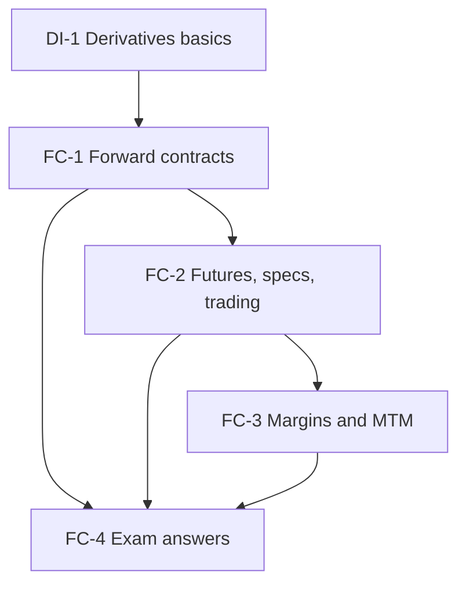

# Derivatives Unit 2: Forward and Future Contracts, node map

ESE: 50 marks, Section A 3 x 5, Section B 2 x 10, Section C one 15-mark case. Unit 2 is CO1 and CO3 (mechanics and use). The syllabus tags margins and MTM as "Problems", so the daily settlement table is the headline skill. All examples are **hypothetical**.

## Nodes

| Node | Topic | Deps | Minutes | Exam focus |
|---|---|---|---|---|
| FC-1 | Forward Contracts | DI-1 | 25 | yes |
| FC-2 | Futures Contracts, Specifications and Trading | FC-1 | 35 | yes |
| FC-3 | Margins and Marking to Market | FC-2 | 45 | yes |
| FC-4 | Unit 2 Exam Answers | FC-1 to FC-3 | 30 | yes |

Total reading time: about 135 minutes.

## Dependency graph

## Headline numbers to know

- Forward K = ₹500: payoff −60, −30, 0, +40, +80 at spot 440, 470, 500, 540, 580. Value later: 20 × e^(−0.015) = ₹19.70.
- Stock future lot 500 at ₹800: contract value ₹4,00,000; tick ₹25; 2 lots to 812 = ₹12,000.
- Margin table: initial ₹60,000, maintenance ₹45,000; call ₹16,000 on Day 4; closing ₹78,500; trigger ₹770; leverage 6.67×.
- Case: short 2 contracts at 2,000; call ₹18,000 on Day 4; trigger above 2,075; P&L −₹12,000; closing ₹66,000.

## Links
- [[Derivatives MOC]]
