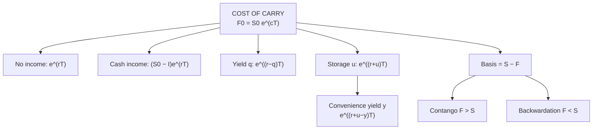

# VF-1: Cost of Carry Pricing of Futures

Covers: the cost-of-carry formula and its five variants (no income, known cash income, known dividend yield, storage cost, convenience yield), basis, contango and backwardation, and the implied financing rate. **(syllabus)** scope, **(textbook)** Hull method. No faculty slides yet: if class uses simple interest or annual compounding, follow the class form and the data given in the question.

## Where this fits in the ESE

Unit 3 is the heaviest unit (12 of 45 hours). The cost-of-carry price is the first step of almost every Unit 3 sum: arbitrage (VF-2), currency futures (VF-3), index hedging (VF-5) and the 15-mark case all start here.

## The idea

Buying the asset now and holding it to T costs **interest on the money tied up**, plus any storage, minus any income the asset pays. The futures price must equal spot plus this **net cost of carry**; otherwise arbitrage exists (VF-2).

## Formulas **(textbook)**

Notation: S₀ spot, F₀ futures price, r risk-free rate (continuous compounding), T time in years, I present value of income, q dividend yield, u storage cost (% a year), y convenience yield.

| Case | Formula |
|---|---|
| No income | **F₀ = S₀ e^(rT)** |
| Known cash income (PV = I) | **F₀ = (S₀ − I) e^(rT)** |
| Known dividend yield q (index) | **F₀ = S₀ e^((r − q)T)** |
| Storage cost u (% a year) | **F₀ = S₀ e^((r + u)T)** |
| With convenience yield y | **F₀ = S₀ e^((r + u − y)T)** |
| General | F₀ = S₀ e^(cT), c = cost of carry |

**Other compounding conventions.** If the question says "simple interest", use F₀ = S₀(1 + rT). If it says "annual compounding", use F₀ = S₀(1 + r)^T. If it says nothing, state which one you use. Continuous compounding is Hull's. Exponent factors below are given to six decimals, not the usual three: derivatives prices are a small gap between large numbers, and a 3-decimal factor moves F by about ₹0.5 on ₹1,000.

## Worked example 1: no income (the base case)

**Data (hypothetical):** share at ₹1,000, r = 7% a year (continuous), no dividends.

1. T = 3 months = 0.25: F₀ = 1,000 × e^(0.07 × 0.25) = 1,000 × e^0.0175 = 1,000 × 1.017654 = **₹1,017.65**.
2. T = 6 months = 0.5: F₀ = 1,000 × e^0.035 = 1,000 × 1.035620 = **₹1,035.62**.
3. Simple-interest check: 1,000 × (1 + 0.07 × 0.25) = ₹1,017.50; 1,000 × (1 + 0.07 × 0.5) = ₹1,035.00.

**Interpretation.** The futures price lies above spot by the interest cost of financing the share: ₹35.62 for six months. The curve slopes upward with maturity (**contango**).

## Worked example 2: known dividend (cash income)

**Data:** the same share, but it pays a **₹20 dividend in 2 months**. T = 6 months, r = 7%.

1. PV of dividend: I = 20 × e^(−0.07 × 2/12) = 20 × 0.988401 = **₹19.77**.
2. S₀ − I = 1,000 − 19.77 = ₹980.23.
3. F₀ = 980.23 × e^0.035 = 980.23 × 1.035620 = **₹1,015.15**.

**Interpretation.** Dividend income lowers the futures price: ₹1,035.62 → ₹1,015.15, a drop of ₹20.47. That is the dividend grown to T at 7% (20 × e^(0.07 × 4/12) = 20.47). Futures holders do not receive the dividend, so the price must be lower.

## Worked example 3: index with dividend yield

**Data (hypothetical):** index at 22,000, r = 7%, dividend yield q = 1.3% a year, T = 3 months.

1. Net carry = 7% − 1.3% = 5.7%.
2. F₀ = 22,000 × e^(0.057 × 0.25) = 22,000 × 1.014352 = **22,315.74**.
3. Without dividends the price would be 22,000 × e^(0.0175) = 22,388.39. The yield cuts it by 72.64 points.
4. **Fair basis** = F₀ − S₀ = 315.74 points. A lot of 50 units (hypothetical) has a fair premium of 315.74 × 50 = ₹15,787.

## Worked example 4: storage cost and convenience yield

**Data (hypothetical bullion):** spot ₹60,000, r = 7%, storage 1% a year, T = 6 months.

1. F₀ = 60,000 × e^((0.07 + 0.01) × 0.5) = 60,000 × e^0.04 = 60,000 × 1.040811 = **₹62,448.65**.
2. If users get a **convenience yield** of 2% a year (benefit of holding the physical item), c = 0.07 + 0.01 − 0.02 = 0.06 and F₀ = 60,000 × e^0.03 = 60,000 × 1.030455 = **₹61,827.27**.

Convenience yield applies to commodities consumed in production, not to financial assets.

## Basis, contango and backwardation

**Basis = Spot − Futures** (Hull). At expiry basis = 0 (convergence).

| Term | Condition | Typical reason |
|---|---|---|
| **Contango** | F₀ > S₀ | Carry cost positive |
| **Backwardation** | F₀ < S₀ | High convenience yield or income, e.g. a dividend yield above r |

## Implied financing rate

If the market futures price is ₹1,050 against spot ₹1,000 for 6 months: **r = ln(F₀ ÷ S₀) ÷ T = ln(1.05) ÷ 0.5 = 9.76%**. Compare with the true borrowing rate to see if arbitrage exists (VF-2).

## Exam layout for a pricing sum

1. Identify the asset type: income, yield or storage.
2. State the compounding convention.
3. Compute the PV of income if any.
4. Substitute into the formula.
5. Compare with the market futures price if given.
6. State the interpretation: contango/backwardation, and what arbitrage would follow.

## Traps

- **Subtract the PV of income, not the income itself**: I = D × e^(−r t) with t the time to the dividend date.
- **Use the right time for T and for the dividend.** The 2-month dividend is discounted over 2 months, then F₀ compounds over 6.
- **Dividend yield belongs to indices; PV of cash income belongs to single stocks.**
- **Do not apply convenience yield to shares or indices.**
- **Futures price is not a forecast of spot.** It is a no-arbitrage price.

## What to remember

- F₀ = S₀e^(rT): ₹1,000 gives ₹1,017.65 for 3 months and ₹1,035.62 for 6 months.
- With income: F₀ = (S₀ − I)e^(rT); ₹20 dividend in 2 months gives ₹1,015.15.
- Index: F₀ = S₀e^((r − q)T); 22,000 gives 22,315.74.
- Storage adds to carry; convenience yield subtracts.
- Basis = spot − futures; zero at expiry.

## Concept map

## Flashcards
Q: Futures price with no income, continuous compounding?
A: F₀ = S₀ e^(rT).

Q: Futures price when the asset pays income with present value I?
A: F₀ = (S₀ − I) e^(rT).

Q: Index futures price formula with dividend yield q?
A: F₀ = S₀ e^((r − q)T).

Q: ₹1,000 share, r = 7%, 6 months, no dividends. F₀?
A: 1,000 × e^0.035 = ₹1,035.62.

Q: Same share, ₹20 dividend in 2 months. F₀?
A: PV of dividend ₹19.77; F₀ = 980.23 × 1.035620 = ₹1,015.15.

Q: Index 22,000, r = 7%, q = 1.3%, 3 months. F₀?
A: 22,000 × e^(0.057 × 0.25) = 22,315.74.

Q: What is basis and what happens at expiry?
A: Basis = spot − futures; it converges to zero at expiry.

Q: Contango vs backwardation?
A: Contango: futures above spot. Backwardation: futures below spot.

Q: Futures ₹1,050, spot ₹1,000, 6 months. Implied financing rate?
A: ln(1.05) ÷ 0.5 = 9.76% a year.

Q: Why does a dividend reduce the futures price?
A: The futures holder does not receive it, so the price is cut by the dividend grown to expiry.

## Sources
- BBA301F-6 syllabus, Unit 3 (cost of carry models)
- Hull, *Options, Futures and Other Derivatives* (6th ed.), ch. 5
- Previous: [[Derivatives Unit 2 - FC-1 Forward Contracts]] · Next: [[Derivatives Unit 3 - VF-2 Cash and Carry Arbitrage]]
- [[Derivatives Unit 3 - Valuation of Future Contracts MOC (Node Map)]]
