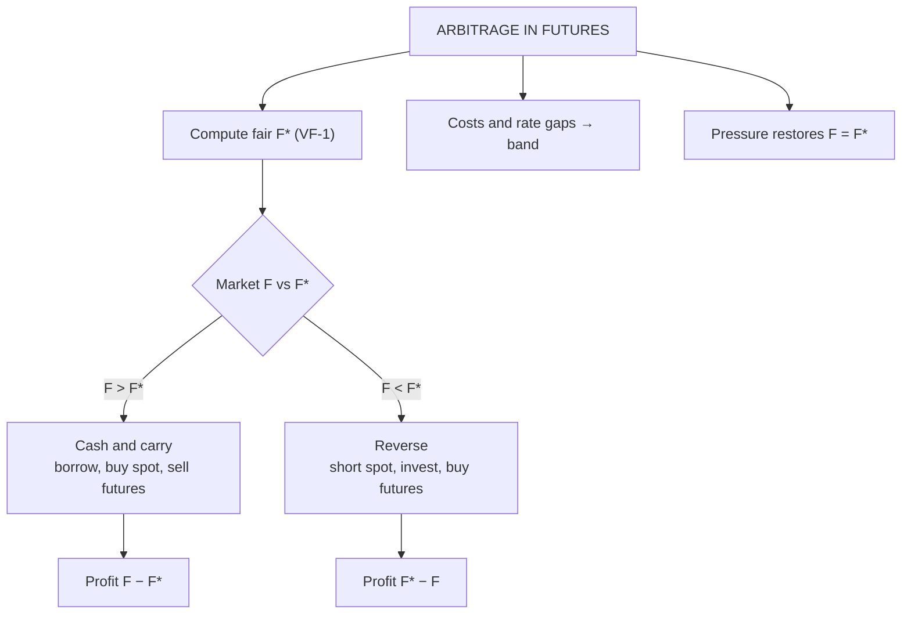

# VF-2: Arbitrage in Futures: Cash-and-Carry and Reverse Cash-and-Carry

Covers: how to detect mispriced futures, the cash-and-carry and reverse cash-and-carry trades step by step with cash-flow tables, the dividend case, transaction-cost bands and the Indian practicalities. **(syllabus)** scope, **(textbook)** Hull method.

## Where this fits in the ESE

"Arbitrage opportunities" is named in the Unit 3 syllabus line, and a step-by-step arbitrage table is a favourite 5- or 10-mark sum and a typical part of the 15-mark case. Marks go for the decision rule, the t = 0 and t = T cash flows, and the profit.

## The decision rule **(textbook)**

Compute the fair price F* from VF-1, then compare with the market futures price F.

| Condition | Futures are | Trade | Name |
|---|---|---|---|
| F > F* | Overpriced | Buy spot, sell futures | **Cash and carry** |
| F < F* | Underpriced | Short spot, buy futures | **Reverse cash and carry** |
| F = F* | Fair | No arbitrage | |

The profit is **F − F*** per unit at T, locked at t = 0 and risk free.

## Worked example 1: cash and carry

**Data (hypothetical):** share ₹1,000, r = 7% (continuous, both borrowing and lending), no dividends, 6-month futures at ₹1,050. Lot size 500 shares.

1. Fair price F* = 1,000 × e^0.035 = **₹1,035.62**.
2. Market ₹1,050 > ₹1,035.62: futures **overpriced**. Use cash and carry.
3. Steps and cash flows (per share):

| Time | Action | Cash flow (₹) |
|---|---|---|
| t = 0 | Borrow ₹1,000 at 7% | +1,000.00 |
| t = 0 | Buy the share in the spot market | −1,000.00 |
| t = 0 | Sell one futures at ₹1,050 | 0 (margin only) |
| **Net at t = 0** | | **0** |
| t = T | Deliver the share against the futures | +1,050.00 |
| t = T | Repay loan: 1,000 × e^0.035 | −1,035.62 |
| **Net at T** | | **+14.38** |

4. **Profit** = 1,050 − 1,035.62 = **₹14.38 per share**, or 14.38 × 500 = **₹7,190 per lot**, with zero investment and no price risk (the share is already bought and already sold).
5. **Interpretation.** Arbitrageurs doing this buy spot and sell futures, which pushes futures down towards ₹1,035.62 and spot up. Profit disappears when F = F*.

## Worked example 2: reverse cash and carry

**Data:** same share, futures trade at ₹1,020 (below ₹1,035.62).

| Time | Action | Cash flow (₹) |
|---|---|---|
| t = 0 | Short sell the share, receive ₹1,000 | +1,000.00 |
| t = 0 | Invest the proceeds at 7% | −1,000.00 |
| t = 0 | Buy one futures at ₹1,020 | 0 |
| **Net at t = 0** | | **0** |
| t = T | Investment matures: 1,000 × e^0.035 | +1,035.62 |
| t = T | Pay ₹1,020 under the futures, receive the share | −1,020.00 |
| t = T | Return the share to the lender | 0 |
| **Net at T** | | **+15.62** |

**Profit** = 1,035.62 − 1,020 = **₹15.62 per share** (₹7,810 per lot of 500). In India the short sale is feasible for institutions through securities lending and borrowing (SLB) or for an investor who already **owns** the share and sells it **[VERIFY]**.

## Worked example 3: cash and carry with a dividend

**Data:** same share, ₹20 dividend in 2 months, 6-month futures at ₹1,030.

1. Fair price F* = (1,000 − 19.77) × e^0.035 = 980.23 × 1.035620 = **₹1,015.15** (VF-1).
2. Market ₹1,030 > ₹1,015.15: overpriced; cash and carry.

| Time | Action | Cash flow (₹) |
|---|---|---|
| t = 0 | Borrow ₹1,000, buy the share, sell futures at ₹1,030 | 0 |
| t = 2 months | Receive ₹20 dividend and invest it for 4 months | 0 (reinvested) |
| t = T | Deliver the share, receive futures price | +1,030.00 |
| t = T | Repay loan: 1,000 × e^0.035 | −1,035.62 |
| t = T | Dividend grown: 20 × e^(0.07 × 4/12) = 20 × 1.023606 | +20.47 |
| **Net at T** | | **+14.85** |

Profit = **₹14.85 per share**, equal to F − F* = 1,030 − 1,015.15 = 14.85 ✓.

## Worked example 4: no-arbitrage band with unequal rates

In practice the arbitrageur borrows dearer than he lends. **Data (hypothetical):** borrowing rate 8%, lending rate 6%, 6 months, spot ₹1,000.

- Upper bound for cash and carry = 1,000 × e^(0.08 × 0.5) = **₹1,040.81**.
- Lower bound for reverse = 1,000 × e^(0.06 × 0.5) = **₹1,030.45**.

Arbitrage exists only if the futures price lies **outside ₹1,030.45 to ₹1,040.81**. A price of ₹1,035.62 is inside the band: no riskless profit. Brokerage, STT and impact cost widen the band further.

## Checklist for the exam answer

1. Compute F* (state compounding and income).
2. Compare F with F* and name the trade.
3. Draw the two-column table: t = 0 and t = T.
4. Show that net at t = 0 is zero.
5. State the profit per unit and per lot.
6. Add one line: arbitrage pressure restores F = F*.

## Traps

- **Wrong direction.** F above fair means sell futures; F below fair means buy futures.
- **Forgetting income.** In the dividend case, the stock's income reduces the profit if not accounted for (and reinvesting it adds interest).
- **Counting the profit at t = 0.** The profit is realised at T; its present value is (F − F*)e^(−rT).
- **Ignoring rate differences and costs.** Band arbitrage replaces point arbitrage in real life.
- **Short selling limits.** Reverse arbitrage is harder for small investors.

## What to remember

- Compare market F with fair F*: above = cash and carry; below = reverse.
- Example: F* 1,035.62; market 1,050 gives +₹14.38; market 1,020 gives +₹15.62.
- With a ₹20 dividend: F* 1,015.15; market 1,030 gives +₹14.85.
- Net at t = 0 is always zero, which is what makes it arbitrage.
- A borrow-lend spread turns the fair price into a band (₹1,030.45 to ₹1,040.81).

## Concept map

## Flashcards
Q: Futures price above fair value. What do you do?
A: Cash and carry: borrow, buy the asset in the spot market and sell futures.

Q: Futures price below fair value. What do you do?
A: Reverse cash and carry: short sell the asset, invest the proceeds and buy futures.

Q: Share ₹1,000, r = 7%, 6 months, futures ₹1,050. Arbitrage profit?
A: Fair ₹1,035.62; profit ₹14.38 per share (₹7,190 for a lot of 500).

Q: Same share, futures ₹1,020. Arbitrage profit?
A: ₹1,035.62 − ₹1,020 = ₹15.62 per share.

Q: Why is arbitrage called riskless?
A: Net investment at t = 0 is zero and the payoff at T is fixed whatever the spot price.

Q: Dividend case: ₹20 in 2 months, futures ₹1,030, fair ₹1,015.15. Profit?
A: ₹14.85 per share.

Q: Borrow at 8%, lend at 6%, 6 months, spot ₹1,000. No-arbitrage band?
A: ₹1,030.45 to ₹1,040.81.

Q: What stops reverse arbitrage for small investors in India?
A: Difficulty short selling shares; it is done through securities lending and borrowing or by selling holdings already owned [VERIFY].

Q: What effect does arbitrage have on prices?
A: Buying spot and selling futures pushes the futures price down and spot up until F = F*.

## Sources
- BBA301F-6 syllabus, Unit 3 (arbitrage opportunities)
- Hull, *Options, Futures and Other Derivatives* (6th ed.), ch. 5
- Previous: [[Derivatives Unit 3 - VF-1 Cost of Carry Pricing]] · Next: [[Derivatives Unit 3 - VF-3 Currency and Interest Rate Futures]]
- [[Derivatives Unit 3 - Valuation of Future Contracts MOC (Node Map)]]
